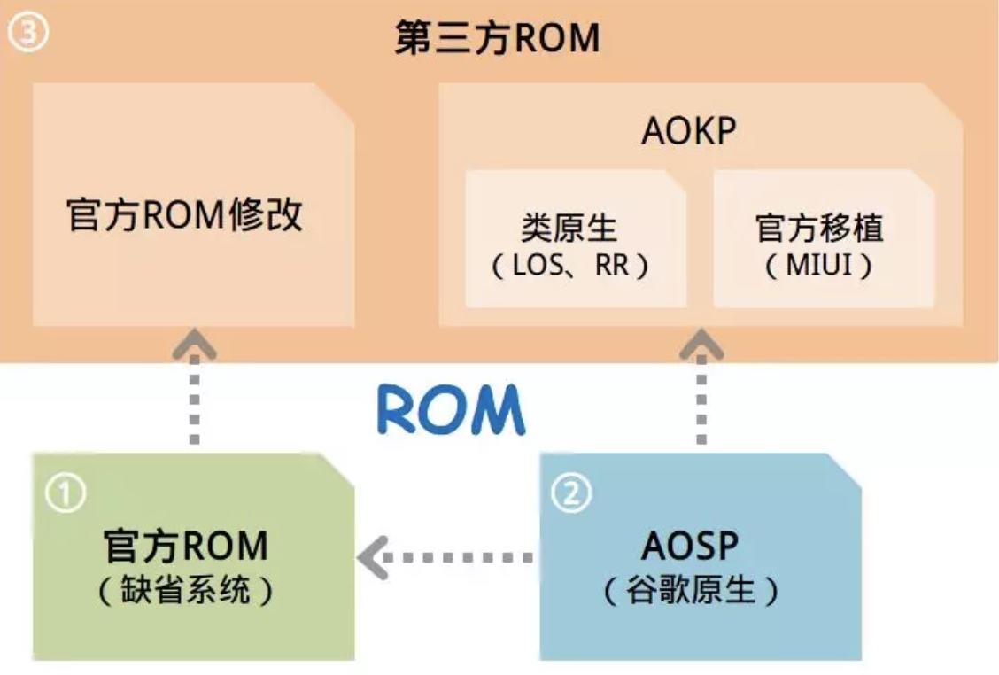
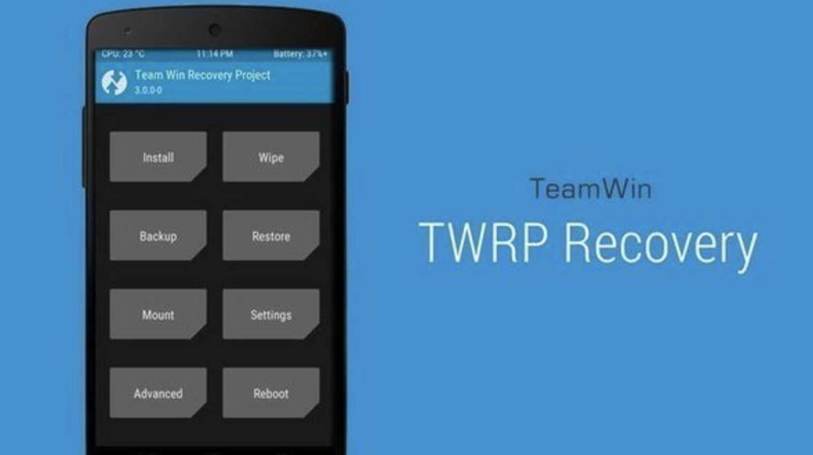
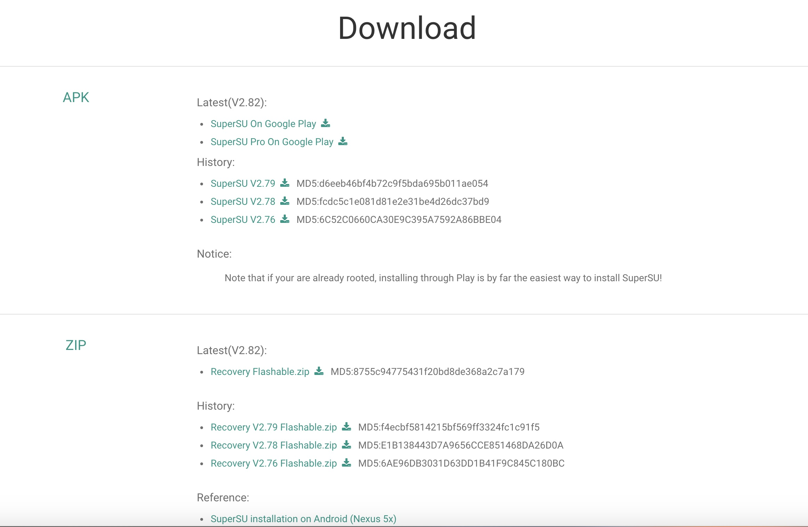
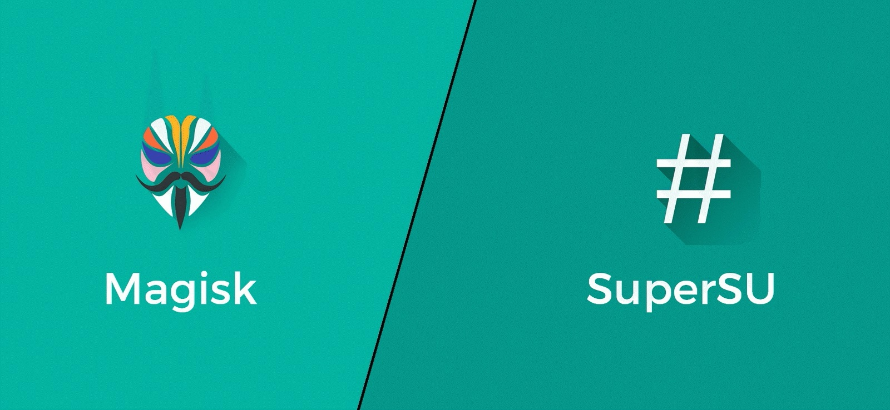

9102 年了，一键 Root 已经成为回忆

<!-- more -->

关于 Root，CS 某 N 上那种改个标题、复制粘贴就上的教程一抓一把，没成体系，乱得简直了。自己踩了点坑，索性整合梳理一下 XD。

看完这篇 Blog，你应该能对刷机常见联机模式（Recovery、Fastboot、Android 系统模式）有个大概了解，对 Root 原理和整体流程也能有点感觉。

本文分享的是通用刷机原理，各机型具体刷机操作还要看专门帖子，这里没法展开。另外诸如 **高通 9008 线刷** 之类的特技不在讨论范围，也不会介绍某刷机助手、某线刷机宝的使用，全部使用 adb 工具箱。

文中具体操作不多，主要堆一点基本概念。

# 为什么刷机

你可以在手机上自定义 ROM、Root 软件、自定义 Recovery、Xposed 框架、修改设备地址、系统字体、卸载预装 Apps..

总之，刷机之后，就可以光明正大地搞机了。

# 刷机分类

从内容上可分为两类：

- 刷 ROM：重装一套系统
- 刷补丁：在原系统基础上扩展某些功能，比如获取 Root 权限、刷内核、安装 Xposed 框架、安装 Magisk 框架、安装谷歌服务等等

```
关于 ROM iamge:
- ROM 是 ROM image（只读内存镜像）的简称，常用于手机定制系统玩家的圈子中。 一般手机刷机的过程，就是将只读内存镜像（ROM image）写入只读内存（ROM）的过程。 
- 常见的 ROM image 有 img、zip 等格式。前者通常用 fastboot 程序通过数据线刷入（线刷）；后者通常用 recovery 模式从 sd 刷入（卡刷），固 img 镜像也被称为线刷包，zip 镜像也被称为卡刷包。
- ROM 分三种：作业系统开发者的原生版本、手机制造商、其他人或团队所开发。
(依次：Google 开发的原生 Android One、小米的 MIUI 接口、Android 的 Lineage OS 团队）
- 固件一般是官方原厂包的叫法，ROM 一般是第三方刷机包的叫法。
```



## 刷机方式

卡刷：平时的手机系统升级，其实就是卡刷的一种。手机进入 Recovery 模式写入固件压缩包来更新、升级，或者直接进行 OTA 更新。

> 卡刷本质是 **对系统文件替换的过程**，不会重新刷写整个分区，只是替换部分系统分区文件实现软件版本升级、更换第三方操作系统。即 ROM 包，它一定是一个 zip 压缩文件，打开卡刷包后里面一般都会有 system 和 META-INF 、boot.img (内核) 等文件与文件夹。

线刷：手机连接电脑，用 Android 调试桥接器（ADB）直接将固件、系统底层、驱动程序等写入手机，比如 Fastboot 模式。

> 线刷是通过数据线连接电脑来刷机、刷系统底包。它是手机厂商常见的一种升级方式，主要用于处理系统问题或非硬件损坏故障，通过**替换和覆盖各个分区**让手机恢复正常。一般是 tg 压缩文件，里面是一大堆 img 文件，某些底包里也会有文件夹。

一句话总结：**卡刷适合简单刷机和系统更新，线刷可以做更深、更敏感的操作。线刷彻底，卡刷方便。**

# 刷机、Root 流程概述

通用 Root 流程是：`解锁 BL - 刷 REC - 线刷或卡刷刷入 SuperSU/Magisk`

详细一点就是：

1. 解锁 **Bootloader**
2. 用数据线连接手机，按组合键进入 `Fastboot 模式`，使用 `adb` 命令行刷入第三方 Recovery：**TWRP**
3. 卡刷：按组合键进入 `Recovery 模式（TWRP）`，刷入 **SuperSU.zip** 或 **Magisk.zip** 获得 Root 权限，或者刷入 **ROM 包.zip** 重装手机系统
4. 或者线刷：数据线连接手机、电脑，按组合键进入 `Recovery 模式（TWRP）`，在高级选项里开启 sideload 模式，在电脑上执行 `adb sideload *.zip`。优点是不用先把包传到手机内存里。

# 刷机、Root 细节

## 解锁 BootLoader

一般来说，对绝大多数手机而言，解除 BL 锁一定是第一步。

解锁 BL 的具体步骤，各机型五花八门：

- 有些需要向官网申请解锁权限并用专用工具解锁（华为、小米）。申请解锁码需要等 n 天时，去某宝有惊喜。
- 有些一条命令 `fastboot oem unlock` 就能解锁（一加）
- 具体问搜索引擎

当然，并非所有机型都会锁 BL，有些机型出厂就是 BL 解锁状态。刚突然发现，菊花厂自 2018 年 7 月起不给发 BL 解锁码了。反正不会买他家的手机，不作评论（小声 bb :@(喷水)

划重点：**解锁 BL 会把手机重置为出厂状态，所有数据清空，务必做好备份。**

既然能解锁，自然也能重新上锁。不过务必确保当前 ROM 与 REC 都是官方原版，并且没有刷补丁，再执行上锁操作。

```
BootLoader 是什么？
在嵌入式操作系统中，[Bootloader（系统启动加载器）](https://zh.m.wikipedia.org/wiki/ 啟動程式) 是开机载入程式。

最主要的作用是引导系统正确启动，它是 Android 操作系统（包括控制台）和手机硬体联繫的桥樑，类似电脑裡面的 BIOS (Basic Input and Output System)。手机开机时，会启动 Bootloader 去启动放在 ROM 里面的核心完成手机的开机过程。

为了避免 Bootloader 读到非官方 ROM, 一般会在 ROM 里面加密、或是有特殊的程序，让 Bootloader 可以藉此分办是不是官方 ROM，限制你直接从 Fastboot 模式下加载、改写系统分区的一个锁定。

解锁就是就是让 Bootloader 跳过这个流程。解锁 Bootloader 后，还可以刷新内核、刷 ROM、修改超频...

一旦放开 BL，OEM 厂商（Original Equipment Manufacturer）会遇到一些麻烦：
- 合约机的运营商在这部分的利益会受到极大挑战
- 用户自行刷第三方固件后，厂商将在一定程度上沦为纯粹的制造商，而丢失自己的研发基因
- 用户刷的 ROM 的稳定性难以保证

所以，OEM 厂商通常在出厂时锁定手机的 BL。

有些人将 Unlock Bootloader 说成刷机模式，但准确来说解锁 Bootloader 是刷机的基础，Bootloader 正好处在开机与进系统的中间阶段，真正实现刷机的是在解锁 Bootloader 之后安装 Recovery（类似于 Ghost）

```

```
Fastboot 是什么？
Fastboot 的功能与 REC 相似，但是要更为高级，更为接近系统的底层。更为高级的意思就是 Fastboot 能够执行的操作要比 REC 更多，比如我们之前的使用 ADB 刷入 REC 就是进入了 fastboot 模式执行的操作。

```

## 刷入第三方 Recovery

所谓第三方 Recovery，主要就是 CWM 与 TWRP 两款 REC，以及坊间基于它们的各种改款。不过 CWM 几年前就停摆了，目前刷机界基本是开源的 [TWRP](http://twrp.me/) 家族独大。TWRP 全称 Team Win Recovery Project，是一个开源社区项目。



先介绍刷入 TWRP：

- 下载合适版本的 TWRP：

  - 进入 [TWRP Recovery 官网](https://twrp.me/Devices/)，选机型
  - 找到 Download Links，挑选镜像下载 *.img，并导入 SD 卡 或 手机
- 下载并配置 [ADB_platform-tools_r28.0.3](https://developer.android.com/studio/releases/platform-tools)：

  - 将手机和数据线连接，点击手机版本号 n 次，打开开发者模式的 `USB 调试状态`
  - (通常是找到 “设置”>>“关于手机”>>“版本号”，多次点击版本号后即出现开发人员选项，再进去：`USB 调试模式`。[如果不是，点我](https://www.bing.com/search?q=USB+%E8%B0%83%E8%AF%95%E6%A8%A1%E5%BC%8F+%E6%89%8B%E6%9C%BA%E5%9E%8B%E5%8F%B7&qs=n&form=QBRE&sp=-1&pq=usb+%E8%B0%83%E8%AF%95%E6%A8%A1%E5%BC%8F+%E6%89%8B%E6%9C%BA%E5%9E%8B%E5%8F%B7&sc=0-13&sk=&cvid=87AB941FBA4E4A239AC110C83891AF0C&mkt=zh-CN)

```
ADB 是什么？
ADB（Android Debug Bridge）是从 Android SDK 里提出来的一个工具，使用 ADB 命令行可以直接操作管理 Android 模拟器或者真实的 Andriod 设备。 ADB 主要功能有:
- 在 Android 设备上运行 Shell (命令行)
- 管理模拟器或设备的端口映射
- 在计算机和设备之间上传 / 下载文件
- 将电脑上的本地 APK 软件安装至 Android 模拟器或设备上
  
安装涉及到环境变量的部署，可以参照教程（原 CDN 图片已失效）
```

打开 cmd，敲入下面几条命令：

- 使手机进入 Fastboot 模式：`adb reboot bootloader`
- 线刷刷入 REC：`fastboot flash recovery *.img`
- 重启手机进入 Android 正常模式：`fastboot reboot`

```
Recovery 是什么？
Recovery（以下简称 REC） 是 Android 手机备份功能，官方的 Recovery 在系统更新时都会启用。

为什么刷入第三方的 REC？
1. 在使用 REC 装系统的过程中，会对刷机包的数字签名进行校验。因而第三方 ROM 是无法通过官方 Recovery 刷入的。
2. 官方的 REC 一般限制较多 (只能刷入官方的固件、补丁、更新等等), 而第三方的 REC 除了能任意刷入第三方 ROM ，还能调整分区大小。
```

了解完 `解 BL`、`刷 REC`，接下来进入正题：`Root`

# Root 原理

在 Linux 中，只要执行 `su` 命令，就可以切换到 root 超级权限。基于 Linux 内核构建的 Android 系统里，管理员用户也是 root，这个账户可以访问并修改手机中几乎所有文件。

`su` 是运行环境变量 `PATH` 下面的一个可执行文件，运行后当前用户会被切换到 Root 用户。未 Root 的安卓系统没有 `su` 这个文件，**所以 Root 一个手机，本质上就是把 `su` 文件放到系统运行环境变量 `PATH` 下面。**

一键 Root 利用的是手机系统漏洞，先对进程提权，再放入 `su` 文件。随着 Android 系统发展，这些漏洞逐渐被修复，早期靠系统漏洞的方式在大多数新机器上已经不好用了。

**这时候，就可以利用第三方 Recovery 把 `su` 程序放入系统文件夹。**

相信像我一样，你小小的脑袋里满是疑惑：为什么几年前 Root 无比简单，下载 KingRoot 就能一键 Root，越变越难:

```
- Android 2.2 被广泛利用的系统提权漏洞是 zergRush
- Android 4.2 以后需要通过 native service 拉起 su daemon 之类的服务进程才能正常使用 root 相关功能。
- Android 5.x 以后更需要搞定 SELINUX 才能正常使用 root 相关功能，Google 在新系统中强制开启了 SELINUX，新设备也会默认自动开启加密。正因如此，大量甚至几乎全部已有的 root 方式都失效了，无法在启动时获得 Superset 超级用户权限。新的授权管理一般都带有类似 seinject 的功能来注入安全策略，依靠替换系统服务如 zygote 等 native service。
```

## 获取 Root 权限并管理

### 获取

- 在 SuperSU 官网上下载 *.apk 和 *.zip (*.zip 文件放入手机内存卡刷，apk 之后安装)
- 手机进入 REC 模式：将手机关机，然后按住音量上键 + 电源键开机，出现开机画面 1-2 秒后，放开电源键，音量上键继续按住不动，直至进入 recovery
- 在 REC 主界面，点击 “安装”，即可进入系统目录选择文件，找到刚刚准备好的 *.zip 包刷入
- 完成：手机会自动重启，然后就会进入系统

### 管理

说起 ROOT 权限管理，`SuperSU` 和 `Magisk` 必须知道。俺当时只用到了 `SuperSU`，这里就只介绍它：

```
SuperSU 一直保持着非商业化运作，并且更新很积极，当初谷歌发布安卓 7.0 和安卓 8.0 开发者预览版，全世界只有 Nexus 和 Pixel 等谷歌自家的手机才能吃上最新系统的时候，Super 都是第一个站出来完成超级用户权限的提权和管理。

遗憾的是，2017 年 10 月 4 日，ChainFire 发表声明，宣布不再参与维护 SU，把 SuperSU 彻底卖给了中国的一家商业化运作的公司，自此更新节奏非常缓慢，并且将来指不定里面会怎么做商业化变现。

目前 SuperSU 已经不能实现一加氢氧系统安卓 8.0 和更高版本的 Root 了，刷入之后会无限卡屏，包括谷歌刚发布的安卓 9.0 开发者预览版上，SuperSU 也没有再和往年一样站出来搞定 Root
```

#### SuperSU

SuperSU 分为：

- 帮助用户管理 Root 权限的 SuperSU.apk
- 帮助用户获取 Root 权限的 SuperSU.zip



为了防止不良软件也拿到 root 权限，Root 过程中通常还会给系统装一个管理程序。后续哪个 App 想获取最高权限，都需要由用户决定是否允许。

这个程序叫 Superuser.apk。当某些程序执行 `su` 指令想获取系统最高权限时，Superuser 会自动启动，拦截这个动作并询问用户。如果用户认为该程序可以安全使用，就选择允许，否则禁止它继续取得最高权限。

### Magisk

关于 Magisk，下面的文章写得非常详尽，我也没用上，自取：

- [用 Magisk 来获取手机的 Root 权限](https://youya.org/2017/11/26/magisk-a-root-and-universal-systemless-interface/)
- [每个 Android 玩家都不可错过的神器（一）：Magisk 初识与安装](https://sspai.com/post/53043)



# 数据清理

数据清理是刷机问题里的哲学问题，这里给出我的一套操作，下面参考了 Gapps 文档。

在 REC 高级清除模式中，可自选需要清除的分区。一个比较规范的刷机过程应该是：

- 恢复出厂设置（清除 Data 分区，但内存数据保留）
- 清除 System 分区
- 刷 ROM
- 刷入 Root 包、Gapps 等
- 清除 Dalvik & cache 分区（双清）
- 重启

# Tail

最后，刷机有风险，折腾需谨慎。

> 文中难免有不严谨的地方，欢迎细心老哥留言交流

# Refer

本文参（cao）考（xi）风味较浓，总结的基本是大佬哥们玩剩下的，你可以继续浏览下面的：

[GApps](https://sspai.com/post/30499)
[卡刷和线刷](https://zh.wikipedia.org/wiki/% E5%88% B7% E6%9C% BA)
[华为 Nova 获取 Root 权限](http://www.234g.net.cn/archives/2103)
[一张图，带你玩转安卓刷机！](https://mp.weixin.qq.com/s/PQQuzX-A593EVxXRraZC_Q)
[Recovery （Android 手机备份功能）](https://baike.baidu.com/item/Recovery/9995978)
[ROOT 与 UNLOCK BOOTLOADER (解锁)](https://tel3c.tw/blog/post/164376615)
[开放的困惑 解读安卓 Bootloader 背后的故事](http://mobile.zol.com.cn/242/2424698_all.html)
[如何在 Google Pixel 上刷入 TWRP Recovery 以及获得 ROOT 权限](http://bilibi.li/2017/01/15/how-to-root-and-install-twrp-recovery-on-google-pixel/)
[How To Root Huawei Devices Using TWRP and Magisk || Complete Guide](https://zfirmware.com/root-huawei-devices-using-twrp-and-magisk/)
