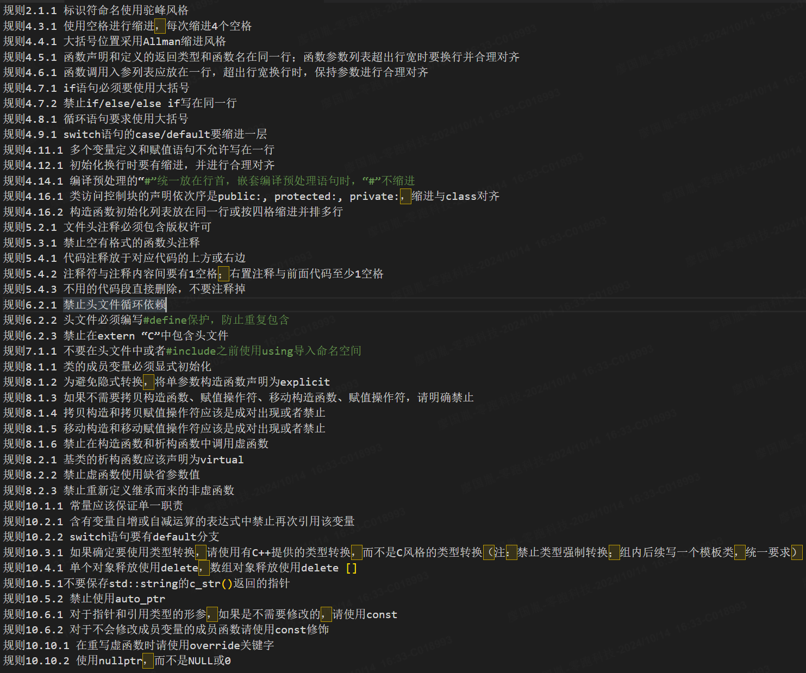
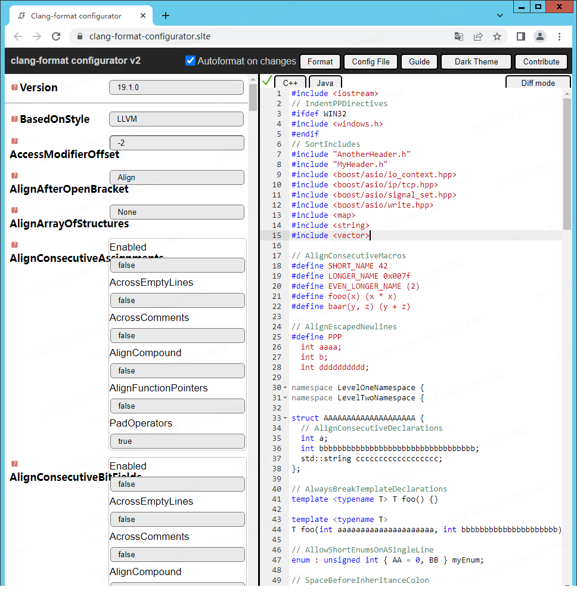
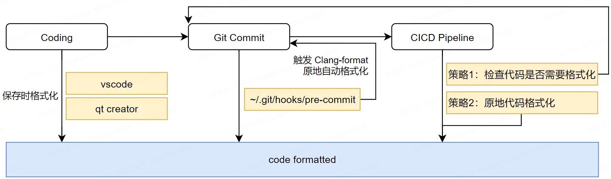

在团队里做 C++ 项目，代码风格不统一是很容易被低估的小麻烦。单看一两行没什么，项目一大，阅读、Review、合并冲突都会被它拖慢。

为实现这一目标，三板斧如下：

1. 确定格式化规范
2. 选择格式化工具，编写调试配置文件
3. 将规范集成到开发流程里，比如编码、代码管理、编译打包，再根据反馈慢慢修配置

## 1. 确定格式化规范

代码格式化这件事已经比较标准化了，常见风格有 LLVM、Google、WebKit 等。

我们组内本来就有一份 C++ 编码规范：



常见规范基本会覆盖这几块：

1. 命名规范

- 类、结构体、枚举、联合体、类型定义、作用域名
- 函数名，包括全局函数、作用域函数、成员函数
- 全局变量，包括全局和命名空间域下的变量、类静态变量，以及局部变量、函数参数、类/结构体/联合体成员变量
- 宏、全局常量、枚举值、goto 标签

2. 格式规范

- 括号位置
- 空格位置及使用情况
- 行宽
- 缩进

3. 注释规范
4. 语言级高级特性使用建议

## 2. 选择格式化工具

规范定下来之后，不能指望每个人都靠记忆和自觉稳定执行。更现实的做法是选一个格式化工具，把它放到开发流程里，让工具帮大家兜住这部分细节。

C++ 常见的格式化/检查工具有 [cpplint](https://github.com/cpplint/cpplint)、[clang-format](https://clang.llvm.org/docs/ClangFormat.html)、[clang-tidy](https://clang.llvm.org/extra/clang-tidy/index.html) 等：

- cpplint 主要围绕 Google 规范展开，公开仓库现在基本不维护了。
- clang-tidy 是静态代码分析工具，可以做[变量名风格纠正替换](https://clang.llvm.org/extra/clang-tidy/checks/list.html)。
- clang-format 是格式化工具，主要调整空格、换行、缩进这类格式。

初步调研下来，[clang-format 基本能满足格式规范和注释规范，命名规范则可以用 clang-tidy 补一部分](https://stackoverflow.com/questions/73788989/how-to-configure-naming-conventions-with-clang-format)：

> Clang-format is all about local changes to the code in a way that is irrelevant to the compiler. Like changing whitespace. Renaming variables, on the other hand, is a completely different thing, since its impact is potentially very global (think about exported symbols consumed by other libraries, or just multiple files).

下面记录一点集成 Clang-format 的实践经验。

## 3. 编写 .clang-format

引入 Clang-format 需要写 `.clang-format` 配置文件。配置文件的好处是很明显的：命令行脚本、IDE、CI/CD 都能复用同一套规范。

[Clang-format 支持的配置参数很多](https://clang.llvm.org/docs/ClangFormatStyleOptions.html)。为了少一点盲调，可以用这个[在线 .clang-format 配置预览网站](https://clang-format-configurator.site/)，改完能实时看格式效果：


GPT 辅助、文档查询、网站在线调试之后，初版配置大概长这样：

```YAML
# .clang-format 配置文件, 根据指定的编码规则生成

# 基础样式，基于 LLVM 并进行覆盖
BasedOnStyle: LLVM
SortIncludes: false

# 缩进设置
IndentWidth: 4                   # 规则4.3.1 使用4个空格缩进
UseTab: Never                    # 规则4.3.1 禁止使用制表符
TabWidth: 4
AccessModifierOffset: -4         # public:, protected:, private:，缩进与class对齐

# 大括号风格：Allman 风格（新行开始）
BreakBeforeBraces: Custom         # 规则4.4.1 Allman 风格的大括号
BreakBeforeBinaryOperators: None
BraceWrapping:
  AfterClass: true               # 类定义后大括号另起一行
  AfterControlStatement: true    # if, else, for, while 等控制语句后大括号另起一行
  AfterEnum: true                # 枚举定义后大括号另起一行
  AfterFunction: true            # 函数定义后大括号另起一行
  AfterNamespace: false          # 将命名空间的左大括号放在行末
  AfterExternBlock: false        # 将 extern "C" 的左大括号放在行末
  BeforeCatch: true              # catch 前大括号另起一行
  BeforeElse: true               # else 前大括号另起一行
  IndentBraces: false            # 大括号不额外缩进

# 控制语句设置
AlwaysBreakAfterReturnType: None              # 确保返回类型和函数名不在返回类型之后强制换行，保持在同一行
AlwaysBreakAfterDefinitionReturnType: None    # 专门针对函数定义，确保返回类型和函数名不在返回类型之后强制换行
AllowShortIfStatementsOnASingleLine: false    # 规则4.7.2 禁止单行 if 语句
AllowShortLoopsOnASingleLine: false           # 禁止单行 for/while 循环

# 函数声明和调用格式化
AllowAllParametersOfDeclarationOnNextLine: false     # 规则4.5.1 函数声明参数不全部放到下一行
BinPackParameters: false                             # 禁止在函数声明和定义中将多个参数打包在一行，确保每个参数在必要时单独换行
BinPackArguments: false                              # 禁止在函数调用中将多个参数打包在一行，确保在行宽不足时参数能够合理换行并对齐

# 参数对齐
AlignAfterOpenBracket: Align                        # 当参数换行时，后续行的参数与第一个参数对齐
ContinuationIndentWidth: 4                          # 规则4.3.1 连续行缩进4个空格，设置续行的缩进为4个空格，确保参数列表换行后的对齐缩进

# 控制括号前的空格
SpaceBeforeParens: ControlStatements                # 控制语句前加空格
SpaceAfterCStyleCast: false                         # C 风格强制转换后不加空格

# Switch 语句格式化
IndentCaseLabels: true                              # 规则4.9.1 case/default 缩进一层

# 指针对齐
PointerAlignment: Right                              # 指针靠左对齐，如 int* ptr;

# 等号操作符对齐
AlignOperands: true
AlignConsecutiveAssignments: true

# 预处理指令格式化
IndentPPDirectives: None                            # 规则4.14.1 预处理指令不缩进

# 最大空行数
MaxEmptyLinesToKeep: 2

# 禁止单行函数定义
AllowShortFunctionsOnASingleLine: None

# 命名约定（无法通过 Clang-Format 强制执行，需要使用 Clang-Tidy 或其他工具）
# 规则2.1.1 标识符命名使用驼峰风格

# 类成员访问控制格式化
# 规则4.16.1 公共、受保护、私有部分排列顺序，并与 class 对齐
# 注意：Clang-Format 并不直接支持访问控制排序，需要手动排列或使用其他工具

# 宏定义格式化（如果需要）
# 根据需要进行自定义，例如对齐等

# 规则4.2.1 行宽设置（按需调整）
ColumnLimit: 200
```

规范和工具都确定后，就可以在命令行里快速格式化单个 C++ 文件：
`clang-format -style=file -i src/path/to/*.cpp`

> `clang-format -style=file` 应用配置文件时会遵循就近原则，从执行目录最近的父级目录里找 `.clang-format`。找不到时，再用默认规则兜底。
> [When using -style=file, clang-format for each input file will try to find the .clang-format file located in the closest parent directory of the input file. When the standard input is used, the search is started from the current directory.](https://clang.llvm.org/docs/ClangFormatStyleOptions.html)

批量格式化也很直接，把多个 C++ 文件传给 clang-format 即可。这里可以借助 Shell 的 **通配符**，或者用 **find 指令 + 管道** 写成脚本：

- `find . -name '*.cpp' -o -name '*.h' | xargs clang-format -i`
- `clang-format -i **/*.{cpp,h,hpp}`

## 4. 集成策略

有了规则和工具，接下来要想的是怎么把它放进小组项目里，并且长期跑下去。

如下图，编码开发、代码管理、编译打包这些阶段，都可以插入格式化。

- Coding（vscode，qt creator format on saving）
- Before git push（Git Hook： ~/.git/hooks）
- After git push（CI Pipeline）



具体放在哪个阶段，可以从侵入性、可复用性、反馈是否及时几个角度看。

- Coding 阶段需要引导开发者给 IDE 配额外工具，前期有一点侵入性，但反馈很快，保存时就能看到结果。
- 本地 Git 阶段也有侵入性，需要为项目配置 `~/.git/hooks`。它比 IDE 方案可复用性差，每个项目都要配脚本、加 hooks。
- CI/CD pipeline 阶段对开发者更无感，也更容易迁移，开发和格式化流程可以分开。CI 里一般有两种策略：
  1. 推送后执行 format，再让 CI 把格式化后的代码推回仓库。这种策略对开发者感知很弱，也不太能让大家重视规范；更麻烦的是，它会直接改代码，缺少人工 Review 时风险比较高。
  2. 在 CI 中执行 format 后检查 git diff。如果存在差异，就拒绝代码推送或 PR 合并，让开发者本地修完再推。

好的工具应该是无感的，是辅助、加成而不是给开发者以限制。

所以我比较倾向的原则是：**多阶段结合，相互补充，逐步平滑引入**。

先在 Coding 阶段引入，一边用一边修 `.clang-format`；配置成熟后，再放进 CI/CD 流水线，增量检查变更代码，并按照策略 2 做自动化审查。没有格式化的代码不能合并。

至于本地 hooks，它没法被 Git 仓库直接同步，还要求开发者在本地额外配置，可迁移性比较差，暂时先忽略，后面有需要再补。

### 4.1 集成到开发阶段

在开发阶段介入，主要是统一给开发者安装 IDE 插件，让保存文件时自动调用 Clang-format。这部分后面可以再单独水一篇。

值得一提的是，[Clang-format 程序版本应该保持一致性](https://askubuntu.com/questions/1409031/how-to-use-a-more-recent-clang-format-or-clang-tidy-version-on-ubuntu-18-04)。

实践时我遇到过一个坑：组内有同事明明配置了 Clang-format，但格式化结果还是和标准不一致。

最后发现是开发环境的锅。比如 Ubuntu 22 和 Ubuntu 24 通过 apt 安装的 Clang-format 版本并不相同，不同版本之间会加入新的格式化规则，默认配置参数也不完全兼容。

**所以团队最好统一 Clang-format 版本。可以编译安装，也可以用 Python pip 安装。**

### 4.2 集成到 CI 流程

开发者把代码推到仓库后，可以在编译前跑一次格式化检查。这条链路的核心是：在 PR 合并阶段，利用 [git diff](https://git-scm.com/docs/git-diff) 对比格式化前后的代码，再决定接受还是拒绝更新。

```
#!/bin/bash

# 脚本名称: format_code.sh
# 功能：格式化指定目录下的 C/C++ 文件（.cpp, .hpp, .c, .h）
# 支持本地和 GitLab CI 环境调用

# 设置要格式化的文件类型
FILE_TYPES=(
    "*.cpp"
    "*.hpp"
    "*.c"
    "*.h"
)
# 设置要搜索的目录列表（支持换行）

SEARCH_DIRS=(
    "src/"
    # 可以根据需要添加更多目录
)

# 检查 clang-format 是否安装
if ! command -v clang-format &> /dev/null; then
    echo "错误: clang-format 未安装。请先安装。"
    exit 1
fi

# 遍历目录列表并格式化文件
for search_dir in "${SEARCH_DIRS[@]}"; do
    if [ ! -d "$search_dir" ]; then
        echo "警告：目录 $search_dir 不存在，跳过。"
        continue
    fi

    for file_type in "${FILE_TYPES[@]}"; do
        find "$search_dir" -type f -name "$file_type" | while read -r file; do
            echo "格式化文件: $file"
            clang-format -i "$file"
        done
    done
done

echo "格式化完成。"

```

CI 配置引入:

```

test-clang-format:
  stage: test
  script:
    - clang-format --version # clang-format >= 19.1.7
    - bash scripts/format/format_code.sh
    # - shopt -s globstar # enable globstar, avaible from bash 4.0
    # - clang-format -i ./src/**/*.cpp ./src/**/*.h
    - git diff > format.diff
    - echo "格式化差异前十行如下，如果有结果则失败，需格式化之后再推送（您也可以下载 CI 过程中右侧的 Job artifacts 查看完整差异）"
    - head format.diff
    - git diff --exit-code # exit if have diffs
  artifacts:
    when: always
    paths:
      - format.diff
  allow_failure: false

```

## 5. 总结

以上就是我在 C++ 项目里集成 Clang-format 的一点经验。

这篇文章主要记录了 Clang-format、`.clang-format` 配置文件怎么写，以及它应该放到开发流程里的哪个阶段：

- 目前我的答案是放在代码开头，也就是开发阶段；再放在代码结束，也就是 CI 编译前。
- 现在借助 GPT 写这类工具配置已经很简单了，更值得琢磨的是怎么把它无感地集成到团队里，尽量不影响开发体验和既有习惯。

此外，规则内容本身没有绝对好坏。比如细抠 C++ 指针符应该靠变量、靠类型，还是放中间，其实没多少意义。

保持一致性，才是做这件事的核心。

## 6. Ref

- https://bayareanotes.com/clang-tidy/
- https://github.com/johnmcfarlane/unformat
- https://coderfan.net/en/how-to-unify-code-stytle-in-c-or-c-plus-plus-html.html#google_vignette
