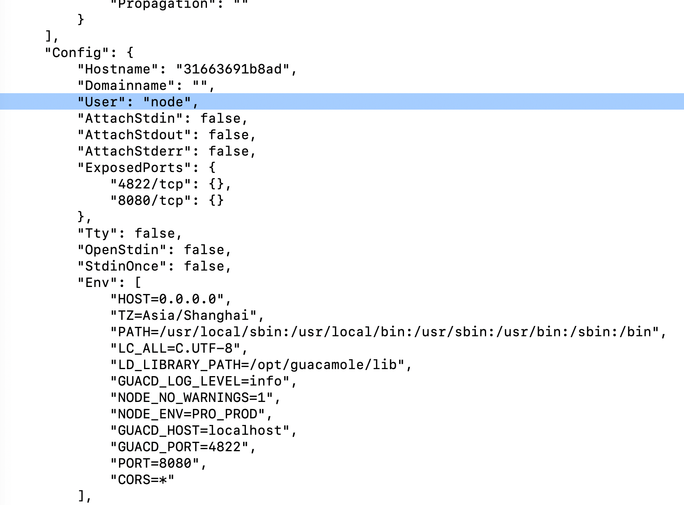
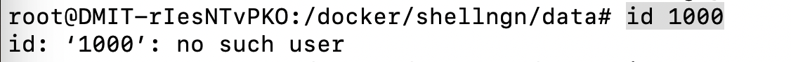
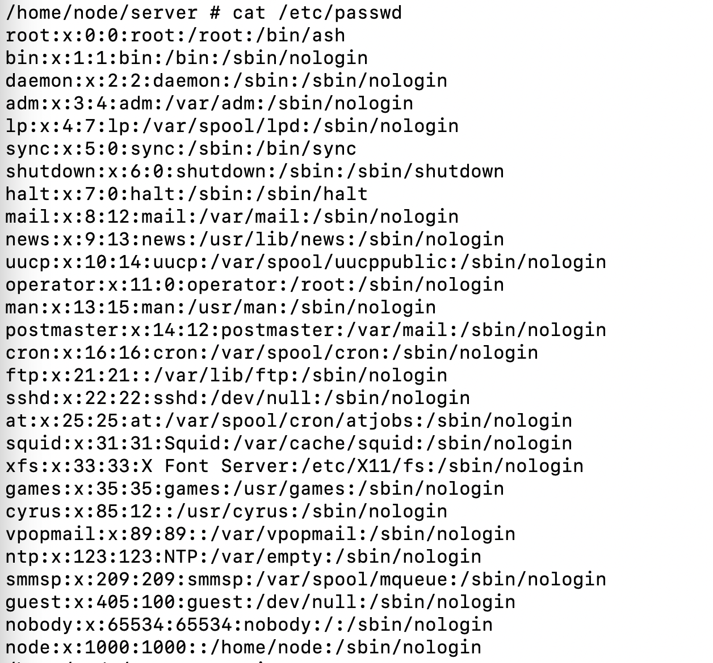
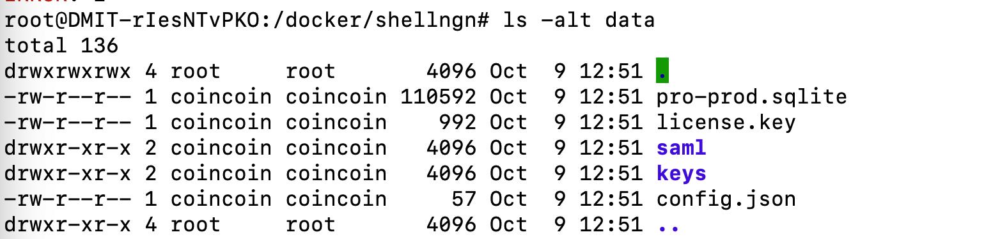
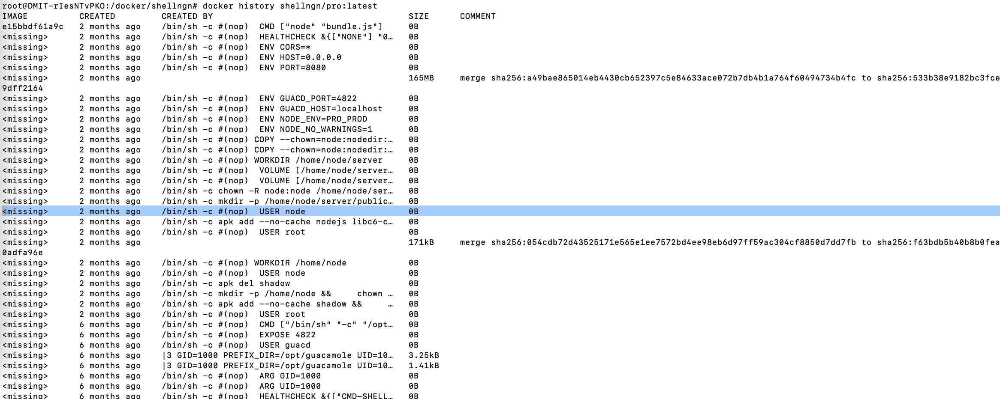

最近频繁用 docker-compose，越来越觉得它在容器迁移、备份和日常管理上确实方便。

容器启停基本就是 `docker-compose up` 和 `docker-compose down`，心智负担小很多。

但有一次用 `docker-compose up` 启动下面这个容器时，遇到了 `./data/config.json` 创建失败的问题。

```
# https://hub.docker.com/r/shellngn/pro/
services:
  shellngn:
    image: shellngn/pro:latest
    container_name: shellngn
    ports:
      - "8080:8080"
    volumes:
      - ./data:/home/node/server/data
    environment:
      - HOST=0.0.0.0
      - TZ=Asia/Shanghai
    restart: unless-stopped
```

用 `docker logs shellngn` 看日志，发现是把本地 `./data` 挂到容器后，容器创建文件时报了权限错误：

```
shellngn is up-to-date
Attaching to shellngn
shellngn    | node:internal/fs/utils:356
shellngn    |     throw err;
shellngn    |     ^
shellngn    | 
shellngn    | Error: EACCES: permission denied, open './data/config.json'
shellngn    |     at Object.openSync (node:fs:596:3)
shellngn    |     at Object.writeFileSync (node:fs:2322:35)
shellngn    |     at _0xb7420b.<computed>.<computed> [as init] (/home/node/server/bundle.js:1:1213484)
shellngn    |     at 40392 (/home/node/server/bundle.js:1:1069259)
shellngn    |     at _0x2d71f3 (/home/node/server/bundle.js:1:9475095)
shellngn    |     at /home/node/server/bundle.js:1:9475859
shellngn    |     at /home/node/server/bundle.js:1:9483783
shellngn    |     at Object.<anonymous> (/home/node/server/bundle.js:1:9483984)
shellngn    |     at Module._compile (node:internal/modules/cjs/loader:1364:14)
shellngn    |     at Module._extensions..js (node:internal/modules/cjs/loader:1422:10) {
shellngn    |   errno: -13,
shellngn    |   syscall: 'open',
shellngn    |   code: 'EACCES',
shellngn    |   path: './data/config.json'
shellngn    | }
shellngn    | Node.js v18.20.1

```

查了一圈资料后，基本能确定是 **Docker 容器内外的操作用户权限不匹配** 导致的：

- 使用 `docker-compose up` 创建挂载目录时，文件夹可能是容器内部进程创建的。容器里的进程可能以 root 或某个指定用户运行，这个用户的 UID（用户 ID）和宿主机上的用户对不上，就容易出权限问题。
- 如果改用 Docker Volume，权限问题通常会少很多。因为目录交给 Docker 守护进程管理，很多映射细节它会自己处理掉。

## 解决方法

解决方法其实不复杂：要么把运行用户对齐，要么把目录交给 Docker 管。

### 方法一：使用 user 指令

在 `docker-compose.yml` 里指定容器用哪个用户/用户组运行，也就是 **user: "${UID}:${GID}"**。

```
...省略...
version: '3'
services:
  your_service:
    image: your_image
    user: "${UID}:${GID}"
    volumes:
      - ./data:/app/data
...省略...
```

### 方法二：使用 Docker Volumes

使用 Docker Volumes，让 Docker 自己处理权限管理。缺点也很明显，Volume 迁移不如文件夹挂载直观，用起来没那么灵活。

```
...省略...
version: '3'
services:
  your_service:
    image: your_image
    volumes:
      - myvolume:/app/data
volumes:
  myvolume
...省略...
```

## 排查问题

问题解决后，我还是有点疑惑：**Docker 容器内外的操作用户权限不匹配**，背后到底是哪一层不匹配？于是又继续排了一下。

- 查看文件夹的用户组和权限，发现容器新建出来的文件所属用户和用户组是 `1000:1000`。
- 为了确认容器实际用什么用户，查看了容器镜像配置 `docker inspect shellngn`。

  这里能看到，ID 1000 在容器内对应的是 `node` 用户。

  
- 在宿主机和容器里分别执行 `id` 查看默认用户，发现默认运行用户都是 0 号用户，也就是 root。

  - 宿主机的 `/etc/passwd` 文件里没有 1000 用户。

    
  - 容器的 `/etc/passwd` 里有 1000 用户，就是上面的 `node` 用户。

    
  - 尝试在宿主机新建一个 ID 为 1000 的用户：`useradd -u 1000 coincoin`。
  - 再执行没有传入 `user` 的 `docker-compose.yaml`，文件就能正常创建了，而且文件归属变成了宿主机上 ID 1000 的用户，也就是刚创建的 `coincoin`。

    

    **结论是：文件权限认 UID/GID，不认用户名。容器里和宿主机里同一个 ID 可以对应不同用户，也可能宿主机压根没有这个 ID。最开始的问题里，文件属于 ID 1000，但宿主机没有这个用户，所以文件操作就炸了。**
- 此外，通过 `docker history shellngn` 查看镜像层，发现容器镜像默认用户在创建文件夹之前就已经被切换成了 `node`（USER node）。

  `<missing>      2 months ago    /bin/sh -c #(nop)  USER node                    0B`

  

  到这里基本真相大白：容器创建文件时用的是内部的 `node` 用户，映射到宿主机后只能看到 UID 1000。宿主机没法把这个 UID 对应到有效用户，最后就变成了权限问题。

容器里切换运行用户本来是安全手段，用非特权用户跑应用，能减少一些潜在风险。Node.js 官方镜像也经常这么做。只是目录挂载到宿主机以后，这套机制就可能带来上面这种权限坑。

## 总结

这次踩坑之后，后面再用目录挂载时我会先看一眼容器默认用户。尤其是 Node.js 这类镜像，如果内部默认切到了 `node`，宿主机目录权限就得提前处理好：

- 尽量保持容器内外用户 ID 一致，可以在 `docker-compose.yml` 里指定 **user: "${UID}:${GID}"**。
- 使用挂载目录时，先考虑 UID/GID 映射问题。
- 如果不想管这些细节，可以考虑 Docker Volumes，迁移麻烦一点，但权限问题少一点。

## 参考资料

- [Docker Dockerfile USER 指令官方文档](https://docs.docker.com/reference/dockerfile/#user)
- ChatGPT
