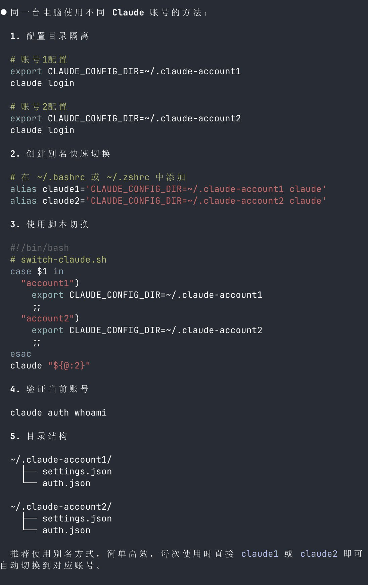
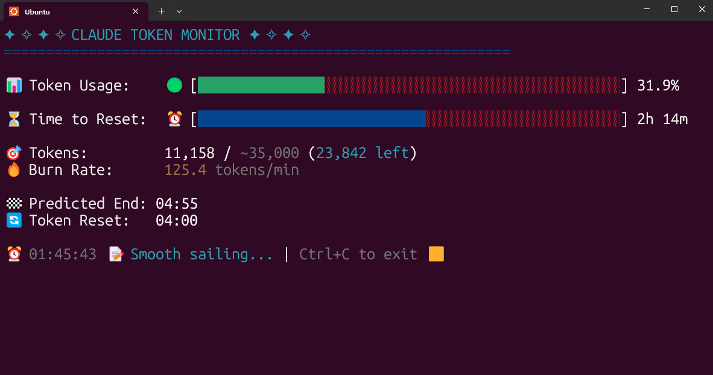
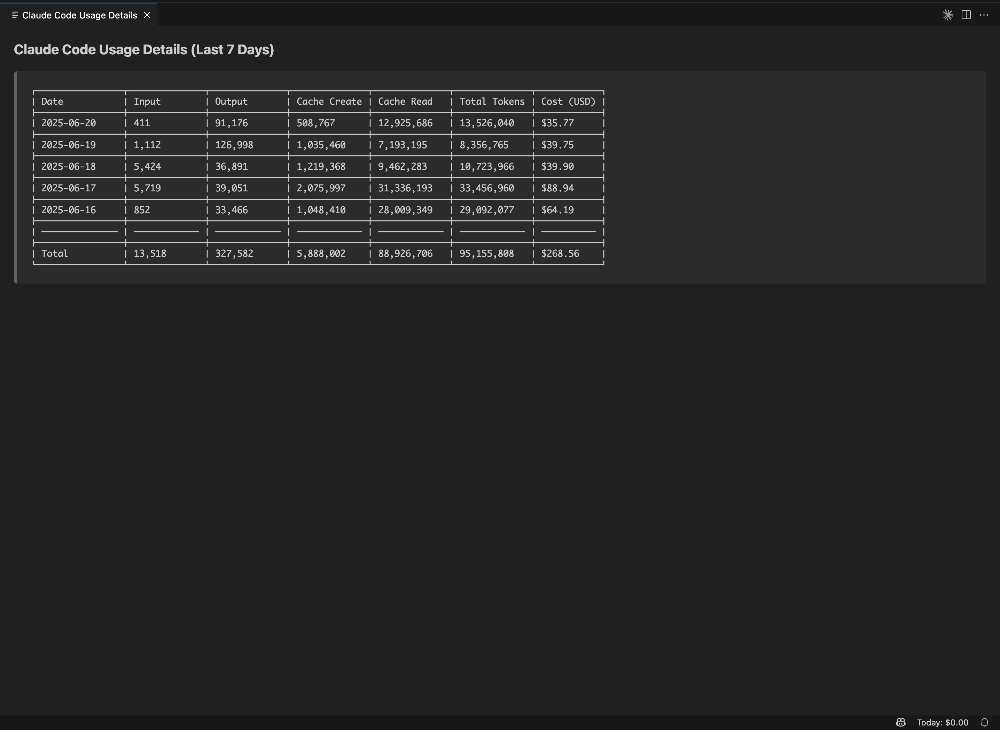

## 用途

### Coding

日常写代码、补测试、改配置，Claude Code 还是最顺手的入口。

### Review

适合用来做一轮代码审查，尤其是看 diff、找遗漏、补测试。

### Operator

需要跨文件、跑命令、整理上下文的任务，可以直接让它当本地 Operator 用。

## 多账号切换

*   [使用环境变量改变当前账号](https://x.com/JacquesThibs/status/1946412707995140347)
    
    

*   [账号文件夹逻辑](https://docs.anthropic.com/en/docs/claude-code/settings)
    

```markup
_claude_with_profile() {
  export CLAUDE_CONFIG_DIR="$1"
  command claude "${@:2}"
}

# Personal profile (default)
claude() {
  _claude_with_profile "$HOME/.claude" "$@"
}

# Work profile
wclaude() {
  _claude_with_profile "$HOME/.claude-work" "$@"
}

```

```markup
alias coinclaude="export CLAUDE_CONFIG_DIR=~/.claude-coin && claude"
alias bjkclaude="export CLAUDE_CONFIG_DIR=~/.claude-bjk && claude"
alias shareclaude="export CLAUDE_CONFIG_DIR=~/.claude-share && claude"

```

## 上下文管理

多用 `/clear`，长对话不要硬扛。上下文脏了之后，继续聊只会越来越糊。

## 拓展插件

*   [https://marketplace.visualstudio.com/items?itemName=anthropic.claude-code](https://marketplace.visualstudio.com/items?itemName=anthropic.claude-code)
    

## 用量监控

原理：Claude Code 使用过程中会在家目录下创建 `.claude/projects/`，记录本机使用 Claude 的情况。可以基于里面的统计内容换算 token，再估算 Claude 用量价格。

*   [https://github.com/Maciek-roboblog/Claude-Code-Usage-Monitor](https://github.com/Maciek-roboblog/Claude-Code-Usage-Monitor)
    
*   [https://ccusage.com/guide/](https://ccusage.com/guide/)
    



*   [https://github.com/philipp-spiess/claude-code-costs](https://github.com/philipp-spiess/claude-code-costs)
    


*   [https://marketplace.visualstudio.com/items?itemName=suzuki0430.ccusage-vscode](https://marketplace.visualstudio.com/items?itemName=suzuki0430.ccusage-vscode)
    



MCP:

*   [https://linux.do/t/topic/714231](https://linux.do/t/topic/714231)
    
*   [https://x.com/idoubicc/status/1934813097455415716](https://x.com/idoubicc/status/1934813097455415716)
    
*   [https://github.com/anthropics/claude-code/issues/261](https://github.com/anthropics/claude-code/issues/261)
