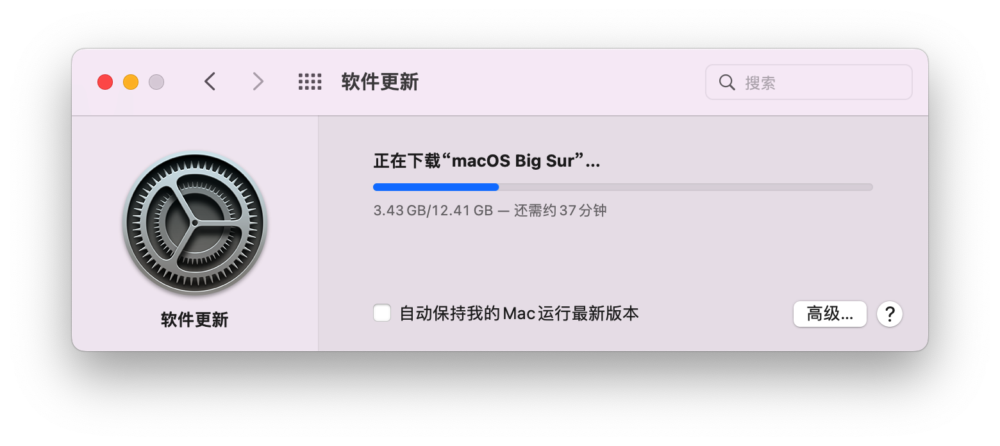
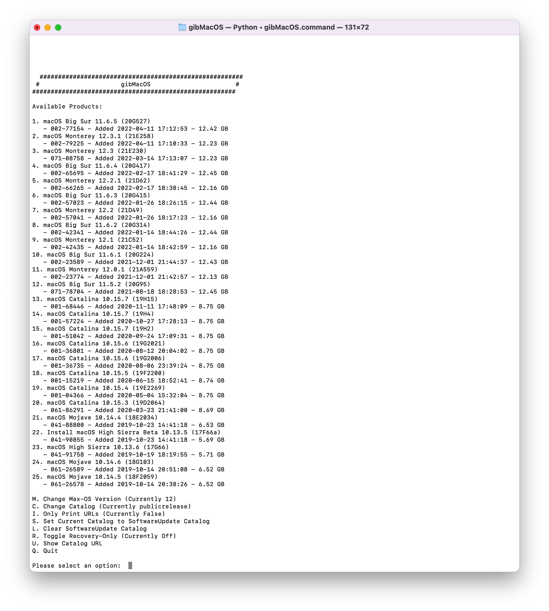
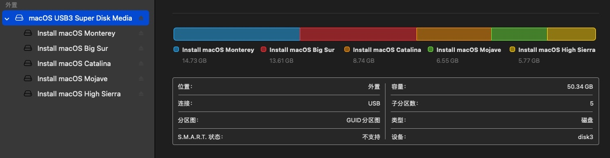
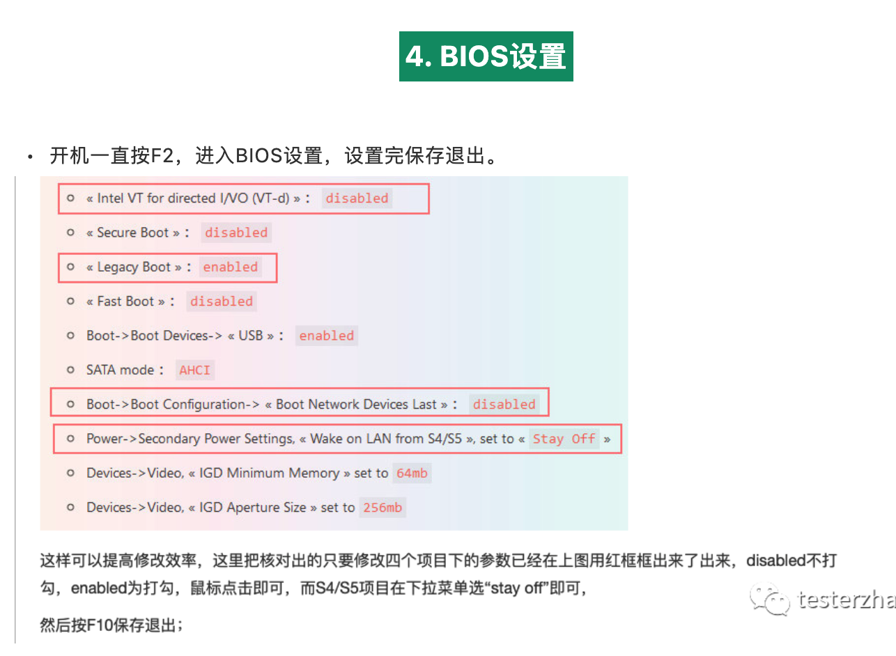
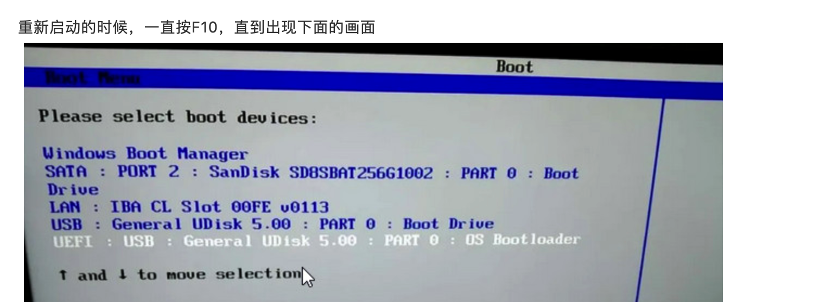
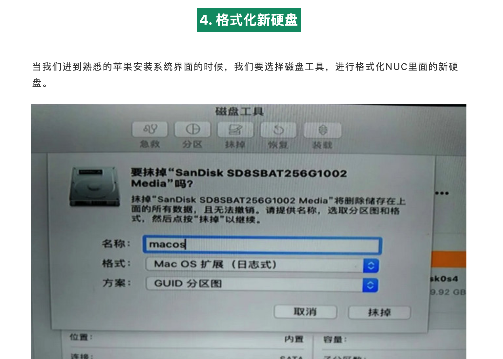

## 0. 刷 BIOS 固件（optional）

升级 BIOS 一般就是插 U 盘、进 BIOS、选择新固件。这里有个容易忘的小坑：很多主板只认 FAT / FAT32 文件系统，U 盘格式别一上来就搞成 NTFS。

BIOS: https://zhuanlan.zhihu.com/p/89058949
https://www.youtube.com/watch?v=zIZ--X-fI-U

https://www.intel.com/content/www/us/en/download/19303/bios-update-becfl357.html?wapkw=NUC8i7BEH

## 1. 准备 mac 系统

官方推荐的装系统方法主要有两种：`在线联网安装` 和 `外部启动器引导安装`。

但按我的体验，在线联网安装是真的折磨：装到一半掉线很常见，更要命的是你还看不到一个靠谱的进度条，只能坐在那里干等。所以，节约生命，直接做 `U 盘可引导 macOS 安装器`。

[如何创建可引导的 macOS 安装器](https://support.apple.com/zh-cn/HT201372) 说白了就是几步：下载目标版本的 macOS，把安装器写进 U 盘，插到机器上从 U 盘启动，然后在安装环境里抹盘、装系统。

制作这个启动盘本身不复杂，核心就三步：

0. 把 U 盘格式化为 `GUID 分区图 + MacOS 扩展日志式`
1. 下载 macOS
2. 在“终端”里用 `createinstallmedia` 写入 U 盘

`createinstallmedia` 在系统镜像包里，具体命令按官网抄就行。

麻烦的是第一步。官网会先跳 App Store，再跳系统设置，下载速度经常玄学，不管开不开代理都慢得很稳定。你不小心关掉下面这个设置界面，下载也可能直接没了。最致命的是：这种方式还默认你手边已经有一台 Mac :(



所以我更推荐用 [gibMacOS](https://github.com/corpnewt/gibMacOS) 直连下载各个版本的 macOS。只要装好 Python，基本各个平台都能拉系统镜像。

> gibMacOS: Py2/py3 script that can download macOS components direct from Apple

> 如果对 gibMacOS 后续烧录有疑问，可以参考：https://kextcache.com/download-macos-big-sur-with-gibmacos-for-clean-installation/



如果你是想在非苹果电脑上装 macOS，也就是俗称黑苹果，那还要继续处理引导分区。

打开磁盘管理（也可以用别的分区工具），你会看到做好的 U 盘开头有一个 200M 左右的未分配区域。在这里新建一个 FAT32 分区，然后把黑苹果引导文件（OpenCore / Clover 之类）拷进去即可。注意必须是 FAT32，NTFS 不行。

黑苹果引导文件跟机型强相关，不能随便通用，所以这里不放现成 EFI。按自己的机型去搜，别硬套。

另外，格式化 U 盘的时候也可以顺手分区：

一部分 16GB+ 用来放 macOS 启动器，格式化成 `Mac OS 扩展格式`；另一部分随便用，推荐 `ExFAT`，跨平台比较省心。这样一个 U 盘就能一盘两用。也有人分更多区，塞不同系统的引导，玩法就看自己折腾欲了。



烧录镜像命令示例：

```bash
sudo /Applications/Install\ macOS\ Sonoma.app/Contents/Resources/createinstallmedia --volume /Volumes/未命名
```

## 2. 安装后的收尾

挂载 EFI 可以用这个工具：https://github.com/corpnewt/MountEFI

https://dortania.github.io/OpenCore-Post-Install/universal/oc2hdd.html#grabbing-opencore-off-the-usb

BIOS 设置可以先按自己主板/NUC 的黑苹果教程来，尤其是安全启动、VT-d、CFG Lock 之类的选项，别凭感觉乱开乱关。





格式化硬盘：在磁盘工具里点上方的“抹掉”，名称随便填，**格式选 APFS**，方案默认即可。这个动作就相当于格式化磁盘，速度倒是很快。



洗码：

修正系统 EFI：原理很简单，就是把 U 盘里的 EFI 文件拷贝到新硬盘的 EFI 分区里。这样后面就不用每次插着 U 盘启动了。

登录 Apple ID 这一步也别太着急。先确认网络、声卡、显卡、睡眠这些基础功能稳定，再处理账号相关问题，省得装完系统又回头排查。

## 一些其他问题

黑果教程：https://www.chengxuxiaohei.top/mac-anzhuang.html

# Related

https://www.xyboot.com/macos_nin1_usb_installer/
https://github.com/corpnewt/MountEFI
https://apple.sqlsec.com/#reloaded

EFI: https://github.com/zearp/Nucintosh
EFI-mainland: https://github.com/Jiangmenghao/NUC8i5BEH
