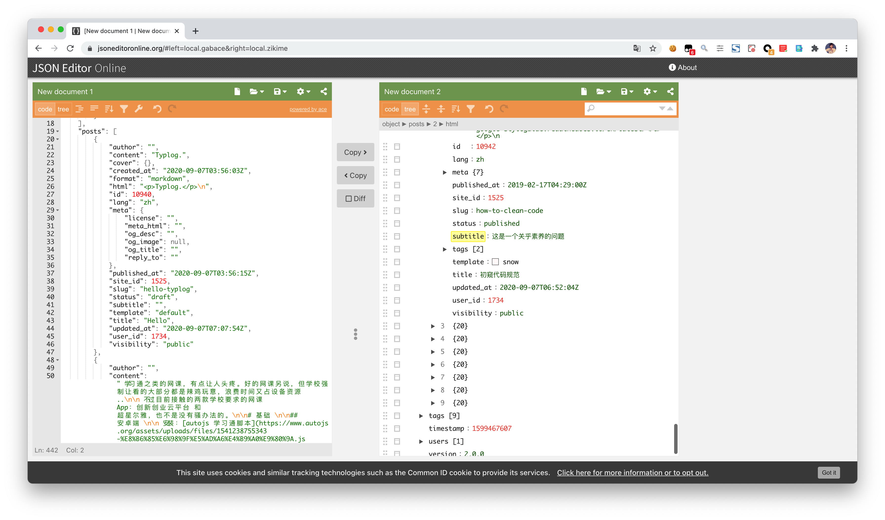
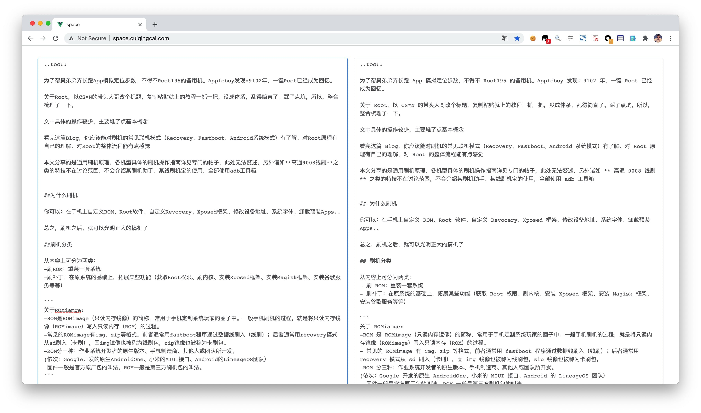
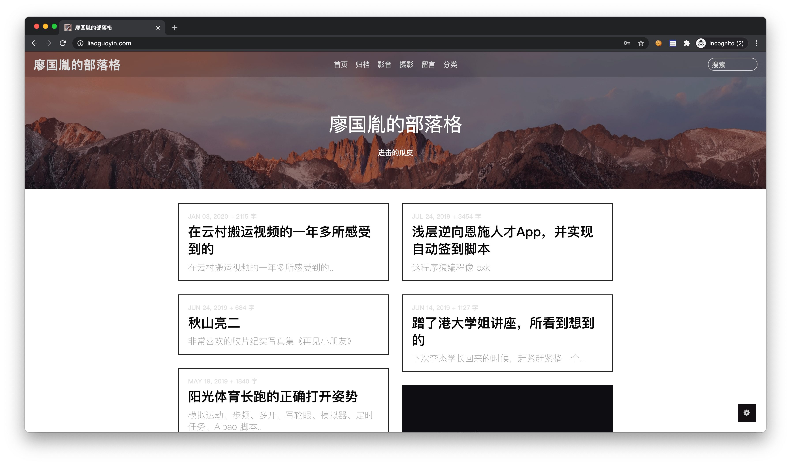
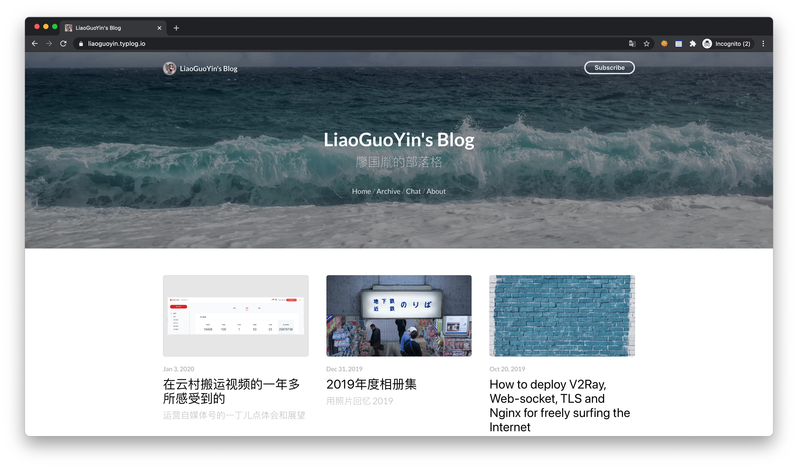

记录一次博客搬家过程中的实用经验，主要包括文章迁移、排版优化和图片处理。

## 给博客搬家的一点 Tips

说起来有点惭愧，上一次发文章还是在一年前，脸都打烂了：

> 好马配好鞍，文章的质量当然也要要提上来了，不然没法给自己交代。

正经博客没写多少，部署、搬家倒是花了挺多功夫。积累下来的经验主要涉及：文章整站导出、汉字和英文之间加空格、图片压缩、URL 重定向。

# 文章迁移

一般来说，Typlog、Hugo、WordPress 这类常见博客系统都提供整站数据导出能力。

举个例子，Typlog 提供了整站文章 [JSON 格式导入导出](https://github.com/typlog/docs/blob/master/import-posts.md)。拿到 JSON 后，事情就好办了：可以[手动](https://jsoneditoronline.org/)处理，也可以写个脚本简单处理每个文章子字段 `posts`，再导入，迁移就完成了。

## 文章汉字和英文之间加空格

在 [文章排版规范](http://space.cuiqingcai.com/) 中提到，最重要的一点当然是 **加空格**。

我的历史文章里有很多不规范的地方，这次统一清理了一遍，用到了 [文本加空格小工具](http://space.cuiqingcai.com/)。当然，这里面有个小 Bug：Markdown 加粗用到 `**`，而 `**` 两边也会被统一加上空格，导致强调语法失效。解决办法很朴素：`Sublime 正则替换`。

\*' " />

# 图片迁移

图片迁移是一个大工程。我用的是 [ImageOptim](https://imageoptim.com/mac)，操作简单，压缩质量高，还支持[命令行模式](https://imageoptim.com/command-line.html)，没有不选择她的理由了。

> 一个小 Tips：如果上传的图片是非摄影类，比如截图，可以考虑 png -> jpg/webp。

# One More Thing of Typlog

Typlog 官方指导文档比较完备，有不少可以借鉴的地方。

[官方博客](https://blog.typlog.com/) 是一个标准的 Typlog 小站，小而精细:

他不仅仅是 [Release Log](https://blog.typlog.com/archive/2017/) or [Guidance](https://blog.typlog.com/markdown)

你还可以在这里发现新 [feature](https://blog.typlog.com/metrics-v2)

也可以在这里感受他们的对 [Typlog Theme 设计的一些想法](https://blog.typlog.com/lotus-theme)

他也会教你怎么申请 [Podcast](https://blog.typlog.com/podcast-for-spotify)

还会教你选择 [License](https://blog.typlog.com/creativecommons)

# Recap

## 历史博客存档

 

总之，Typlog 快而稳定的基本设定，给个人博客提供了很不错的体验，也基本满（超）足（出）了我对写博客这件事的期待。

Typecho 默认的没有单行多图管理，后来用上了一个第三方插件，结果还是不太好用。

但是在 Typlog，官方（[Images in Typlog](https://blog.typlog.com/images)）提供了非常简单而完备的图片管理模块。

Typecho 的定位毕竟是大众博客，所以对图片排版支持并不好。相比之下，Typlog 图片管理页的拖拽 UX 深得我心，图片展示页面也很干净。从前到后，全方位满足了我对图片管理的需求（~~以后应该能好好拍照传图了~~）。

另外，万一后期没钱续费，或者官方不干了没地儿续费，也可以直接导出整站 JSON，然后写个类似火车头的入库脚本，很方便地迁移到新的地方。

希望这个产品越来越有生命力，~~也希望自己能坚持用她记录好东西~~
