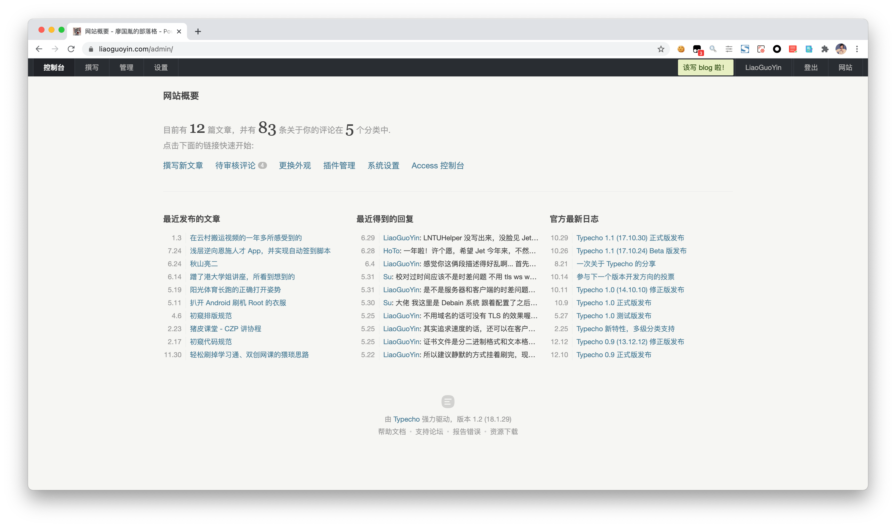
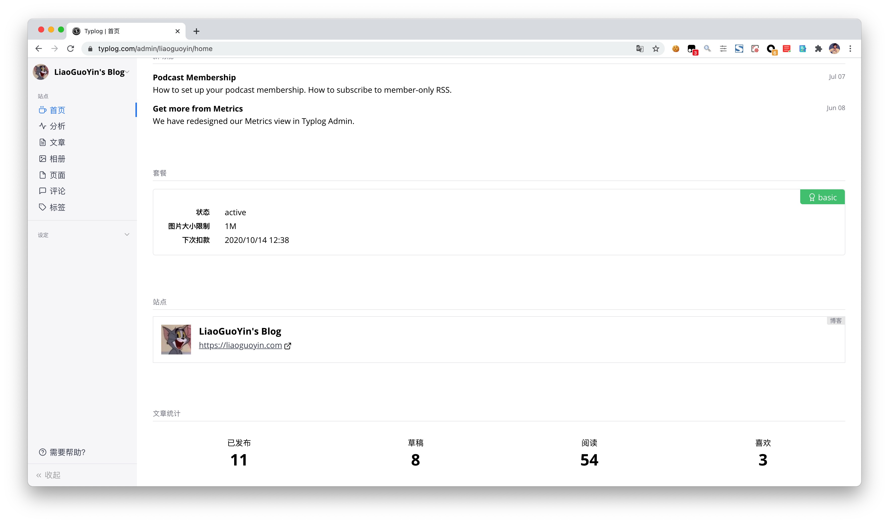
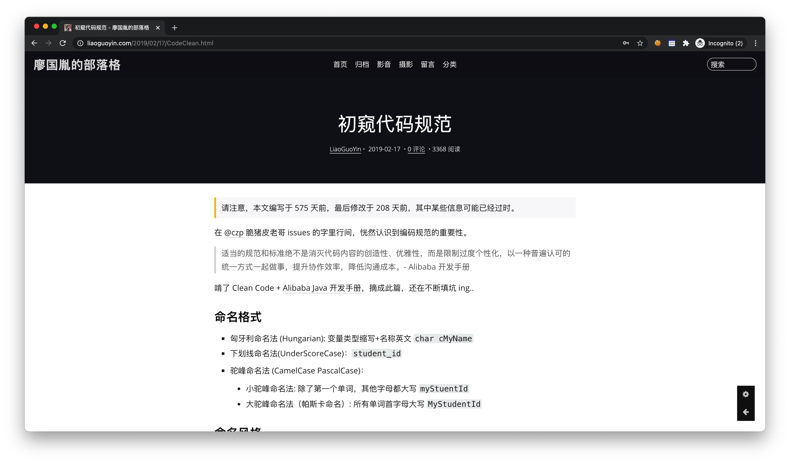
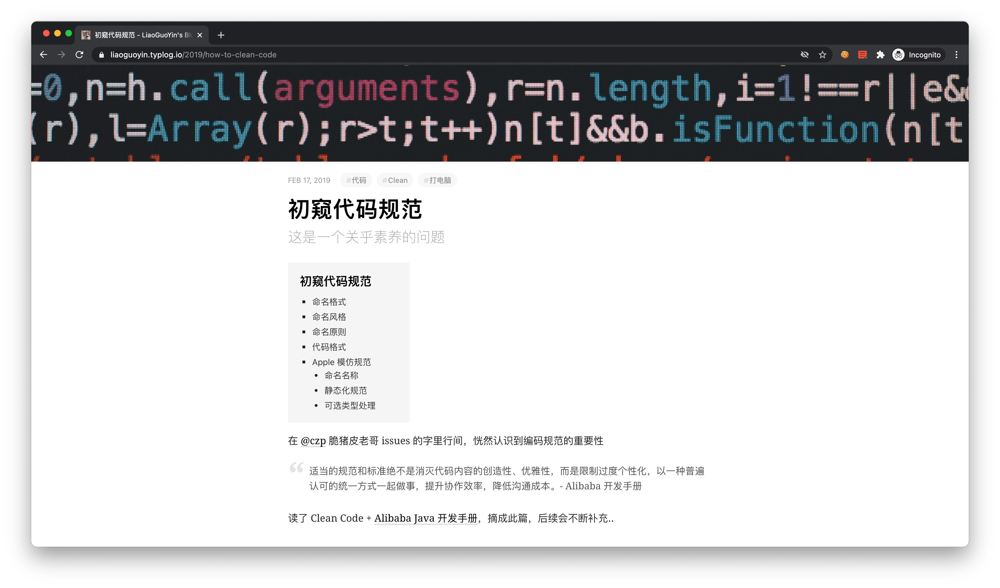
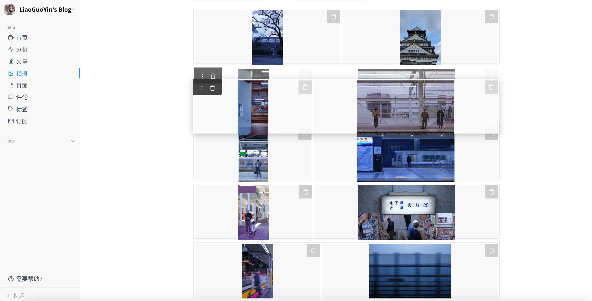
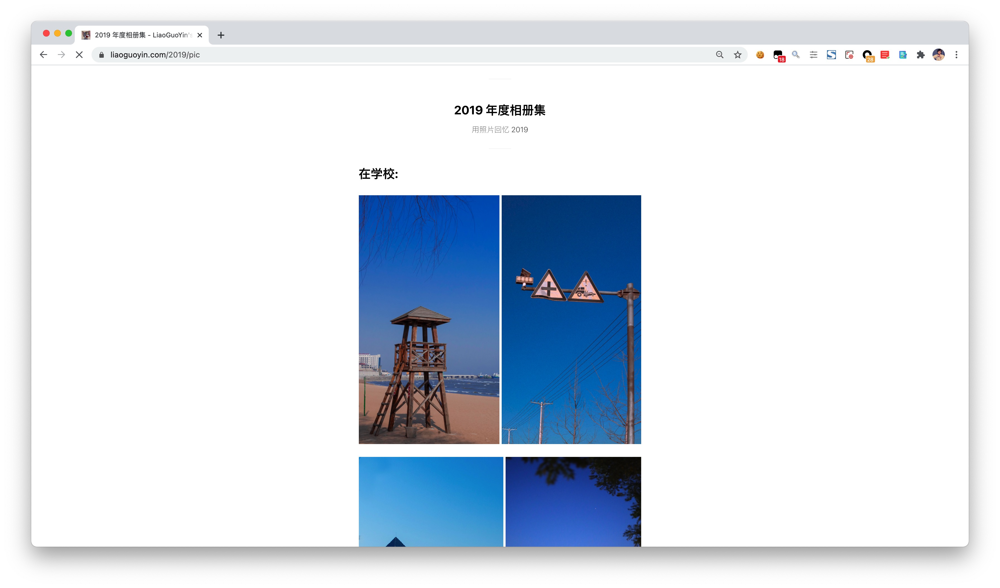
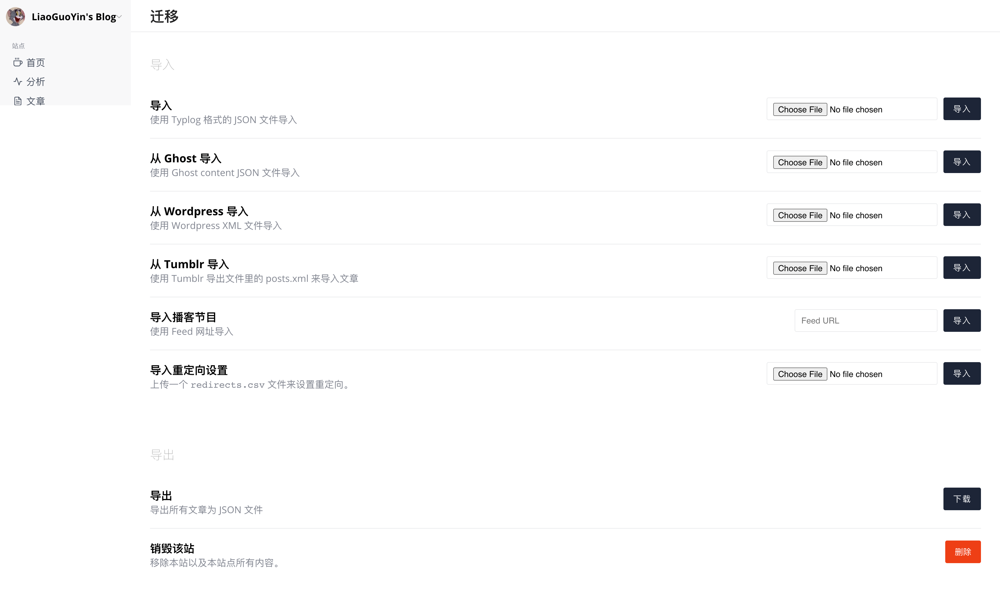
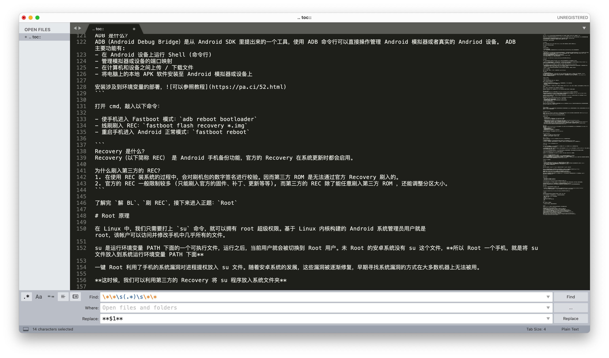
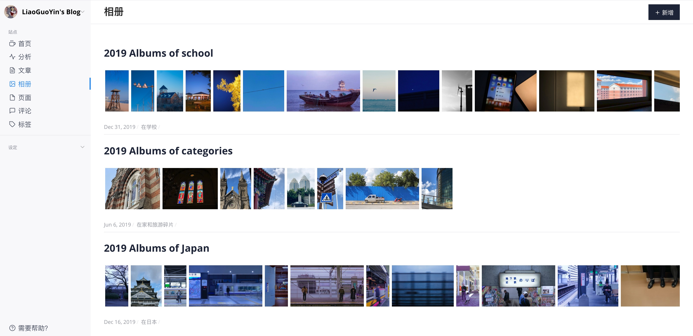

这是一个无聊的欢迎页。

意味着博主刚刚给博客换了套皮。

又要开始胡说八道了。

---

Hello, Typlog!

## 开篇

其实搬迁博客这件事拖了快... 半年了？

从半年前知道 Typlog 起，就隐隐被种了一波草。今天拔完草，只想赶紧写篇文章来吹吹。

Typlog 特别的地方：

1. 快
2. 图片管理一目了然
3. 迁移方式多样，而且有后路
4. 统计视图优雅美观（现在还没多少浏览量，体会不太出来
5. UI 尤其精简。如你所见，每一个页面的小组件都稳定而且有质感

另一方面：

1. [Typlog-Prcing](https://typlog.com/pricing)，同时基础款图片容量太小了（李姐万岁，毕竟 CDN 本来就贵
2. 网站 Footer 有风格看起来比较突兀的 Typlog 官网的链接，无法编辑（李姐万岁，毕竟要打造 Brand
3. ~~URL 无法自定义，从源站迁移过来的时候没法重定向从而导致收录丢失~~[已解决](https://twitter.com/typlog/status/1279801016154636288?s=20)
4. ~~没有搜索功能~~（Pro 订阅可以，充钱能解决的问题不算问题）

## Typecho vs Typlog

我之前用的博客方案是 [Typecho](https://typecho.org/)，用几张图对比下 Typecho VOID 和 Typlog

### 管理页

 

### 前端页

 

 

### 其他

Typecho 默认没有单行多图管理，后来用上了一个第三方插件，结果还是不太好用。

但是在 Typlog，官方（[Images in Typlog](https://blog.typlog.com/images)）提供了非常简单而完备的图片管理模块。

Typecho 的定位毕竟是大众博客，所以对图片排版支持并不好。相比之下，Typlog 图片管理页的拖拽 UX 深得我心，图片展示页面也很干净。从前到后，全方位满足了我对图片管理的需求（~~以后应该能好好拍照传图了~~）。

 

要说缺点，就是页面上 [图片过多时](https://liaoguoyin.com/moments/) 页面加载较慢（或许需要个图片懒加载？

## 一点微小的迁移建议

好马配好鞍，文章的质量当然也要提上来了，不然没法给自己交代。

### 批量文章迁移

批量文章迁移，Typlog 提供的迁移手段比较多：

可以看到，官方并没有提供非主流博客系统的直接迁移。但是，Typlog 提供了整站文章 [JSON 格式导入导出](https://github.com/typlog/docs/blob/master/import-posts.md)，这就很棒了呀朋友们：先把文章草稿创建好，然后导出整站 JSON，再[手动](https://jsoneditoronline.org/)或者写个脚本简单处理每个 `posts`，再导入，迁移就完成了。

### 文章重排版

在 [文章排版规范](http://space.cuiqingcai.com/) 中提到，最重要的一点当然是 **加空格**。

我的历史文章里有很多不规范的地方，这次统一清理了一遍，用到了 [文本加空格小工具](http://space.cuiqingcai.com/)。当然，这里面有个小 Bug：Markdown 加粗用到 `**`，而 `**` 两边也会被统一加上空格，导致强调语法失效。解决办法很朴素：`Sublime 正则替换`。

\*' " />

### 图片迁移

图片迁移是一个大工程。

1. 首先是图片压缩，用到了 [ImageOptim](https://imageoptim.com/mac)，操作简单，压缩质量高，还支持[命令行模式](https://imageoptim.com/command-line.html)，没有不选择她的理由了
2. 另外，图片的命名问题这里就不用考虑了
3. 上传过的图片都会被放在 Typlog 账户下的图片仓库里面，复用起来非常方便，甚至可以给到外链用

> 一个小 Tips: 如果上传的图片是非摄影类的如截图，那么可以考虑 png -> jpg

## One More Thing of Typlog

官方指导文档比较完备。

[官方博客](https://blog.typlog.com/) 是一个标准的 Typlog 小站，小而精细:

他不仅仅是 [Release Log](https://blog.typlog.com/archive/2017/) or [Guidance](https://blog.typlog.com/markdown)

你还可以在这里发现新 [feature](https://blog.typlog.com/metrics-v2)

也可以在这里感受他们的对 [Typlog Theme 设计的一些想法](https://blog.typlog.com/lotus-theme)

他也会教你怎么申请 [Podcast](https://blog.typlog.com/podcast-for-spotify)

还会教你选择 [License](https://blog.typlog.com/creativecommons)

## Recap

总之，Typlog 快而稳定的基本设定，给个人提供了更简单极致的~~水文~~体验，也很好地满足（超出）了我对写博客这件事的期待。

另外，万一后期没钱续费或者官方不干了没地儿续费了，可以直接导出整站 JSON，然后写个类似火车头的入库脚本，便能非常方便地迁移到新的地方。

看了整站导出的 JSON 文件，大概能看到我的 ID 号是 1734，文章 ID 11000+，可以看到 Typlog 其实还是一个比较小众的产品，但是，这并不影响他很好用。

希望这个产品越来越有生命力，也希望自己能坚持用她记录好东西。
