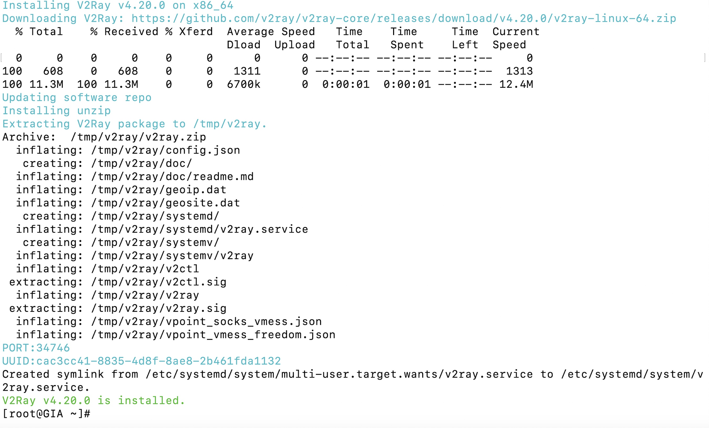
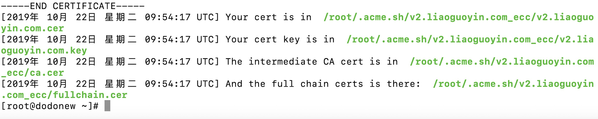
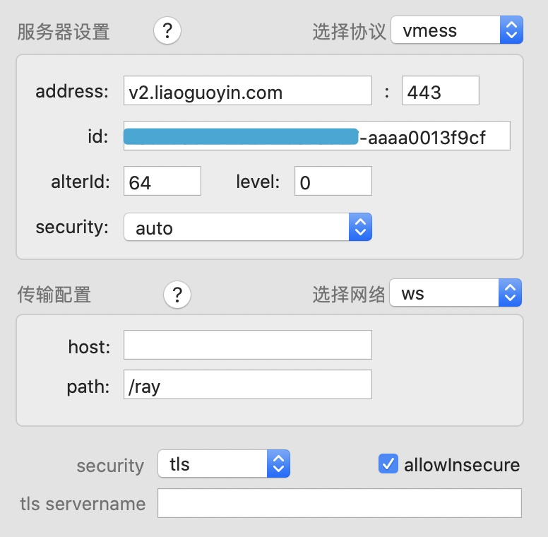
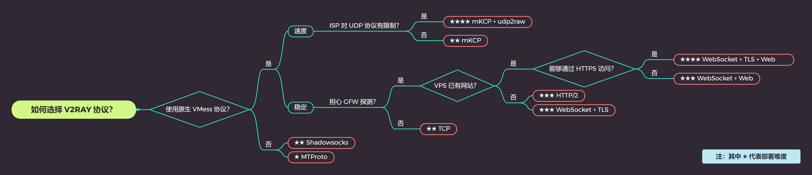

这是一篇很早期的部署笔记，主要记录当时折腾 V2Ray + WebSocket + TLS + Nginx 的完整过程。现在回头看，里面不少工具和配置都已经有年代感了，所以更适合当作思路存档，而不是无脑照抄的最新教程。

<!-- more -->

当时在 Hostloc 上看了一圈讨论，比较多人提到 `V2Ray + WebSocket + TLS + Nginx` 这套组合。它的好处是方案成熟、资料多、排查问题时不至于完全没路可走。

那就先拥抱一下 V2Ray。

## 零、准备

- 域名 * 1
- 会使用 Google
- 国外 VPS * 1：当时用的是 CentOS 7+
- 一定的 Linux 基础（至少知道 vim 等命令的用法）

## 一、安装 V2Ray-Core

[官方的 V2Ray-Core 安装脚本当时只需要一条命令，更多细节可以看原文档：][2]

```
bash <(curl -L -s https://install.direct/go.sh)
```

安装完成后，大概会看到类似下面的输出：



```
V2Ray 安装信息：
bin命令：/usr/bin/v2ray/v2ray 
配置文件：/etc/v2ray/config.json 
日志：/var/log/v2ray/access.log 和 /var/log/v2ray/error.log

V2Ray 命令行参数：
Usage of ./v2ray:
  -config string    Config file for V2Ray.
  -format string    Format of input file. (default "json")
  -test             Test config file only, without launching V2Ray server.
  -version          Show current version of V2Ray.
```

## 二、部署 TLS

TLS（Transport Layer Security）负责证书和加密，在这套方案里主要用于让外层连接看起来像一个正常的 HTTPS 服务。要用 TLS，就需要一个域名；拿到域名后，别忘了先在 DNS 面板里添加 A 记录，把域名指向 VPS 的公网 IP。

这里使用 acme.sh 申请 Let's Encrypt 免费证书。本节部分内容参考 [acme.sh README][4]。

### 2.1 Acme 脚本安装

先装 acme.sh 需要的 `socat`，再下载脚本：

```
yum install -y socat
curl https://get.acme.sh | sh
```

### 2.2 使用脚本生成证书

再次确认域名的 A 记录已经指到当前服务器。acme.sh 会根据 DNS 记录校验域名归属，然后向 Let's Encrypt 申请证书。

```
~/.acme.sh/acme.sh --issue -d 自己的域名 --standalone -k ec-256
```

> 注意 80 端口占用。如果报错 `tcp port 80 is already used by ...`，先停掉占用 80 端口的服务，例如临时 `killall nginx`。

生成结果里，`*.cer` 是证书文件，`*.key` 是私钥文件。



注意：Let's Encrypt 证书有效期只有 3 个月，可以手动续签，也可以配置定时任务自动续签。

完成后可以在 SSL Labs 上看一下安全评级：https://www.ssllabs.com/ssltest/analyze.html?d=刚才部署好TLS的域名

## 三、Nginx 部署

Nginx 监听服务器的 443 端口。客户端访问 `https://xxx` 时先和 Nginx 完成 TLS 握手，之后 Nginx 再把 WebSocket 请求转发到本地 V2Ray 端口。这样 Nginx 就像一个中间层，负责把外部 HTTPS/WebSocket 流量接进来，再交给 V2Ray 处理。

### 3.1 安装 Nginx

CentOS 默认 Yum 仓库里没有 Nginx，先安装 EPEL-release：

```
rpm -ivh http://dl.fedoraproject.org/pub/epel/epel-release-latest-7.noarch.rpm
```

然后安装 Nginx：

```
yum install -y nginx
```

```
Nginx 安装信息:
应用程序：/usr/bin/nginx
配置文件：/etc/nginx/conf.d
日志默认存放位置：/var/log/nginx
程序默认存放位置：/usr/share/nginx/html
```

### 3.2 配置 Nginx

新建一个目录放 TLS 证书和私钥，并把前面生成的文件移进来：

```
cd /etc/nginx/conf/conf.d && mkdir key
mv ~/.acme.sh/生成的域名证书文件夹/*.cer /etc/nginx/conf.d/key
mv ~/.acme.sh/生成的域名证书文件夹/*.key /etc/nginx/conf.d/key
```

新建 Nginx 配置文件：

```bash
vi /etc/nginx/conf.d/v2ray.conf
```

```
server {
    listen       443 ssl http2 default_server;
    listen       [::]:443 ssl http2 default_server;
    server_name  **你的域名**;
    root         /usr/share/nginx/html;

    ssl_certificate "conf.d/key/**替换证书名字**";
    ssl_certificate_key "conf.d/key/**替换密钥名字**";
    ssl_protocols TLSv1 TLSv1.1 TLSv1.2;
    ssl_ciphers HIGH:!aNULL:!MD5;

    location /ray {
proxy_redirect off;
proxy_pass http://127.0.0.1:10000;
proxy_set_header Upgrade $http_upgrade;
proxy_set_header Connection "upgrade";
proxy_set_header Host $http_host;
    }
}
```

## 四、V2Ray 配置文件

`vi /etc/v2ray/config.json`

这里直接贴当时用过的一份配置。更完整的配置规则请看文档：[V2Ray 基本配置][6]。

UUID 可以在线生成：https://www.uuidgenerator.net/

注意：正常 JSON 不支持注释。V2Ray 的配置文件可以识别 `//`、`/* */` 这类注释，所以不删注释也能跑，但有些编辑器可能会因此提示 JSON 格式错误。

```
{
  "log": {
      "access": "/var/log/v2ray/access.log", // 成功日志存放地址
      "error": "/var/log/v2ray/error.log", // 错误日志存放地址
      "loglevel": "warning" // 错误警告类型
  },
  "inbound": {
    "port": 10000, // 本地 V2Ray 监听端口
    "listen":"127.0.0.1",
    "protocol": "vmess",
    "settings": {
      "clients": [
        {
          "id": "你的uuid", // 输入生成的 UUID
          "alterId": 64
        }
      ]
    },
    "streamSettings":{ // 传输配置
      "network":"ws", // 传输协议为 Websocket
      "security": "auto", // 加密方式为 auto
      "wsSettings": {
         "connectionReuse": true,
         "path": "/ray" // 请求路径
     }
    }
  },
  "outbound": {
    "protocol": "freedom",
    "settings": {}
  },
  "outboundDetour": [
    {
      "protocol": "blackhole",
      "settings": {},
      "tag": "blocked"
    }
  ]
}
```

到这里，服务端基本就配完了。启动 V2Ray 和 Nginx 后，就可以开始配客户端。

```
启动命令：
/usr/bin/nginx
/usr/bin/v2ray/v2ray

加入开机启动项：
systemctl enable v2ray
systemctl enable nginx

关闭防火墙（较粗暴）：
service firewalld stop
```

## 五、客户端使用

客户端主要是把服务端对应的信息一项项填进去。几个关键项别填错：`ws` 传输配置、对应的 `path`、TLS、安全协议和 VMess。

**传输配置 ws、对应 Path、安全性质 TLS、协议 VMess**



### 客户端选择

[经过横向使用对比后，][8]我当时的选择是：

- Windows：[V2RayN][9] + [V2Ray-Core][10]
- Android：[V2RayNG][11]
- macOS：[V2rayU][12]
- iOS：[Shadowrocket][13]

## 六、为什么当时选择这套方案

**Shadowsocks**
先说 Shadowsocks。单纯的 Shadowsocks 流加密 + OTA，在当时已经比较容易被识别。

后来 SIP004 草案提出使用 AEAD 算法替换旧方案。加密算法能保护传输内容，但流量形态本身仍然可能暴露特征。

再后来出现了混淆流量的办法，比如 Simple-obfs。思路是在原本流量外面再包一层，让它更像正常 HTTP 流量。不过混淆也有自己的特征，问题并没有彻底消失。

**V2Ray**
很多代理方案是直接用 TCP、HTTP 或自定义协议连接远端服务器。

V2Ray 这套组合则是在远端做一个 HTTPS 服务，由 Nginx 接 WebSocket 流量，再在服务器本地转给 V2Ray。外层看上去更接近一个普通 HTTPS 网站。

这样一来，外部观察到的更像普通网页请求，特征会被压低一些。理论上也就能降低被 ban IP 的概率。

啰嗦一句：**本方案未必适合你**。

比如你非常在意速度，这套方案就不一定合适。中间多了几层转发和封装，开销、延迟都可能上来。适合自己的才是最好的。



### Related

更多资料和本文参考：

[V2Ray 设计理念][15]

[V2Ray 抗封锁最优配置][16]

[各个翻墙工具的协议进化][17]

[简单介绍一下网络连接的封锁与反封锁][18]

[v2-ui，一个全新的多协议多用户 V2Ray 面板][19]

[V2Ray 配置指南][20]

[V2Ray 搭建小记][21]

[WebSocket+TLS+Web][22]

[V2ray 实现 ws+tls+nginx 加密传输][23]

> 水平有限，里面可能有不准确的描述。欢迎看到这里的朋友勘误。

  [1]: https://liaoguoyin.com/2019/04/05/Shadowsocks.html
  [2]: https://toutyrater.github.io/prep/install.html
  [4]: https://github.com/Neilpang/acme.sh/blob/master/README.md
  [6]: https://ansongd.gitbooks.io/v2ray/v2rayji-ben-pei-zhi.html
  [8]: https://www.v2ray.com/awesome/tools.html
  [9]: https://github.com/2dust/v2rayN
  [10]: https://github.com/v2ray/v2ray-core/releases
  [11]: https://github.com/2dust/v2rayNG
  [12]: https://github.com/yanue/V2rayU
  [13]: https://apps.apple.com/us/app/shadowrocket/id932747118
  [15]: https://www.meirenji.info/2017/12/22/v2ray%E8%AE%BE%E8%AE%A1%E7%90%86%E5%BF%B5/
  [16]: https://la4ji.blogspot.com/2018/07/v2ray.html
  [17]: https://twitter.com/gfwrev/status/1081802626243514370
  [18]: https://chinadigitaltimes.net/chinese/2017/10/v2ray%EF%BC%9A%E7%AE%80%E5%8D%95%E4%BB%8B%E7%BB%8D%E4%B8%80%E4%B8%8B%E7%BD%91%E7%BB%9C%E8%BF%9E%E6%8E%A5%E7%9A%84%E5%B0%81%E9%94%81%E4%B8%8E%E5%8F%8D%E5%B0%81%E9%94%81/
  [19]: https://blog.sprov.xyz/2019/08/03/v2-ui/
  [20]: https://toutyrater.github.io/
  [21]: https://rinchan.me/index.php/archives/44/
  [22]: https://toutyrater.github.io/advanced/wss_and_web.html
  [23]: https://linuxfunk.com/post/v2ray-ws-tls-nginx%E5%AE%9E%E7%8E%B0%E5%8A%A0%E5%AF%86%E4%BC%A0%E8%BE%93/
