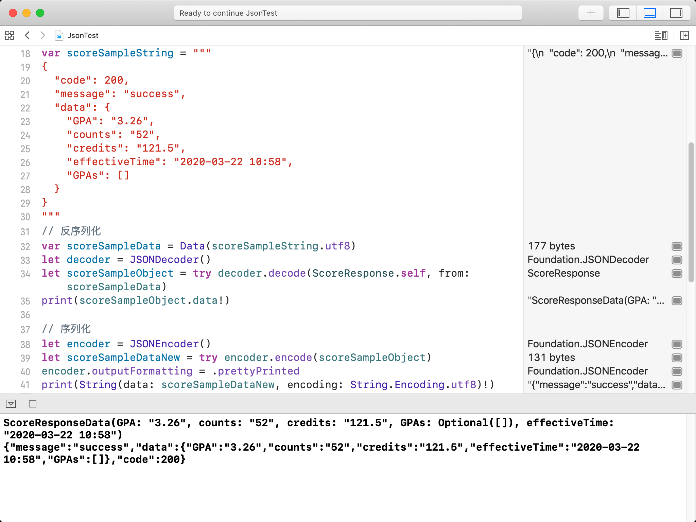
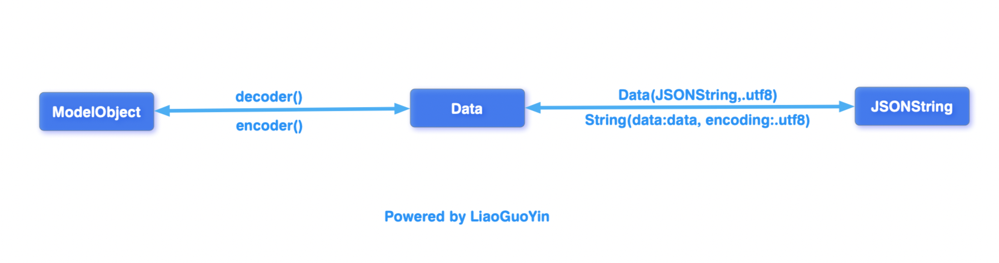

对 Swift 初学者来说，Codable 应该是一个必须掌握的协议。

这个协议实现的是序列化和反序列化，不过在 Swift 里，我们通常把这个过程叫 Encode 和 Decode。

[Apple 文档][1] 的描述是：

> Decodable: A type that can decode itself from an external representation.
> Encodable: A type that can encode itself to an external representation.
> Codable: A type that can convert itself into and out of an external representation.

Codable 其实就是一个类型别名，也就是组合协议。它和手动写一遍没啥区别，只是为了方便。没了这个东西，本文名字就得改。

> typealias Codable = Decodable & Encodable

原汁原味的定义不太适合在这里硬背。总之，Encodable 和 Decodable 分别实现数据对象模型的序列化和反序列化。数据模型只要实现 Codable 协议，就可以比较灵活地做对象和外部表示之间的转换。

下面给出最常见的反序列化、序列化实践。

```
import Foundation

struct ScoreResponseData: Codable {
    var GPA: String
    var counts: String
    var credits: String
    var GPAs: [String]?
    var effectiveTime: String
}

struct ScoreResponse: Codable {
    var code: Int
    var message: String
    var data: ScoreResponseData?
}

// 示例数据
var scoreSampleString = """
{
  "code": 200,
  "message": "success",
  "data": {
    "GPA": "3.26",
    "counts": "52",
    "credits": "121.5",
    "effectiveTime": "2020-03-22 10:58",
    "GPAs": []
  }
}
"""

// 反序列化
var scoreSampleData = Data(scoreSampleString.utf8)
let decoder = JSONDecoder()
let scoreSampleObject = try decoder.decode(ScoreResponse.self, from: scoreSampleData)
print(scoreSampleObject.data!)

// 序列化
let encoder = JSONEncoder()
let scoreSampleDataNew = try encoder.encode(scoreSampleObject)
encoder.outputFormatting = .prettyPrinted
print(String(data: scoreSampleDataNew, encoding: String.Encoding.utf8)!)
```



可以看到，数据转换了一次又一次：
jsonString -> Data -> ObjectInstance -> New Data -> New jsonString

> [Data][3]: A byte buffer in memory.
> [JSONDecoder][4]: An object that decodes instances of a data type from JSON objects.

乍一看，序列化和反序列化的过程差别不大。但如果对整个数据传输和封装过程没有理解，一写代码就是 bug。所以有必要理清楚数据交互封装的整个流程。

## 网络传输中的数据封装过程

开发 App 时，难免要和服务器做数据交互，用来实现 **跨平台存储** 和 **网络传输**。跨平台存储和网络传输走的是 IO，在这个过程中，IO 支持的数据格式是 **字节数组**，也就是这里看到的 Data（New Data）。

## 序列化与反序列化

传输之后，从 IO 流中读出数据，再按照同样规则还原成对象，这个过程就是反序列化（decode）：
Data -> ObjectInstance

传输之前，把对象按照一定规则（JSON、XML..）转成字节数组，这个过程就是序列化（encode）：
ObjectInstance -> New Data

## 什么情况下需要序列化

本质上，存储和网络传输对象时，都要先把对象状态按照某种格式（JSON、XML、Hessian..）序列化成跨平台可识别的字节格式，然后才能用同样的规则反序列化，还原成对象。

## 迂回的坑

你可能会问：这里有个 jsonString，从服务器来的不应该是 IO 流字节数组吗？为什么这里收到的是 IO 字节数组处理过的结果？

的确如此，这是因为 URLSession 请求之后，会替我们读到 IO 流，并编码成字符串。

有了这样一个迂回，调用好像方便了。但对不知道细节的人来说，事情反而突然复杂起来，常常让新手（俺）在序列化、反序列化时斟酌半天才敢下手。

> （当然，在很多第三方网络请求库中 [Alamofire]，我们拿到的默认是 Data 字节数组）

也不知道 Hello World 了多少次 Swift，每次重新拿起来时，我都会把序列化、反序列化过程混成一锅。直到了解到这么一点传输细节之后，才稍微懂了一点。以后每次写 bug 时脑子里有一幅图，一切就好办了。

## 结论

那，废话完了，要想理清楚转化关系，一图胜千言：




因为太菜了，描述难免存在错误，欢迎拍砖

[1]: https://developer.apple.com/documentation/foundation/archives_and_serialization/encoding_and_decoding_custom_types
[2]: https://public.liaoguoyin.com/how-to-code-swift-codable/decode-encode-result.png#vwid=2048&vhei=1536
[3]: https://developer.apple.com/documentation/foundation/data
[4]: https://developer.apple.com/documentation/foundation/jsondecoder
[5]: https://public.liaoguoyin.com/how-to-code-swift-codable/convert-flow.png#vwid=1744&vhei=400
