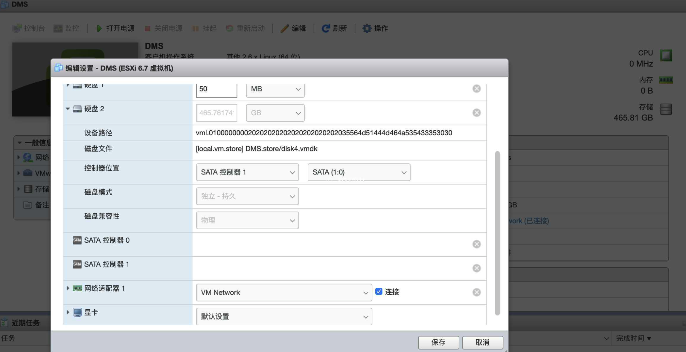
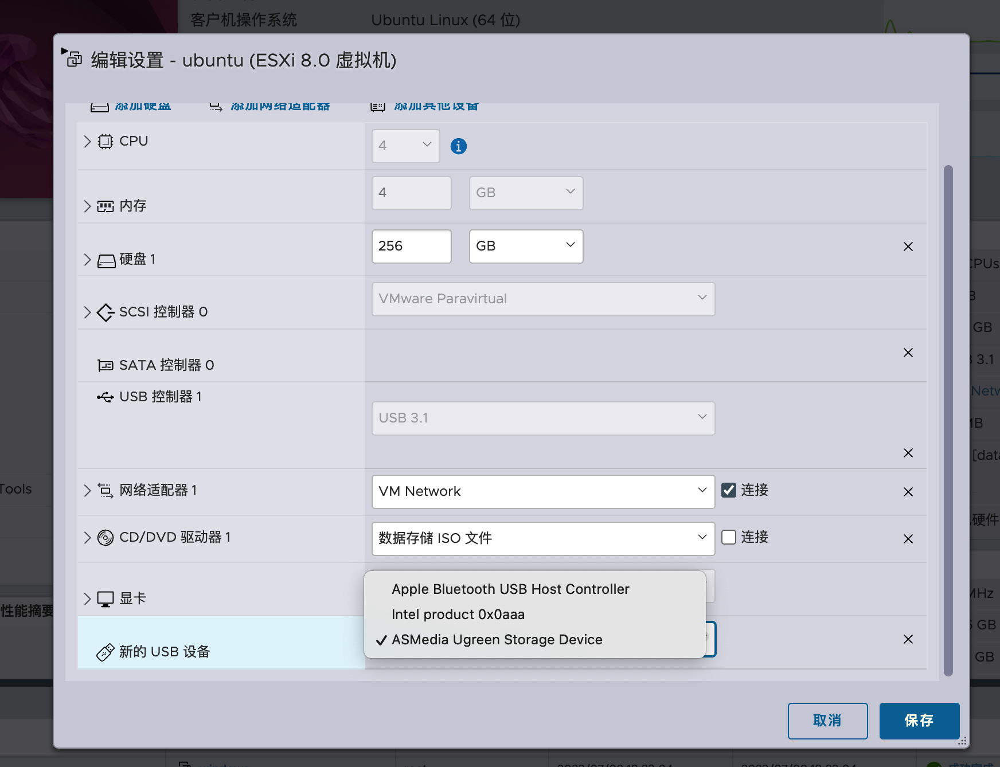

## 直通

### 硬盘直通

通过 RDM（Raw Device Mapping）方式，将磁盘映射为本地 VMDK。

> 优点：不需要增加硬件，也不需要修改配置文件，配置起来很省事。并且不影响现有磁盘数据分区和文件系统，谁挂载谁解决文件系统兼容问题即可。
> 缺点：如果后续要调整硬盘，需要重新映射；群晖无法获取 SMART 信息。

步骤：

1. 查看当前能识别的硬盘：`ls -l /dev/disks`
2. 通过命令 `vmkfstools -z /vmfs/devices/disks/<直通硬盘的标识符> /vmfs/volumes/<保存vmdk的硬盘标识符>/<VMDK名字>.vmdk` 进行挂载。其中 `<直通硬盘的标识符>` 是上一个命令里类似 `t10.ATA_____ST3500413AS_________________________________________5VMQDMFJ` 这样的值；`<保存vmdk的硬盘标识符>` 可以在 `/vmfs/volumes/` 下查看；`<VMDK名字>` 随意。
3. 设置群晖磁盘。



参考：

- [[VMware]ESXI下硬盘的两种直通方式 - 软媒设计 (rmbz.net)](https://rmbz.net/archives/vmware-esxi-passthrough)

### USB 网卡直通

USB 网卡可以打补丁进 ESXi，也可以直通到虚拟主机里，然后在虚拟主机上打驱动。

比如 USB 网卡主板是 RTL8125，想直通给虚拟机 OpenWrt 用，那么 OpenWrt 固件里要有对应驱动，否则无法正常识别。

步骤：

1. 添加 USB 控制器。USB 控制器负责识别连接到系统的 USB 设备，并提供通信所需的电源和数据传输能力
2. 添加 USB 设备
3. 在虚拟机内部装驱动

可能的问题：

- 添加 USB 设备的按钮是灰色的？

> 检查 usbarbitrator。如果搞过 USB 直通 RDM，可能曾经关闭过 usbarbitrator，需要重新开启，否则添加 USB 设备的按钮会是灰色的。
>
> 1. 开启 ESXi SSH 登陆
> 2. `/etc/init.d/usbarbitrator start` 会启动一个叫 USB arbitrator 的服务。它会监视 USB 总线以及 USB 设备插拔状态，确保 USB 设备能和系统稳定通信。
> 3. 列出所有识别到的 USB 设备：esxcli hardware usb passthrough device list
> 4. 在控制台中添加 USB 硬盘盒（USB 设备可以开机状态下添加）
>
> 
>
> 参考：[Solved: Add USB Device grayed out in ESXi 6.7 - VMware Technology Network VMTN](https://communities.vmware.com/t5/ESXi-Discussions/Add-USB-Device-grayed-out-in-ESXi-6-7/td-p/2737898)
>
> 检查 acscheck。到管理、系统、高级设置搜索 acscheck 设置为 True，重启后即可直通参考下图

```
[root@MiWiFi-RA69-srv:~] esxcli hardware usb passthrough device list
Bus  Dev  VendorId  ProductId  Enabled  Can Connect to VM  Name
---  ---  --------  ---------  -------  -----------------  ----
1    6    5ac       8289          true  yes                Apple, Inc. Bluetooth Host Controller
1    7    8087      aaa           true  yes                Intel Corp. Bluetooth 9460/9560 Jefferson Peak (JfP)
1    8    bda       8156          true  yes                Realtek Semiconductor Corp.
1    9    174c      1356          true  yes                ASMedia Technology Inc.
```

参考：

- [ESXi安装Realtek USB RTL8156B 2.5G网卡驱动](https://www.mi-d.cn/2763)
- [ESXi下直通网USB网卡（USB设备）给虚拟机 ](https://www.mi-d.cn/3384)
- [关于USB 2.5G网卡的安装说明 - 玩物进化论 (chiphello.com)](https://uf.chiphello.com:30177/index.php/archives/26/)
- [Linux 2.5G USB网卡驱动安装RTL8156/8156B - 轶哥 (wyr.me)](https://www.wyr.me/post/704)
- [ESXi入门指南 | 土豆不好吃 (dmesg.app)](https://dmesg.app/esxi-tutorial.html)

### 软路由配置

#### openwrt 固件编译

由于部分硬件驱动缺失，可能需要打补丁。有老哥封装了定制化在线编译：[OpenWrt 软路由固件下载与在线定制编译](https://supes.top/?target=x86%2F64&id=generic#downloads1)

eSir 固件：[V1 [2023] - Google 云端硬盘](https://drive.google.com/drive/folders/1BNjtBTnhoK1S9Ww-e2O5yv0uomoWKT2y?pli=1)

#### openwrt 固件安装

手动安装：[Running OpenWRT in ESXi ](https://galaxysd.github.io/linux/20220618/OpenWRT-IN-ESXi)

自动安装：[V2V Converter / P2V Converter - Converting VM Formats](https://www.starwindsoftware.com/starwind-v2v-converter)

OpenWrt 镜像通常需要转换成 VMDK，然后挂载成对应虚拟机的动态硬盘，ISO 往往无法直接使用。

> OpenWrt 镜像的 ISO 文件常常不能直接使用，因为 ISO 文件是一种光盘映像文件格式，它的文件系统是只读的，无法进行写操作，因此无法存储和修改一些持久化的信息，如系统设置、状态信息、日志等。
>
> 而 OpenWrt 镜像是一种基于 Linux 操作系统的根文件系统，需要被挂载到一个磁盘设备上才能运行。因此，需要将 OpenWrt 镜像文件转换成虚拟机所需要的磁盘映像格式，如 VMDK 或者 RAW，以便挂载成为虚拟机的动态硬盘来运行和操作 OpenWrt 系统。

**网络配置参考：**

- [OpenWrt DHCP 详细设置教程 - 科技师](https://www.3kjs.com/topic/13287.html)
- [OpenWrt 常用网络配置 | Hongbo Lin](https://linhongbo.com/posts/openwrt-usual-configuration/)
- [WiFi 路由器设置为 AP 模式 - Tesla's Blog](https://tesla9527.github.io/2020/06/12/openwrt-ap/)
- [OpenWrt 固件下载 - Li 网盘](https://lidrive.vip/OpenWrt/OpenWrt%20X86/%E5%9C%A8%E7%BA%BF%E6%9B%B4%E6%96%B0%E7%89%88)

#### SMB3 多通道

- [家庭网络系统搭建经验分享 篇六：乘着SMB3的翅膀，低成本实现内网多通道带宽叠_交换机_什么值得买 (smzdm.com)](https://post.smzdm.com/p/akmr4n9r/)
- [双网口黑群晖NAS主机零成本网速叠加：SMB设置多通道传输实现传输速度叠加 - 逍遥玩Blog:NAS与数码修行 (xywnas.com)](https://xywnas.com/?p=1673)
- [【软路由 ESXI 硬件直通 USB 3.0】为什么 USB3.0 只有 2.0 的速度？VMware esxi USB 局域网 smb 共享速度提升！ALL in ONE【吹乐了】 - YouTube](https://www.youtube.com/watch?v=g-biIGZPNzI)

openwrt 开 smb 账户：[[OpenWrt Wiki] Create new users and groups for applications or system services](https://openwrt.org/docs/guide-user/additional-software/create-new-users)


#### 单线多拨

参考：

- [迄今为止最完美最彻底的openwrt多Wan口upnp解决方案！包含单线多拨、多线多拨场景。-OPENWRT专版-恩山无线论坛 - Powered by Discuz! (right.com.cn)](https://www.right.com.cn/forum/forum.php?mod=viewthread&tid=8279329&highlight=%E5%A4%9A%E6%8B%A8)
- [多宽带联网（二） OpenWrt中g利用MWAN3负载均衡实现带宽叠加_没有昵称&lt;-的博客-CSDN博客](https://blog.csdn.net/Cx2008Lxl/article/details/123116458)

N5105

- [倍控N5105软路由安装Exsi7.0+Openwrt+ikuai - 一枝梅的技术收录 (kdyzm.cn)](https://blog.kdyzm.cn/post/122)

## WebDav

Windows 下作为客户端访问 Webdav：[如何使用WebDAV访问Synology NAS上的文件？ - Synology 知识中心](https://kb.synology.cn/zh-cn/DSM/tutorial/How_to_access_files_on_Synology_NAS_with_WebDAV)
