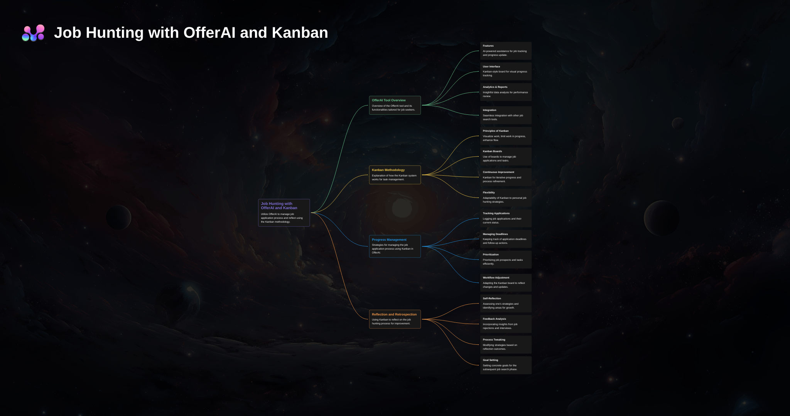
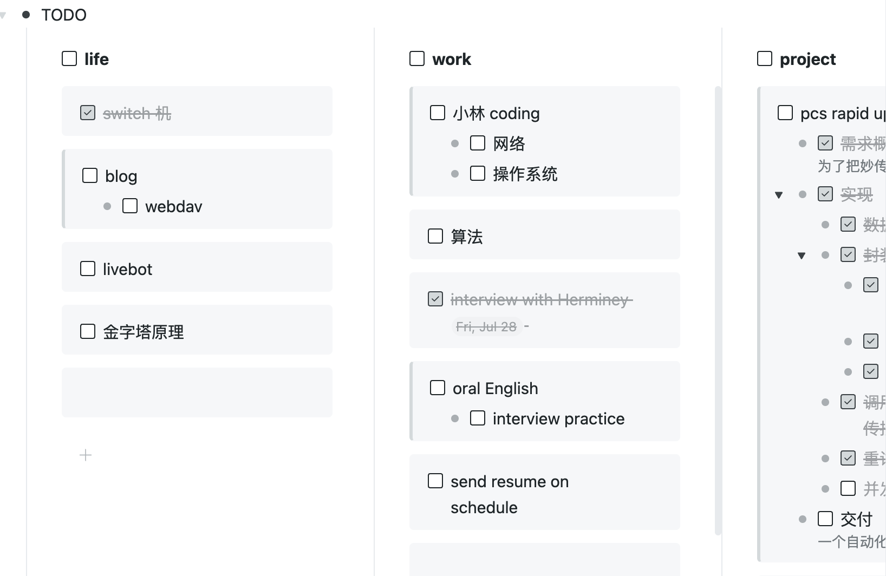

## 需求分析

秋招是一个漫长、乏味的持久战。除去少数有议价能力的同学，大多数海投的普通同学想拿到满意 Offer，实力和运气缺一不可。从计算机软件研发岗来看：

实力主要体现在技术能力上，更具体一点，是简历项目的阐述能力 + 八股文准备能力。

运气是玄学因素，尽人事听天命，无法人为把控，不应该给它太多期望。

秋招又是一个磨练自我的过程，经常会出现各种折磨人的情况：海投了那么多却没有动静，为什么同学进面了我没被海面到，明明表现不错却进不了下一轮，或者签了三方第二天梦想厂开奖，又陷入无限纠结。

一个常规的、合格的秋招人，大概是这种状态：秒接垃圾推广电话，天天睁眼就是刷新邮箱找笔试评测链接，高强度刷牛客网。

其实，没几个人秋招就能拿到满意 Offer，这个过程少不了反思、总结和复盘。

个人在秋招过程中发现了一个很大的需求缺口：大家最关注的其实是两件事，进度管理和情绪管理。

进度管理的手段参差不齐：Excel、备忘录、飞书表格、Notion。现有流程基本是：**新建表格，手动记录岗位 JD，记录投递、一面、二面时间，总结复盘每一面的情况，反思面经，再定期打开网页查询进度。**

另一方面，情绪管理也很重要。我个人常常会在复盘面试表现时突然觉得自信，或者突然觉得自负，然后在焦虑、内耗、自我怀疑中反复弹跳，把精神状况搞得很糟。最糟糕的一段时间，不想吃饭，不想背八股，不想投简历，不想刷题，连游戏都玩不起来，感觉一切都没了意义。找朋友倾诉，臭骂一顿傻逼秋招，朋友当然会提供正面的情绪价值，陪你一起骂，然后帮你内推，再一起骂。但到了二面三面还想找人一起骂时，朋友可能也只能尴尬一笑。哪怕是最好的 npy，也不应该每天都被倒情绪垃圾。

总的来说，现阶段的记录方式不够直观，是否反思复盘完全取决于自我约束能力。没有复盘习惯的同学只能干瞪眼玩单机，时间一长也不会反复打开表格记录，自然更没有复盘欲望。

那么，能不能有这样一个工具：帮我记录秋招整个流程，辅助我准备和复盘每一场面试，在我焦虑时和我聊聊天，给一点鼓励，也给一点调整建议。

OfferAI 想做的就是这样的辅助工具。

它应该能跟踪面试全流程，辅助复盘，并提供一个足够友好的界面，像一个结对校招的小助手。

### 技术上能不能做

OfferAI 先别想太大，核心就两个点：一个是足够顺手的进度管理，另一个是能在复盘时提供一点情绪支持。

1. 尽可能优化进度流程管理
   1. 冷启动要简单：粘贴岗位链接，自动解析 JD，直接开始记录。
   2. 界面要直观：用 kanban 记录投递、笔试、一面、二面、OC、offer 这些状态。
   3. **辅助面试**：核心不是“帮你面试”，而是逼你复盘。每次状态变化，比如评测 -> 一面、一面 -> 二面，都顺手记录面试问题，顺便梳理八股知识点。
      1. 后面可以考虑上传面试录音，自动识别问答内容。
      2. 面试前模拟面试、面试后提供复盘能力
2. 情绪辅助
   1. 结合面试表现，在情绪低的时候给一点聊天鼓励，尽量像个正常人，而不是像一个只会说“你已经很棒了”的模板机器。

### 技术方案选型

GPT 后端可以先提供几类能力：

- 模糊输入能力：丢给它一个包含 JD 的网页，让它做 JD 匹配和内容解析；也可以把已有表格模糊导入进来。
- 八股文整理能力：虽然 GPT 不是搜索引擎，但一些固定技术八股，它通常能整理出可用的脉络。
- 复盘辅助能力：把面试问题、回答、结果串起来，帮助用户形成复盘记录

需要进一步调研的东西也不少：

- GPT prompt 是否需要 fine-tune，以及如何写好 prompt
- 了解 token 计费方式
- 常规的数据结构和存储方式，是否真的需要向量数据库
- 多个 session 之间如何关联，用来做阶段性总复盘
- React + JS 前端

## MVP 功能设计

- 基本看板界面
- 导入能力，把现有表格迁移进来
- 复盘对话能力
- 每个岗位的时间线记录
- 面试问题和回答沉淀

## 功能模块设计前的小心思

- 细节至上，这是区分 GPTs 的关键。界面要友好，用户要少输、少点、少思考。
- 仪式感。提供更有仪式感的流程体验，拿到 offer 后放礼花，生成 timeline 分享图。
- 安全和隐私。核心部分开源，或者 Token 可以 DIY 设定。
- 每天打开都是新的一天，每天的记录都应该有仪式感，参照墨墨背单词盖戳。

## 功能模块设计

如果真要做成在线应用，先别堆太多模块。最小版本应该围绕这几件事转：

1. **岗位看板**：记录公司、岗位、JD、投递时间、当前轮次和下一步动作。
2. **面试记录**：每一轮都能写问题、回答、结果、主观感受，最好支持从录音或零散笔记里整理。
3. **复盘助手**：根据某次面试记录给出复盘提醒，比如哪些问题答虚了、哪些知识点需要补。
4. **阶段复盘**：每隔一段时间总结投递漏斗，看看卡在哪一层，是简历问题、笔试问题，还是面试表达问题。
5. **情绪出口**：不要做成鸡汤机器人，重点是陪用户把问题讲清楚，然后给一个能执行的小动作。

第一版不用面面俱到。只要用户愿意把秋招进度放进来，并且愿意在每次面试后顺手复盘，这个产品就已经过了最难的第一关。

域名方向可以继续围绕 offer、flow、deck、track、job 这些词想。比起长域名，短、好记、看一眼知道做什么更重要。
