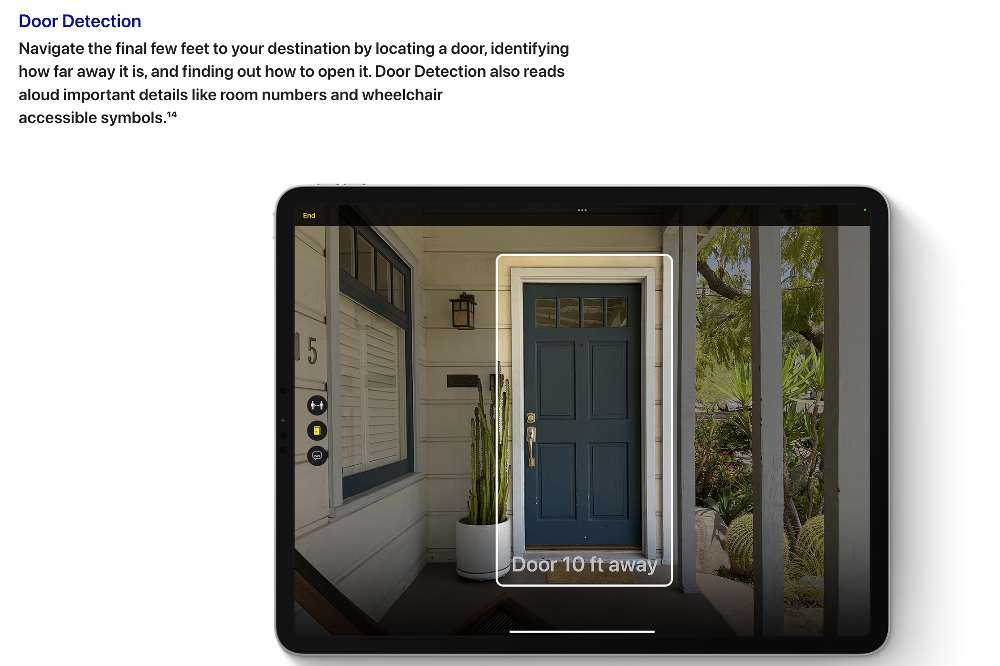
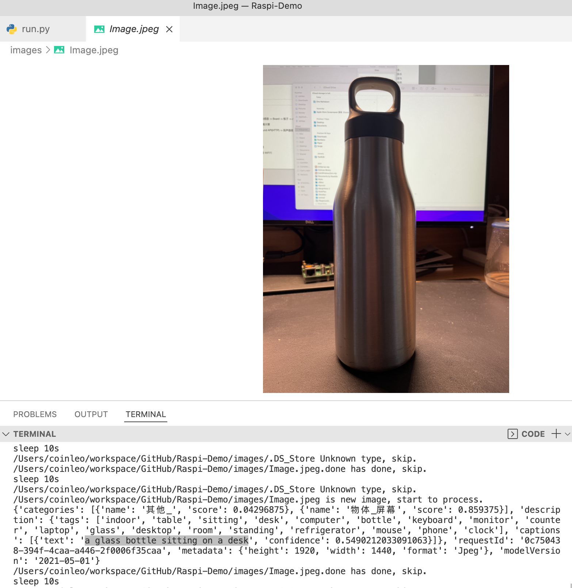
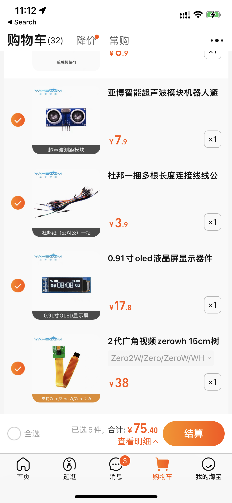

# 基于树莓派的无障碍环境提示器计划书

## 背景介绍

拥有一双健康的眼睛，对人类日常活动的重要性不用多说。有研究表明，人类日常获取的信息中约有 83% 来自视觉[1]。而盲人这一特殊群体，由于种种原因无法通过视觉获取周围环境信息。现存保障盲人安全出行的方式主要有无障碍设施、导盲犬和导盲杖[2]。但实际情况是，城市盲道经常被占用，导盲犬训练成本也很高，全国在服役的导盲犬数量不足 100 只[3]。

近几年计算机软件和硬件技术快速发展，移动便携式终端设备也越来越成熟，可穿戴设备开始有了更多想象空间。这让我们有机会尝试用更低成本的方式帮助盲人群体，让他们更方便地了解周围环境。

本设计拟充分利用树莓派及其外设，实现一个无障碍环境提示器，在用户出行或室内活动时，辅助感知周围环境情况。

## 设计内容和方案

1. 数据采集模块
- 超声波传感器
- 摄像头传感器

2. 数据处理模块
- Azure 图像认知服务
- Azure 语音合成 TTS(TextToSpeech) + 翻译

3. 人机交互模块
- LED 状态指示
- 按键操作
- 语音输出

原型图：
(/images/raspberry-pi-accessibility-environment-detector_2.jpg)

## 可行性分析
### 技术可行性

树莓派提示器通过摄像头捕获图像帧，利用 HTTP 协议将图像数据传输给 Azure 认知服务进行处理分析，并将识别结果返回给树莓派。同时，树莓派结合超声波传感器识别主要障碍物距离，根据图片信息和距离信息生成提示内容，再结合 Azure 进行语音合成，最后调用语音模块输出提醒。

#### 树莓派

1. 利用 GPIO-Zero 控制各种传感器；
    (/images/raspberry-pi-accessibility-environment-detector_3.jpg)

1. 利用超声波传感器识别放在周围的主要障碍物

  超声波的产生需要依靠超声波发生器，目前比较常用的是压电式超声波发生器。超声波测距方法有多种，常见的是基于相位、基于声波幅值，以及基于往返时间的检测方法。三者里，基于往返时间的方案优势更明显，应用也更广。

  基于往返时间的超声波测距原理很直观：超声波发射器发出信号，遇到探测物体后折返，由接收器接收。已知声音在空气中的传播速度，再计算信号往返时间，就可以得到障碍物距离，足够用来做提示功能。
  > 超声波测距的公式表示为: L=C×T/2 其中，L 表示测量距离;C 是传播速度; T 为从发出到接收超声波的时间差。
  (/images/raspberry-pi-accessibility-environment-detector_4.jpg)

#### Azure认知服务

1. 图像分析-图像说明

3. 文本转语音

### 经济可行性
- Raspberry Pi Zero 2W: 15$（95 RMB）
(/images/raspberry-pi-accessibility-environment-detector_6.jpg)
- 摄像头传感器、超声波传感器、OLED、按键、杜邦线等：75 RMB

- Azure 图像分析、认知服务、翻译订阅教育计划: 0
(/images/raspberry-pi-accessibility-environment-detector_8.jpg)

(/images/raspberry-pi-accessibility-environment-detector_9.jpg)

## 实施计划
### 主要方案
1. 按钮/拾声器/App(?) -> 驱动摄像头传感器 -> RaPi -> Azure Image API（HTTP）-> 周围环境状态
2. 超声波传感器 -> 主要物体(?)距离计算
3. 结合前两步的结果 -> Azure Sound API（HTTP）-> 驱动扬声器或耳机提示最终结果
4. LED 显示基本情况，视工作量决定

### 主要问题
1. 驱动各种外设
2. Raspberry Pi GPIO 编程
3. Pi 网络通信，网络从上机位来？Wi-Fi？
4. 主要物体判断是否准确
5. 实时性（延迟）优化问题
