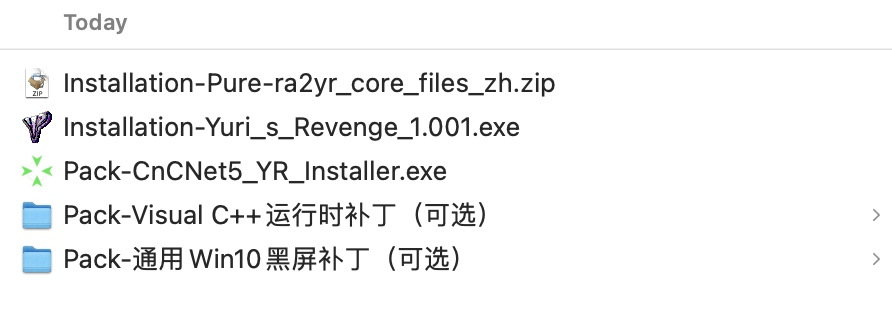
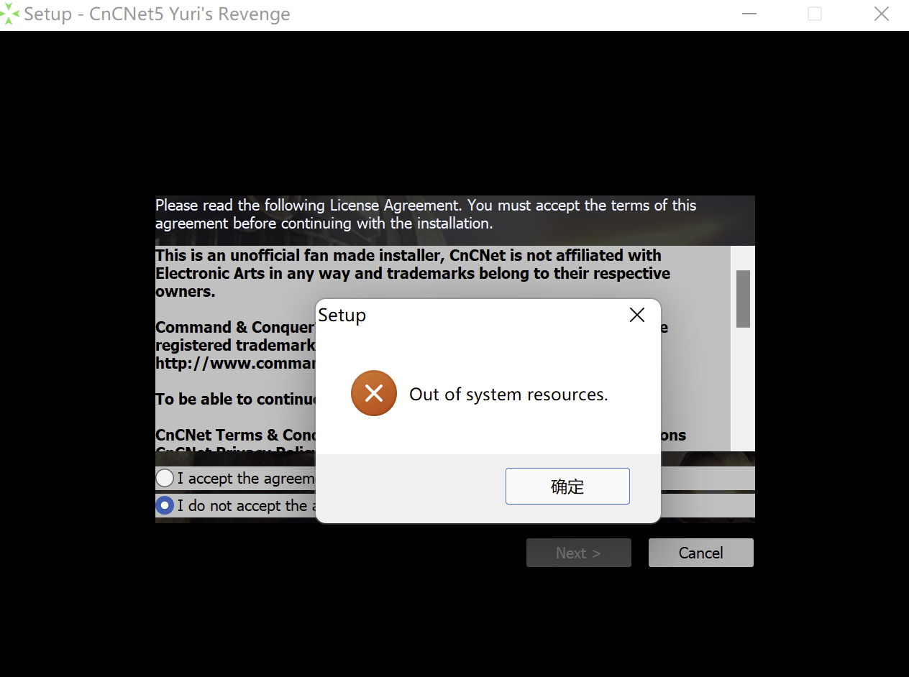
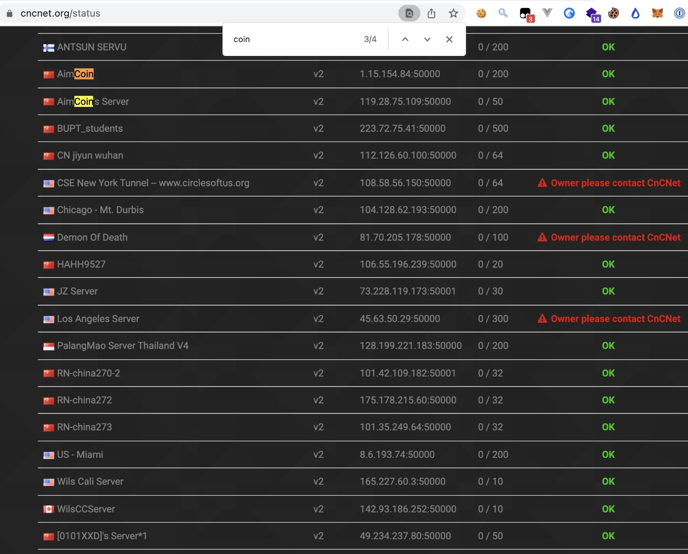

经测试，以下方法适用于 Windows 10、Windows 11（ARM），更多环境请自行测试。

安装后，不仅可以打单机剧情线，具体看安装包完整程度，还能通过 CnCNet 和朋友、网友联机对战。

本文用到的安装包合集下载链接：https://public.liaoguoyin.com/public/RA2/RA2.zip

# 1. 安装 Red Alert 2

有三种安装方式，任选其一：

1. [正版原版游戏包](https://www.origin.com/hkg/en-us/store/command-and-conquer/command-and-conquer-the-ultimate-collection)（某宝 License Key 90 CNY）
2. Installation-Pure-ra2yr_core_files_zh.zip 解压
3. Installation-Yuri_s_Revenge_1.001.exe 直装

# 1.1 安装运行时环境

[VC+ 运行时下载安装](https://docs.microsoft.com/en-US/cpp/windows/latest-supported-vc-redist?view=msvc-170)

# 2. 安装 CnCNet 平台

安装 `Pack-CnCNet5_YR_Installer.exe`，安装目录选择第一步安装的 Red Alert 2 根目录。

> 安装过程中可能弹红框报错，不用太担心，狂点下一步就行。

# 2.1 自装 CnCNet 中转服务器（可选)

[How to Host a CNCnet Server](https://forums.cncnet.org/topic/6325-how-to-host-a-cncnet-server/)

*The servers will not show up instantly on the website, it can take up to 4 hours*

部署完之后需要等待 4h 左右，可以在 [CnCNet Services Status](https://cncnet.org/status) 查询到自己的服务器。

推荐使用 `AimCoin`、`AimCoin's Server` 这俩服务器。这是我和朋友自建的，已经用过一段时间，效果还不错。服务器还有几年到期，正常情况不会关。

# Related

1. [CnCNet 官网](https://cncnet.org/red-alert-2)
2. [童年回忆：Red Alert 2](https://wzyboy.im/post/1279.html)
3. 在 MacBook M 系列上安装 ARM Windows 虚拟机运行 Red Alert 2，可能遇到的问题：
   - 在 M1 MacBook 上安装 Red Alert 2: [Red Alert 2 running on M1 MacBook](https://www.reddit.com/r/commandandconquer/comments/pjxqh6/red_alert_2_running_on_m1_macbook/)
   - M1 Macbook 外接显示器可能无法运行 CnCNet(还未解决): [Yuri&#39;s Revenge crashing after launch](https://forums.cncnet.org/topic/12199-yuris-revenge-crashing-after-launch/#comment-85769)
   - Parallels Desktop 虚拟机鼠标可能不符合滚动方向，通过修改注册表进行: [Windows 修改鼠标滚轮方向](https://www.chuchur.com/article/window-mouse-roller-reverse)
