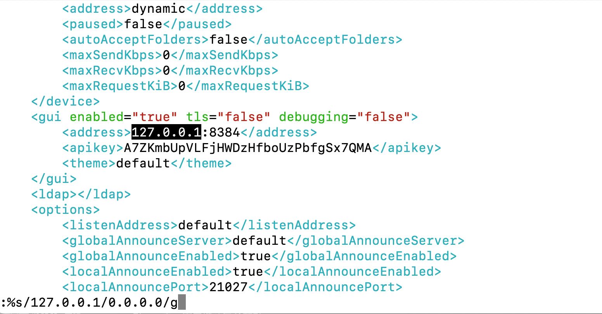

# rsync 和 syncthing 同步

**rsync** 是一个数据同步工具，而 **syncthing** 是一个连续文件同步程序。它们都可以用来同步文件，但有不同的使用场景和特点。

## rsync

`rsync` 是一个非常强大的文件和目录同步工具。它可以在本地或通过网络，在两个位置之间复制和同步文件。它会优化数据传输，只传输两个位置之间的差异部分。

下面记录几个常见用法。

### 1. 本地文件同步

如果你想在本地文件系统内的两个位置之间同步文件或目录，可以使用以下命令：

```
rsync -av /source/directory/ /destination/directory/
```

- `-a` 表示归档模式，会保留文件属性，如时间戳、权限等，并递归复制目录。
- `-v` 表示冗余模式，会显示正在传输的文件。

注意，源目录后的尾随斜杠（`/`）很重要。它告诉 `rsync` 要同步目录内容，而不是目录本身。

### 2. 通过 SSH 同步到远程服务器

也可以使用 `rsync` 通过 SSH 同步到远程服务器：

```
rsync -av /local/directory/ username@remote_host:/remote/directory/
```

### 3. 从远程服务器同步到本地

反过来，也可以从远程服务器同步到本地目录：

```
rsync -av username@remote_host:/remote/directory/ /local/directory/
```

### 4. 删除目标目录中不存在于源目录中的文件

如果想让目标目录和源目录完全一致，也就是删除目标目录中不存在于源目录的文件，可以添加 `--delete`：

```
rsync -av --delete /source/directory/ /destination/directory/
```

### 5. 其他有用的选项：

- `--exclude`：排除匹配模式的文件或目录。例如：`--exclude '*.txt'` 会排除所有 `.txt` 文件。
- `--dry-run`：模拟同步过程，不实际传输任何文件，但会显示哪些文件将被同步。
- `--progress`：显示文件传输的进度。
- `-z`：压缩数据以减少传输量。

比如想先看看哪些文件会被同步，但不实际执行，可以运行：

```
rsync -av --dry-run /source/directory/ /destination/directory/
```

这只是 `rsync` 功能的一部分。它的选项很多，真要长期用，还是建议看手册：

```
man rsync
```

## syncthing 配置流程

Syncthing 配置涉及两台机器，主要流程是安装、修改配置文件、配置为启动项。

具体来说，在两台机器上安装 syncthing：

1. 更新包列表：sudo apt update

2. 安装 syncthing：sudo apt install syncthing

3. 启用 syncthing 服务：sudo systemctl enable syncthing@root.service

4. 启动 syncthing 服务：sudo systemctl start syncthing@root.service

5. 修改配置文件，确保能被其他主机访问：`vi /root/.config/syncthing/config.xml`，将 `127.0.0.1` 改成 `0.0.0.0`

   

6. 重新启动 syncthing 服务，确保配置更改生效：sudo systemctl restart syncthing@root.service

7. 如果你希望仅发送文件而不接收（设置为"Send Only"模式），可以在配置中对相应的设备或文件夹进行修改。

## 效果验证

为了验证 `syncthing` 是否正确工作，可以这样检查：

- 访问 Web UI：在浏览器中打开 `http://localhost:8384/`。如果能看到 Syncthing 控制面板，说明它正在运行。
- 在两台设备上都安装 syncthing，并确保它们都在同一网络中。尝试在一台设备上添加文件或目录，并查看是否可以在另一台设备上同步。
