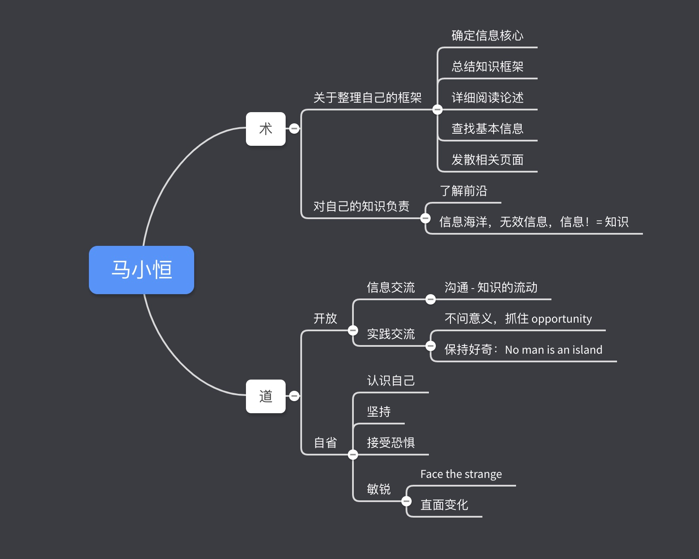
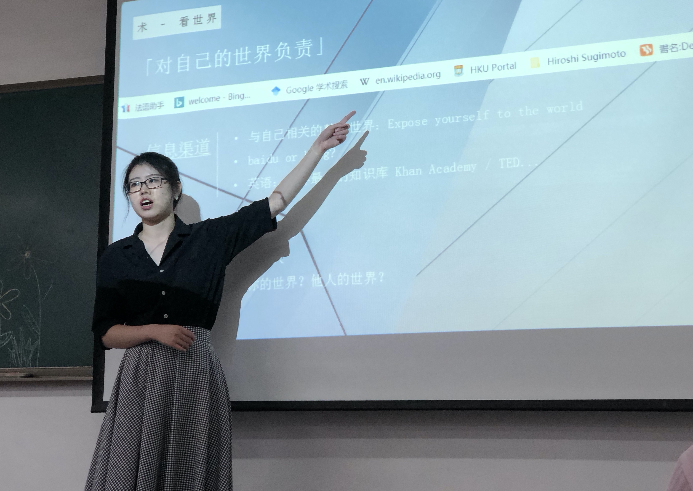

下次李杰学长回来的时候，赶紧整个一样一样的。

<!-- more -->

偶然的机会，居然能在破破的 LNTU 听到香港大学学姐的讲座。

不得不感叹，气质气场在线。说话有条有理、不慌不忙，谈观点的时候也很抓重点，长眼了。

# Process

 
主题是「面向未来」。当时做了点笔记，回过头来整理时，又觉得有点鸡汤向，主要两大块：

然后，现场提问环节，有位同学酝酿了无数个彩虹屁之后，憋出一个焦虑、定位不准、怎么学法语英语之类的问题。
学姐的回答：

- 这很正常
- 现在 Mooc 很丰富，你应该自己去学
- 这很正常
- 这很正常
- ...

这...第一次见这么实诚的现场回答。

**话说回来，说着是去干了碗鸡汤，还是有几点引起共鸣：**

# 1. 沟通

自闭不好

之前和朋友聊天，说到很多时候想封闭自己。自个儿觉得在这样一个环境下，沟通就是白瞎。

个人倾向于闭嘴，并且觉得在说了也没用的前提下，还未必能把自己想的表达清楚，实在费劲。

除了厌恶交流，有事乱想一通时，也会把想到的写下来，往备忘录一丢，然后听歌干熬。

于是这样半年下来，我比其他任何人都要了解自己得多得多得多得多。这很悲哀。

都知道信息流动时会一层层递减，但因噎废食，没有输出、没有沟通，那就是 0，那直接没你了。

实际仔细想想，可说可不说的那些事，是自己圈子窄，少说点倒也没什么大问题。

但是，这种态度不应该被带到生活学习的其他方面去。这样会让自己在自卑和自负中沉沦。

# 2. 抓重点

没有核心，胡子眉毛一把抓的下场就是什么都做不出来，自信心也很容易受挫。

最近的一个感触就是：写东西一段要有一个重点，摄影一张照片要有突出的主题，阿猫阿狗都要有个重点..

前面很长一阵子感觉一团乱麻，什么都没做成，就是这个锅。

# 3. 对知识负责

当然是摒弃垃圾信息流。她说：「现在的信息圈子绝大多数都很杂乱冗余，有选择地获取优质信息流非常有必要。」

其实这个观念最开始是从 czp 老哥那里感受来的
> czp: 求求你不要再百度了，立即科学上网 Google，打开官网文档，立即精通

> czp: 你下次要是看谁不顺眼，就告诉他：CSDN 可以学到东西

# 4. 接纳变化中的自己和他人

自己接受自己还行。去年不喜欢的衣服鞋子丢了可以买中意的，喜欢听的歌不喜欢了可以立马删掉，以前发的微博今年觉得尬人可以隐藏掉。自己接纳自己很简单，关键是要自醒，没有一直一成不变，没有一直咸鱼就行。

接纳变化的他人就麻烦了，没办法用标准去框框别人

其实接纳变化的他人这个观点，个人是不认同的：

他变任他变，聊不来了就聊不来了。我能接受，但不一定要接纳，我有自己的猪脑子（高中班主任教导得是）。

但是，看见对方的变化，应该是引发思索和碰撞的好机会。

 

# Recap

要说这个讲座的意义：

算是给葫芦岛小市民开了有意义的小课堂，长了点眼界，也引发了一丢丢思辨共鸣。

比较 * 的是，这样一个干货讲座是在小教室办的，听众几乎来自同一个专业，~~主办方凑人~~。问了里边一个同学来的理由，很简单：能加创新学分 :X

讲座快结束的时候，脑子里疯狂冒出来一个想法：等下次李杰学长回来的时候，联系李新春老师，赶紧赶紧整个讲座，把见闻带回来给岛上的小市民看看。
