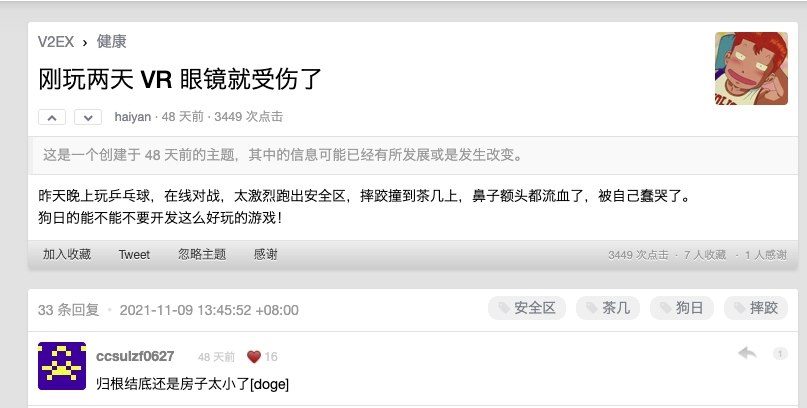

关于 VR、AR、MR、XR 的一些杂想。

现有技术体系里，大部分交互和体验还是面向 2D 维度的。屏幕里能看见很多东西，但所见和所交互的维度缺失很严重。纸片人、等身抱枕这类东西，某种程度上就是用户对更多维度体验的补偿。

现阶段 XR 体验基本还是围绕游戏展开，体验边界有限，也很容易给人一种技术发展正在把人往娱乐坑里拖的错觉。

未来可能：

1. 下一代计算平台
2. 云计算
3. 亟待一款突破级别的小型 XR 设备

几个概念先放在这里，后面再展开：

- 云计算的本质，是把计算资源协调在一起，向外提供运算能力。
- 物联网的本质，是物物相连之后改变产业里的工具和流程。
- 区块链的本质，是去中心化、全民参与记账的方式。
- 人工智能的本质，是让机器实现人难以直接完成的认知和运营能力。
- 智慧营销的本质，是以个人为中心，借助 AI 算法和精准投放，满足消费者个性化需求，并帮助企业直达营销结果。

每个公司都有自己的 DNA。苹果本质上是一家研究手指与屏幕交互的公司，它帮助人类和数字化世界发生关系。微软更像一家鼠标键盘公司，帮助企业实现信息管理、信息流通和流程数字化。谷歌的本质，是把一个大的仓库建成一台计算机。

罗永浩：选择 AR，一个很重要的因素是觉得时间窗口对我们这个级别的团队来说特别好。大的科技公司基本上没有 all-in AR 的，唯一号称重兵做 AR 的只有苹果。但从供应链了解的信息来看，苹果做的是一个 AR 兼 VR 的 XR 设备。

# Related

[对话罗永浩：再创业可能后悔，不再创业百分之百后悔](https://mp.weixin.qq.com/s/l-jZBoVC29H-dyGeWL_NDQ)

[活动作品【亦】唠唠 VR·AR·MR：智能手机之后会是？ ](https://www.bilibili.com/video/BV1zN411Z7kj)

[电丸科技 AK](https://www.youtube.com/watch?v=XOfCBmz3oAI)

[活动作品【何同学】2021 年了，AR 眼镜可以做什么？ ](https://www.bilibili.com/video/BV1RA41157hM)
