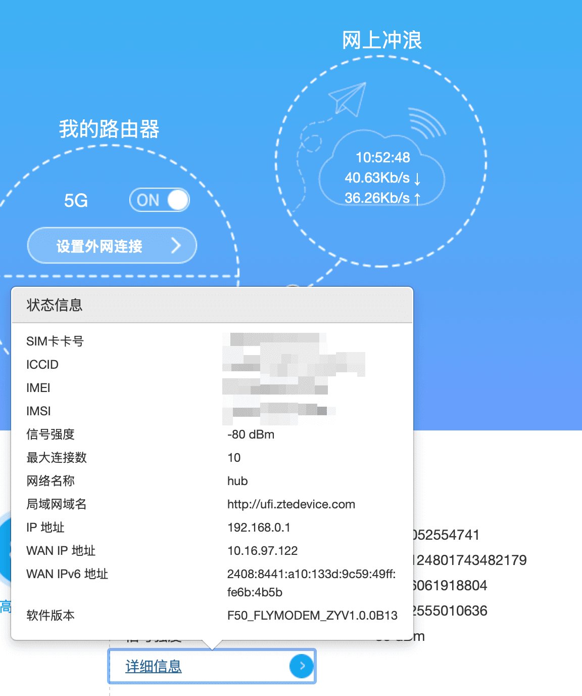

## macmini + f50

## IPv6 不可用

F50 本身能获取到 IPv6 地址，但是无法继续下放给下游设备。

IPv6 可用性检查网址：[https://test-ipv6.com](https://test-ipv6.com)

随身 WiFi 不像家宽一样能获取 IPv6-PD 地址，通常只分配 64 位前缀的 IPv6 地址，下游设备无法直接获得公网 IPv6 地址。[因此需要 IPv6 中继，才能让连接到路由器的设备获取公网 IPv6](https://post.smzdm.com/p/azo0zg85/)。

*   有防火墙
    
    *   IPv6 防火墙是指光纤调制解调器（光猫）内置的安全功能，用于管理和保护 IPv6 网络流量。有些路由器不支持自己设置防火墙规则。
        
*   IPv6 PD 下放才能用
    
    *   IPv6 PD（Prefix Delegation）是一种用于 IPv6 地址分配的机制，主要用于在网络中动态分配 IPv6 前缀。这里还要确认到底是 ISP 支持问题，还是设备限制。
        
*   [不支持 IPv6 入栈](https://www.right.com.cn/forum/thread-8431618-1-1.html)
    
    *   无法识别或处理通过 IPv6 协议传输的数据包。换句话说，入栈接收后，无法将数据包传递到协议栈中的相应层进行处理。
        

## Ref

QCI: [https://sspai.com/post/92452](https://sspai.com/post/92452)

ZTE: [http://192.168.0.1:2333/](http://192.168.0.1:2333/)

硬件体验：[https://blog.twofei.com/1546/](https://blog.twofei.com/1546/)

CUDY+F50: [https://cn.thelynan.com/cudy-tr3000-and-zte-f50-setup/](https://cn.thelynan.com/cudy-tr3000-and-zte-f50-setup/)
