在 App Store，「恩施人才」评分 1.3，算得上是我目前见过最「有口碑」的应用。唯一拉高平均分的五分评价也在夸「程序猿编程像 cxk」，有多烂就不喷了，看图 🤣。

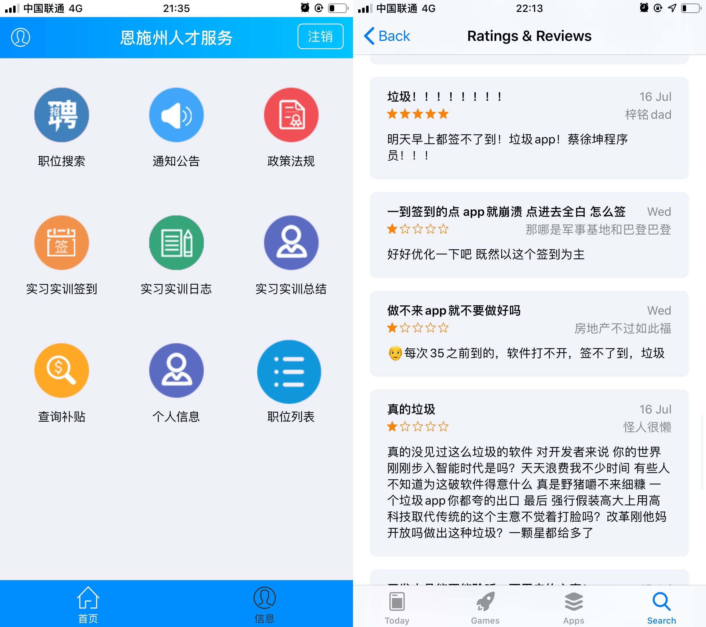

~~位置签到每天要在规定时间打卡，要想不在公司还光明正大地摸鱼。~~ 第一反应当然是虚拟定位（iOS 哭），但每天要点开两次 App 打卡，显然不够优雅。

换个思路，可以研究签到 HTTP 请求本身，每天按时执行脚本，解放双手。

> 懒得看中间的瓜皮分析过程，可以直接滑到最下面看应用部分

## 抓包

常见逆向办法分为两种：

1. 静态分析法：在不执行应用的情况下，对应用进行静态分析，比如获取应用文件系统结构、分析本地文件、反汇编分析代码逻辑。
2. 动态分析法：在应用执行过程中进行动态分析，通过调试分析内存状态，观察应用文件和网络请求，分析应用内部结构与原理。甚至可以用工具动态修改内存、打补丁。

一般来说，两种办法需要结合使用。但这次尝试中，外包程序猿让一切变得简单了起来。

`Thor`（iOS 上非常好使的抓包工具），启动！

走一遍流程之后，筛选 POST 请求，我们可以得出下面的接口：

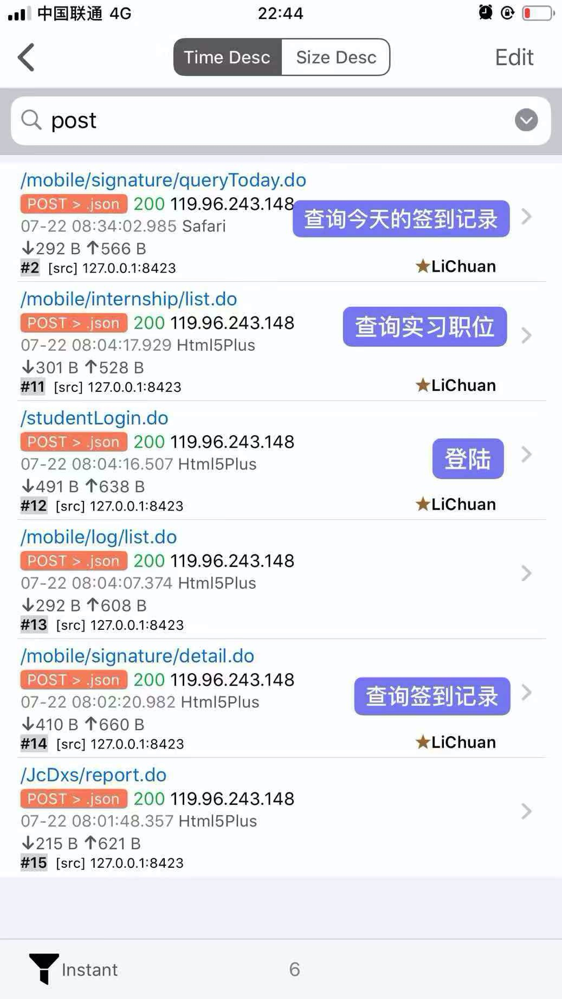

接下来详细看看。

> （拒绝查水表，下面的 HTTP 请求都已经做过二次处理，同时选择性省略了无关字段。）

### 登陆接口

首先映入眼帘的 URI 是 `/studentLogin.do`，很显然是登录请求，Request 长这样：

```
POST http://119.96.243.148:90/studentLogin.do HTTP/1.1
Content-Type: application/x-www-form-urlencoded
Referer: http://119.96.243.148:90/pages/esrc2019071902/mobile/ioslogin.html
User-Agent: Mozilla/5.0 (iPhone; CPU iPhone OS 13_0 like Mac OS X) 

usercode=15172215000&userpass=testmima&pushcid=dbba2782f2ed1bb7f3b0a37d5a80a82c
```

经过多次登录发现，Request Body 中第三个参数 `pushcid` 没有太多实际意义，也就是说 `pushcid=null` 也完全可以。

在 Response Headers 中可以看到字段 `set-cookie : ["JSESSIONID=84202004044C4CE0BAD531C313C5BAE3; Path=/; HttpOnly"]`。

首次登录时，如果请求头没有带 Cookie，服务器会在响应头里返回一个 `Set-Cookie` 字段。浏览器端会在一定时间内被设置唯一身份标识，以后每次域内请求都会带上这个 Cookie，而不是每次都带用户名密码。

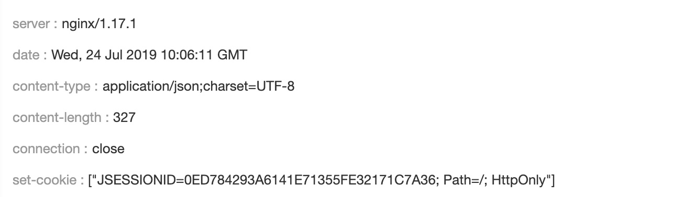

```Response
{
 "msg": "用户登录成功!",
 "object": {
  "user": {
    ...
   "fjcXzq":"3",
   "sdm": "422802191101011111",
   "sid": "c7d0de0ff62245a79657b65a8804d63d",
   "sjylx": "实习实训",
   "sxm": "姓名咕咕咕",
  }
 },
 "success": true
}
```

Response Body 里，中英混沌匈牙利缩写命名法都来了（cxk 程序员干的好事）。同时可以看到姓名、身份证和 `sid`。姑且不知道 `sid` 的实际意义，先放着。另外多次实验发现，这个字段只和账号有关。

总结一下：**这个登录接口的使命，就是用用户名密码作为请求体，在响应头中取得 Cookie，供后续请求使用。**

### 查询接口

#### 岗位查询

```Request
POST http://119.96.243.148:90/mobile/internship/list.do HTTP/1.1
Cookie: JSESSIONID=84202004044C4CE0BAD531C313C5BAE3
Referer: http://119.96.243.148:90/pages/esrc2019071902/mobile/internship.html?type=signature
User-Agent: Mozilla/5.0 (iPhone; CPU iPhone OS 13_0 like Mac OS X) 
```

Request 中没有比较有用的信息，就是带 Cookie 访问接口。

```Response
[
 {
  "sid": "9f14525f6948475ebebdf99be5b9faae",
  "ssxzt": "实习中",
  "syrdw": "**xx支公司",
  "szwmc": "**工作人员"
 }
]
```

Response 中又来了个 `sid`。多次实验发现，每个账号独立对应一个 `sid`，但和上文登录接口里的 `sid` 不一致，作用不详，还是先放着。

#### 个人资料查询

```Request
POST http://119.96.243.148:90/JcDxs/findInfoById.do HTTP/1.1
Cookie: JSESSIONID=84202004044C4CE0BAD531C313C5BAE3
User-Agent: Mozilla/5.0 (iPhone; CPU iPhone OS 13_0 like Mac OS X) 
Referer: http://119.96.243.148:90/pages/esrc2019071601/mobile/self/userinfo.html
```

继续看查询个人信息的接口。Request Body 中没有参数，仅仅通过 Cookie 就能得到下面的内容。

```Response
{
    "fjcXtzdXl":12,
    "sbyxx":"xx大学",
    "sid":"c7d0de0ff62245a79657b65a8804d63d",
    "sjg":"湖北省恩施州xx市",
    "sjtdz":"xx市",
    "skhhmc":"中国邮政储蓄银行湖北省xx市天桥支行",
    "slxdh":"15977775000",
    "smm":"*明文密码！*",
    "ssfzfmzp":"/upload/2019/7/18/41bf7dd044a1d744f75960b6.jpg",
    "ssfzhm":"422802112111113232",
    "ssfzzmzp":"/upload/2019/7/18/1018920a3b46ddd09cscf0bcc4.jpg",
    "ssxzy":"金融",
    "sxb":"女",
    "sxh":"201721000000",
    "sxm":"姓名",
    "sxszmzp":"/upload/2019/7/18/cb840743413242d5e8a1b9585a8.png",
    "sxzq":"3",
    "syhkfmzp":"/upload/2019/7/18/3a5ace092d5339fb976f009.jpg",
    "syhkzmzp":"/upload/2019/7/18/033b1d58a4b399bd8e65ad5c5ca.jpg",
    "syhzh":"6217995200223331",
    "szp":"/upload/2019/7/18/340c2dba04429a463d46aaaa8.jpeg",
    "szsxxdz":"xx市xx1号"
}
```

`sid` 与登录接口中的 `sid` 一致，同时这里包括银行卡、身份证、学籍信息照片等一系列个人资料。并且 **没有做任何加密处理，甚至连密码都是明文在这个返回体中**。这。。「cxk 程序员 nb」。

#### 签到记录查询

```Request
POST http://119.96.243.148:90/mobile/signature/list.do HTTP/1.1
Content-Type: application/x-www-form-urlencoded
Cookie: JSESSIONID=84202004044C4CE0BAD531C313C5BAE3
Referer: http://119.96.243.148:90/pages/esrc2019071902/mobile/signature/list.html
User-Agent: Mozilla/5.0 (iPhone; CPU iPhone OS 13_0 like Mac OS X)

sxsxid=9f14525f6948475ebebdf99be5b9faae&rows=10&page=1
```

Request Body 中的 `rows，page`，修改字段值发包后发现，它们分别代表响应体获取数据的条数和页数。

另外重要的请求凭证就是 `Cookie，sxsxid`。多次请求发现 `sxsxid` 不变，并且和上面查询职位返回的 `sid` 一毛一样。换个账号，改掉 Cookie 和 `sxsxid`，也能成功复现。

```Response
[{ "_page_row_num_hb":1,
        "dsj":"2019-07-24 08:32:51",
        "sdd":"xx文化传媒大楼",
        "sid":"f139ef53ba634cb89185a6941f02b074",
        "slx":"签到"
    },
    {
        "_page_row_num_hb":2,
        "dsj":"2019-07-23 14:25:34",
        "sdd":"xx文化传媒大楼",
        "sid":"0aebd34e98584f5ebc6b41d38bb63aac",
        "slx":"签到"
}]
```

在上面的响应体中，我们可以看到又出现了新的 `sid`，同一字段一个接口一个意义，? 这人怎么满脑子 sid

另外，关于查询签到，还发现了这条查询单条记录详细信息的接口

```Request
POST http://119.96.243.148:90/mobile/signature/detail.do HTTP/1.1
Content-Type: application/x-www-form-urlencoded
Cookie: JSESSIONID=84202004044C4CE0BAD531C313C5BAE3

sid=0aebd34e98584f5ebc6b41d38bb63aac
```

上面这个参数 `sid` 即上面所有记录中单个签到记录的详细信息

```Response
{
    "dsj":"2019-07-23 14:25:34",
    "fywJxsxsxb":"9f14525f6948475ebebdsdfe5b9faae",
    "ilx":1,
    "sbz":"签到",
    "sdd":"xx文化传媒大楼",
    "sid":"0aebd34e98584f5ebc6bdf8bb63aac",
    "sjd":"108.948833",
    "sjwdzbxlx":"腾讯地图",
    "swd":"30.283992"
}
```

通过这个命名法，我们可以大胆猜测 `sjd，swd，sdd` 分别代表经纬度和地址名，同时 `fywJxsxsxb` 字段和 `sxsxid/查询岗位字段 sid` 相同。

通过修改 sid = f139ef53ba634cb89185df941f02b074，可以成功得到该次签到记录的详细信息

**这里甚至还发现，我仅仅通过 sid 就能查询别人的签到记录，辣细真的🐂🍺**

### 签到接口

最核心的部分来了，签到记录的发包当然是终极目标，通过 URI（signature/save.do）也能大概看出这条请求的意义。

```Request
POST http://119.96.243.148:90/mobile/signature/save.do HTTP/1.1
Content-Type: application/json
Cookie: JSESSIONID=84202004044C4CE0BAD531C313C5BAE3
Referer: http://119.96.243.148:90/pages/esrc2019072201/mobile/signature/detail.html?sid=&selectLocation=1

{
 "dsj": "",// 通过下文知道是服务器当前时间
 "sid": "",// sid 居然为空，按理来说它的意义应该是将来 历史记录中的sid字段
 "sdd": "xx文化传媒大楼",// 位置名称
 "ilx": 1,// 展示未知
 "sjd": "108.948833",// 经度
 "swd": "30.283992",// 纬度
 "sjwdzbxlx": "腾讯地图",
 "fywJxsxsxb": "9f14525f69484dfsbebdf99be5b9faae",// 岗位查询中的 sid字段
 "sbz": "签到"// 签到 or 签退
}
```

Request Body 居然没有任何加密迹象，具体含义见注释。不过目前为止只是猜测，没有确凿证据。

```Response
{
    "dsj":"2019-07-23 14:25:34",
    "fywJxsxsxb":"9f14525f6df475ebebdf99be5b9faae",
    "ilx":1,
    "sbz":"签到",
    "sdd":"xx文化传媒大楼",
    "sid":"0aebd34e98584sdf6b41d38bb63aac",
    "sjd":"108.948833",
    "sjwdzbxlx":"腾讯地图",
    "swd":"30.283992"
}
```

可以看到，Response Body 和上文查询结果是一样的。

要想实现终极目标，构造签到请求，那么这条接口的每个字段都得搞清楚。

为了让自己账号保持干净的签到记录，最好不要随意修改字段测试关键步骤。可以说上面都是通过重复请求、一路猜测、看是否能复现摸出来的 🤣，显然不够有逻辑，也非常不靠谱。

除了抓包猜猜猜，还有一种方法就是所谓的 **静态分析**。因为 HTTP 请求都是手机里的 App 构造并发送出来的，只要大概搞清楚本地怎么构造请求体参数，问题就迎刃而解。

一般来说，稍微正常点的 App 都会有常见签名加密算法和代码混淆，所以逆向通常会有一系列操作：砸壳、定位、反混淆 etc.. 总之尽可能反汇编，再通过关键字段找对应代码，搞清楚请求构造流程。

但是今天这个 App 就不是一般的（笑）。通过签到请求头的 Referer 和之前抓包的请求，可以看到这样一个 URL: http://119.96.243.148:90/pages/esrc2019072201/mobile/signature/detail.html?sid=&selectLocation=1

点开，打开新世界。大概浏览一遍页面，签到请求就是从这里来的，那么继续顺藤摸瓜。

```
$.ajax({ 
            type: "POST",
            url: "/mobile/signature/save.do",  
            contentType: "application/json",
            data: JSON.stringify(window.pageJS.model.tableData),
            success: function(data) {  
               ...
            }
        });
```

其中 `data` 字段的 `tableData` 就是请求体 ，在当前页面搜索可以看到左下图

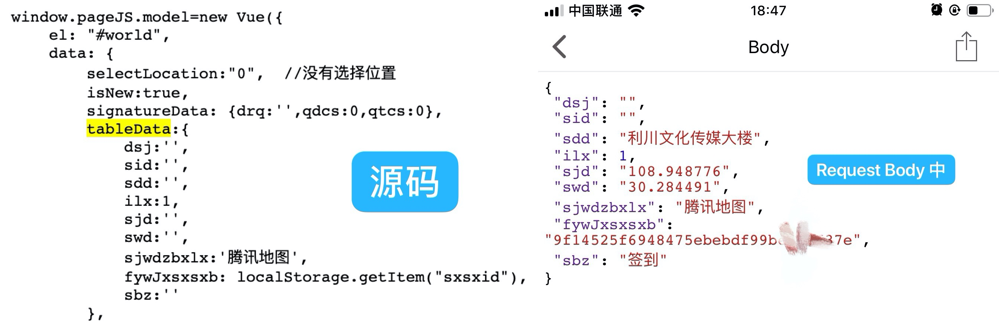

可以看到源码中的 `tableData` 字段和抓包得到的签到请求 Request Body 一模一样，找对地方了 lol。

`fywJxsxsxb`的来历是 `localStorage.getItem("sxsxid")`

本页面没能搜到，这是因为 localStorage 是 H5 的本地存储，`sxsxid` 是其他页面存下来的数据，本页面当然看不到怎么传参。但结合前面抓包实际值来看，`sxsxid` 其实就是获取岗位的 `sid`。

`dsj，sid` 在原始请求体里面是空值，说明本地没有作处理，由服务器生成
`sjd，swd，sdd` 调用了 腾讯地图API，直接获取到的当前位置的经纬度名称
`ilx` 字段代表签到签退

[ilx字段](./assets/8400154858_040395.jpg)

### 其他

看完请求字段，顺便喵喵其他部分，可以发现一个有趣的东西。

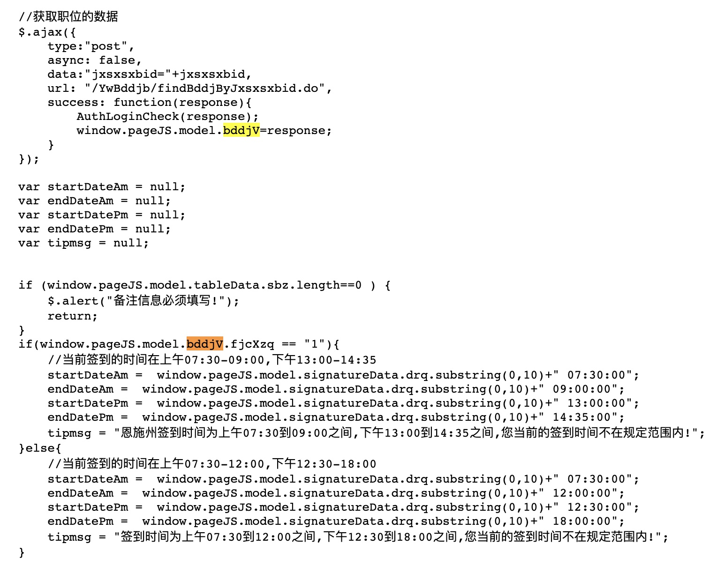

签到页面通过判断字段 `*.model.bddjV.fjcXzq == 1` 来决定当前是否能签到，而这个字段的值可以从上面信息查询接口里翻出来。我的账户这个字段值是 3，也就是第二种签到时间制。但是。。这 tm 和官方文件通知的一点都不一样啊。

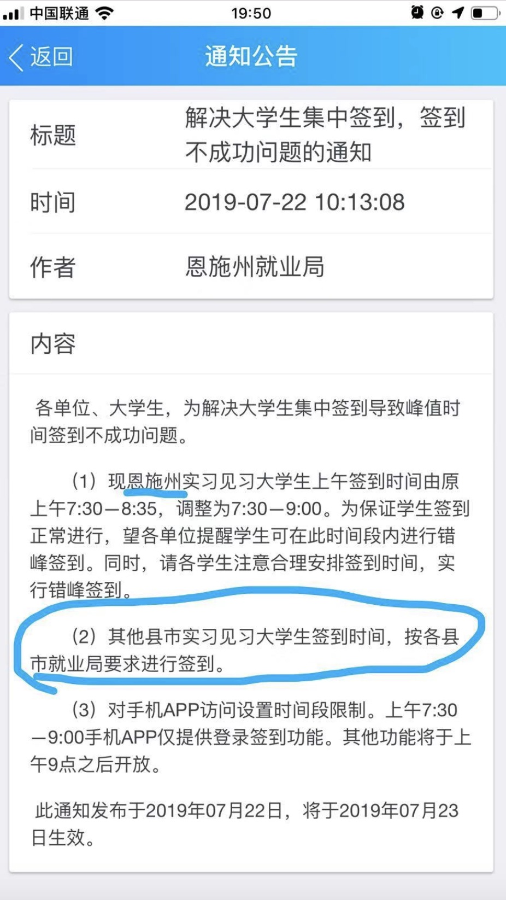

研读了多次之后发现，恩施州不包括下面的各县市么，这个通知应该是有歧义的，应该是恩施市实习大学生的 `*.model.bddjV.fjcXzq = 1`，其他县市的实习大学生 非1，执行第二种签到时间。

这个通知，变更几次了都没变更对，估计发通知的人都没搞清楚吧，这么看来，肉食者鄙好像不是没有道理的。

另外，这里的本地验证实际上非常不靠谱，我构造发送请求的时间似乎并没有被服务器验证，尝试了次晚上签到，果然成功，这也太水了点。。

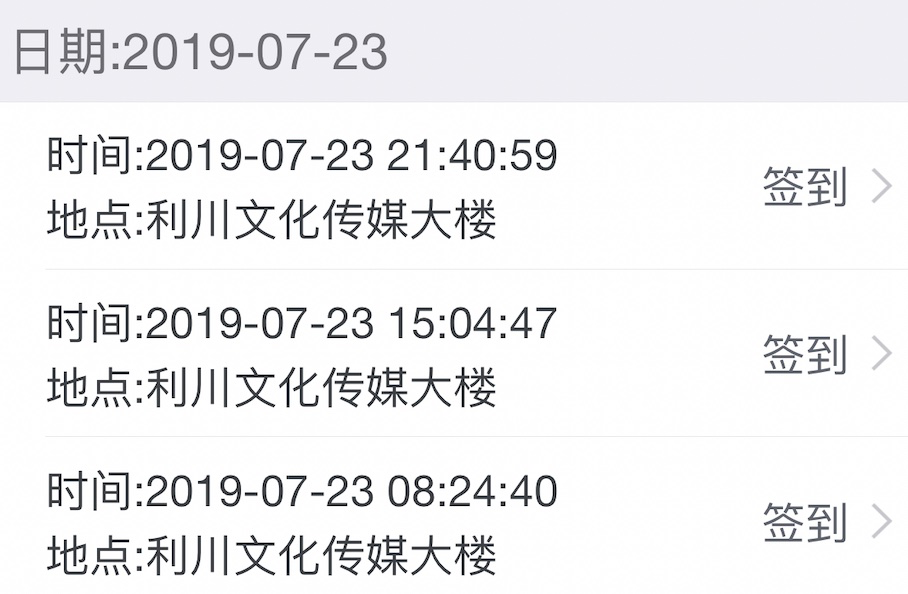

真是写得漂亮。虽然我没完整写过 App，但还是忍不住想喷这里面由不规范烂代码导致的各种信息资料安全问题。别问有什么资格喷，问就是有底气，因为我会写云上代码.jpg

## Python 签到脚本

脚本链接：https://gist.github.com/LiaoGuoYin/c7225657ac7ce18dff7e141604aef4d3

[https://gist.github.com/LiaoGuoYin/c7225657ac7ce18dff7e141604aef4d3](https://gist.github.com/LiaoGuoYin/c7225657ac7ce18dff7e141604aef4d3)

## 部署自动签到 - 应用

进入 [腾讯云无函数服务](https://console.cloud.tencent.com/scf/index)

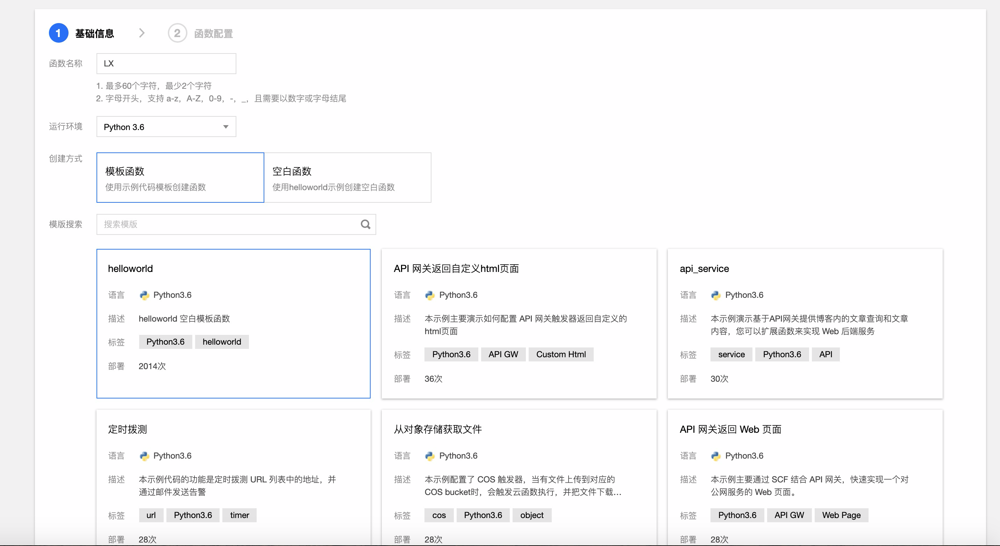

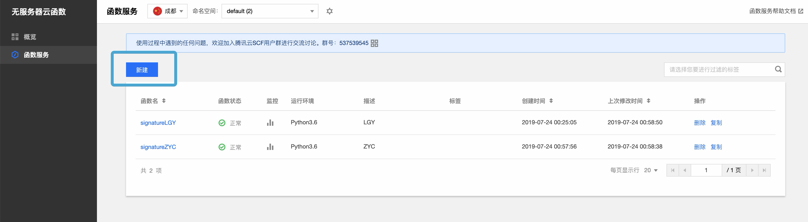

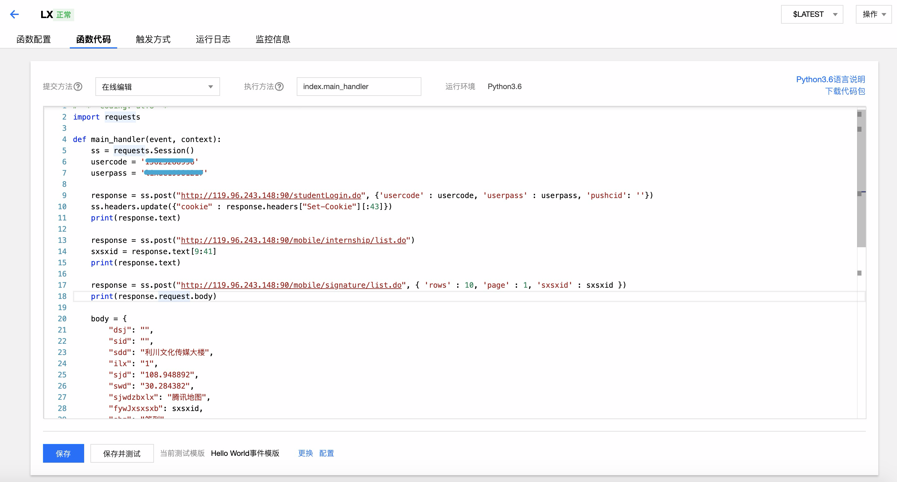

添加完成后，直接点进函数代码进来，粘贴代码并：

1. 填入用户名密码
2. https://lbs.qq.com/tool/getpoint/index.html 通过签到地址名来获取对应的经纬度，替换下面 body 中 sdd,sjd,swd 的字段值

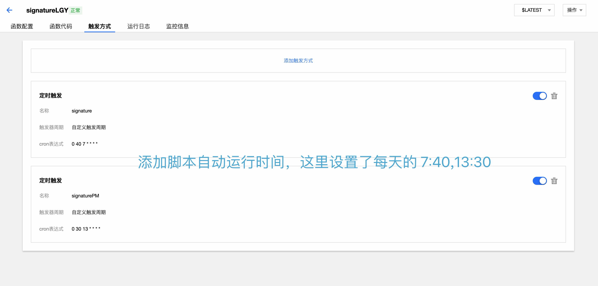

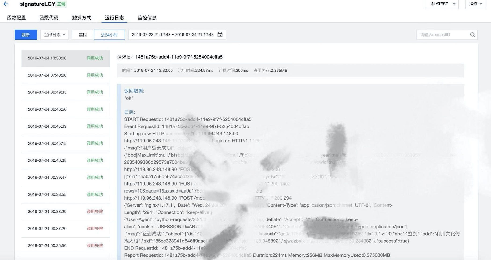

Done ! 🤣

到这里，那你已经精通怎么解放双手了。每天无函数服务会定时自动签到打卡。

不过保险起见，最好还是不时看看记录。接口一改，那就聊不来了。

**注：本文章仅作技术交流，模拟操作产生的后果自行承担，本人概不负责**

> 本文用到的技术极为浅显·真（希望看到的大佬不要取笑）
