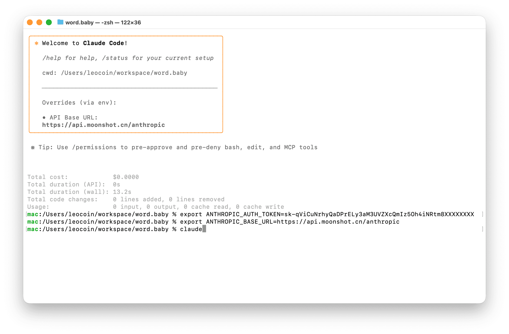
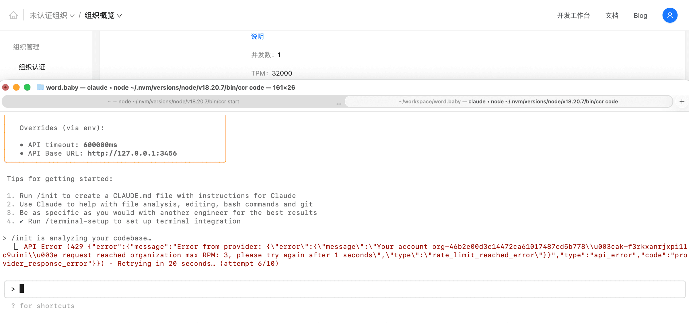
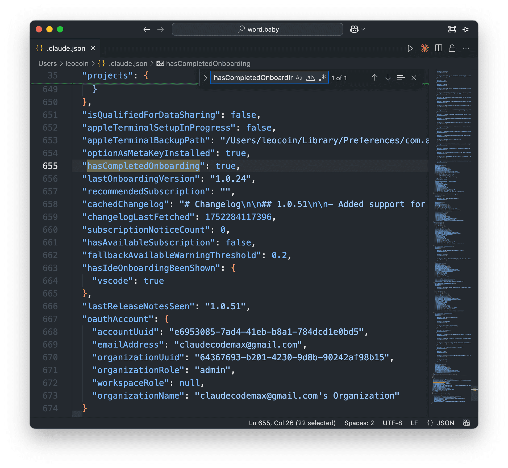
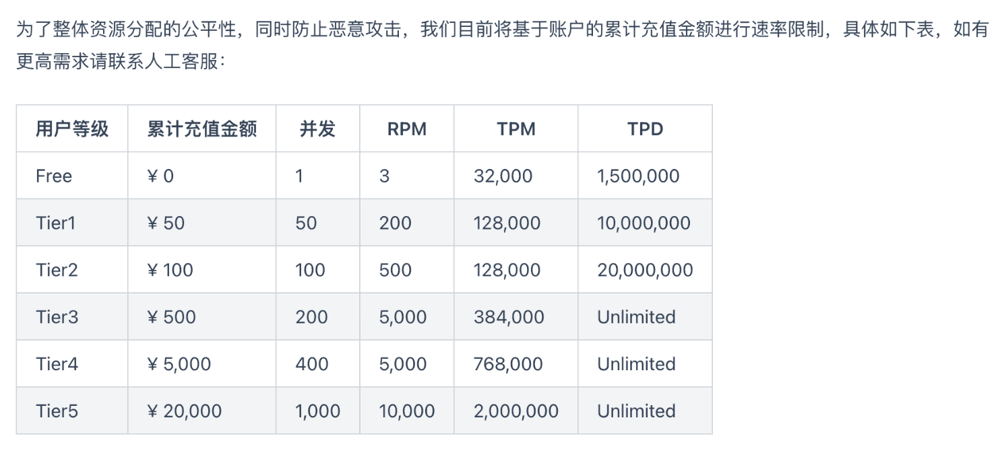
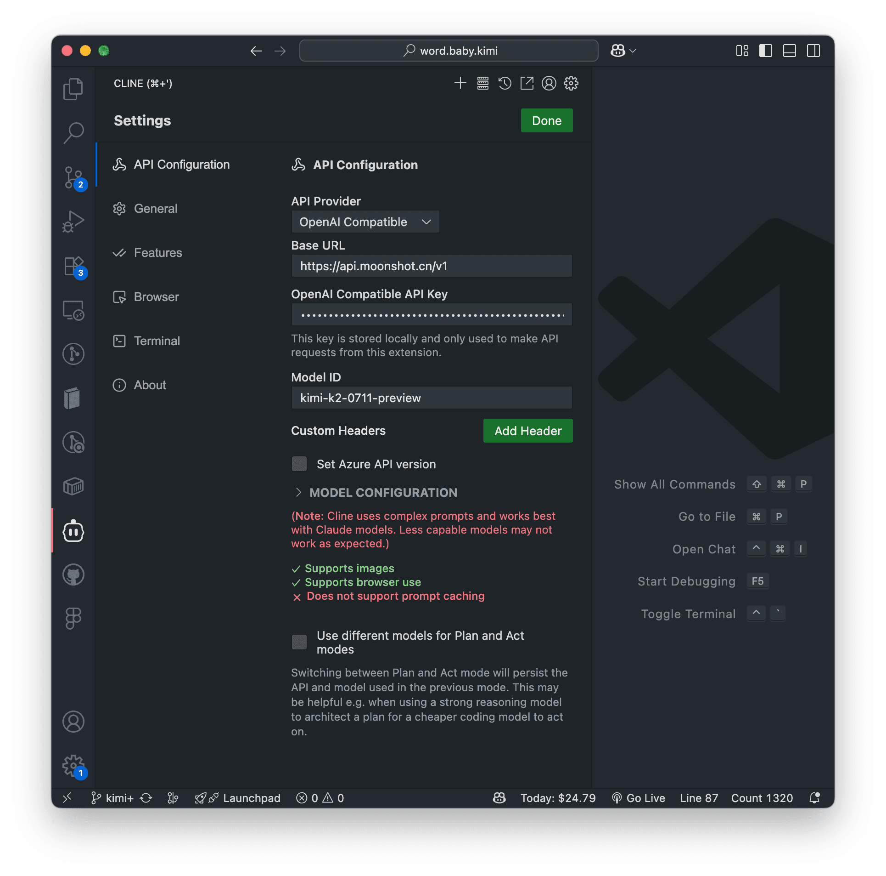
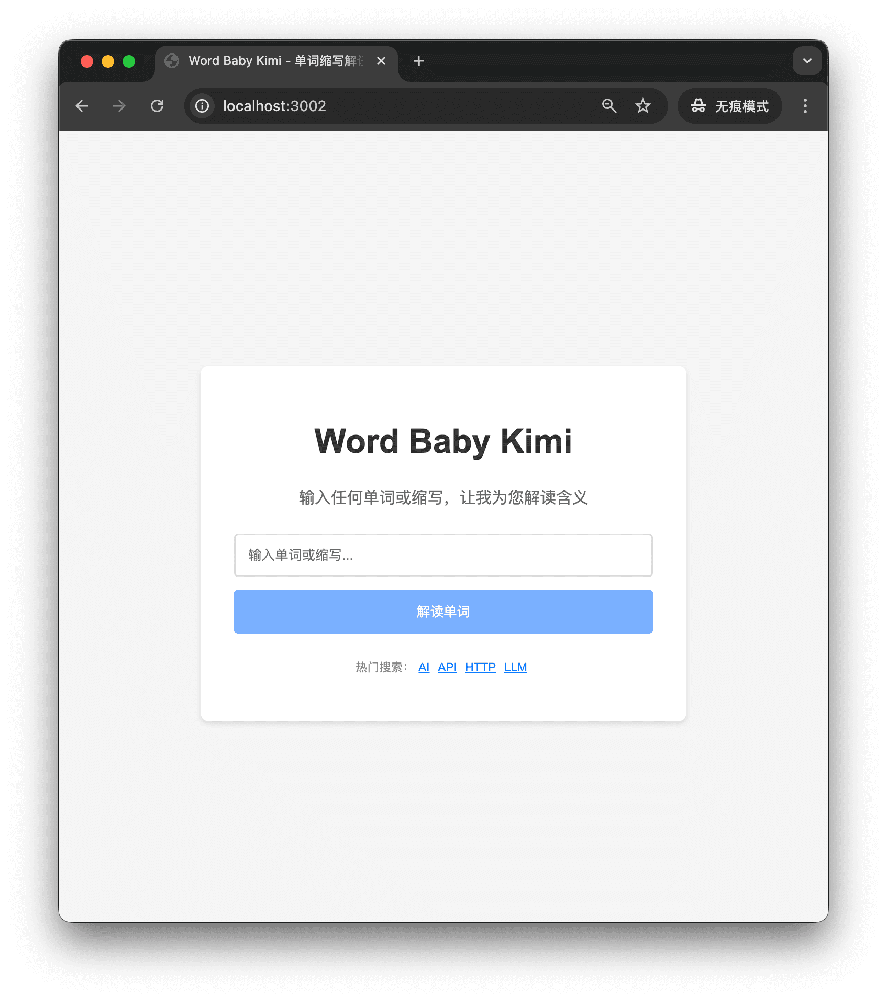
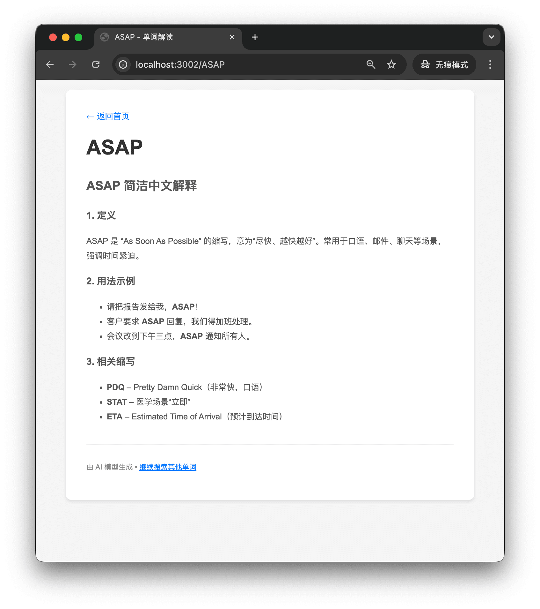

昨天晚上（20250711）刷到开源的 Kimi K2 模型，非推理模型。

[官方号称：上下文 128K，总参数 1T，成本超低。](https://github.com/MoonshotAI/Kimi-K2)

比较意外的是，它支持 Anthropic 协议。我印象里还没见过其他官方模型主动支持这个，大家一般都是 OpenAI compatible。看到这里一下就来兴致了，顺手研究了一下怎么在 Claude Code 里用 Kimi K2。

直接说结论：在已经装过 Claude Code 的情况下，不用再装任何新东西，配两个环境变量就能用。

*   [Kimi 官网生成 API key](https://platform.moonshot.cn/console/api-keys)
    
*   打开命令行，导出 `ANTHROPIC_BASE_URL` 和 `ANTHROPIC_AUTH_TOKEN` 两个环境变量，见 P1。
    



```markup
export ANTHROPIC_AUTH_TOKEN=sk-qViCuNrhyQaDPrELy3aM3UVZXcQmIz5Oh4iNRtm8XXXXXXXX
export ANTHROPIC_BASE_URL=https://api.moonshot.cn/anthropic
claude

```

## 在 Claude Code 里使用外部模型

常规在 Claude Code 里接外部模型，大概有两种路子：Proxy 代理，或者 LLM 网关。

### Proxy 代理

我测了 claude-code-router，claude-bridge、anthropic-proxy 没测。结果是 Proxy 在上下文维持上有问题，初始化阶段就会触发 TPM（每分钟 Token 处理量）限制，基本不可用，见 P2。



### LLM 网关（推荐）

[LLM Gateway 是 Claude Code 官方支持的企业级方案。](https://docs.anthropic.com/en/docs/claude-code/llm-gateway)

这个口子本来是给企业接 Claude 模型用的，但 Kimi K2 主动兼容了 Anthropic API。对 Claude Code 客户端来说，它以为自己还在和 Anthropic 服务器通信，实际请求已经被转到了 Kimi 服务器，返回格式也能对上 Anthropic API。这样一来，Claude Code 里就能直接用 Kimi K2。

#### 绕过 Claude Code 认证

打开项目文件夹，终端启动 Claude Code

```hljs
cd /path/to/your_project
claude

```

如果是第一次启动 Claude Code，会弹出登录认证网页。

这里可以编辑 `$HOME/.claude.json`，添加 `"hasCompletedOnboarding": true` 跳过 onboarding。



到这里配置就完成了。实际体验下来，Claude Code 使用过程中还是有概率爆 TPM。[账号升级 T1 后 TPM 扩大到 128000](https://platform.moonshot.cn/docs/pricing/limits)，基本才比较可用，至少要充 50 CNY。单次会话爆 TPM 的话，可以 `/clear` 或者开新会话。



#### VS Code + Cline 使用 Kimi K2

另外也试了下 VS Code + Cline 接 Kimi K2。UI 驱动逻辑打断比较多，个人感觉没有 Claude Code 丝滑。放这里当个参考，见 P3。



#### 初体验

最后用 Claude Code + K2 实现了一个简单的小想法，见 P4、P5。



## 总结

个人感觉，Claude Code + Kimi K2 是国内免魔法、免第三方号商情况下 Vibe Coding 的一个不错选择。

K2 模型本身也挺不错，开源，API 便宜又大碗，直接拿来做 LLM 应用 API 也很香。
