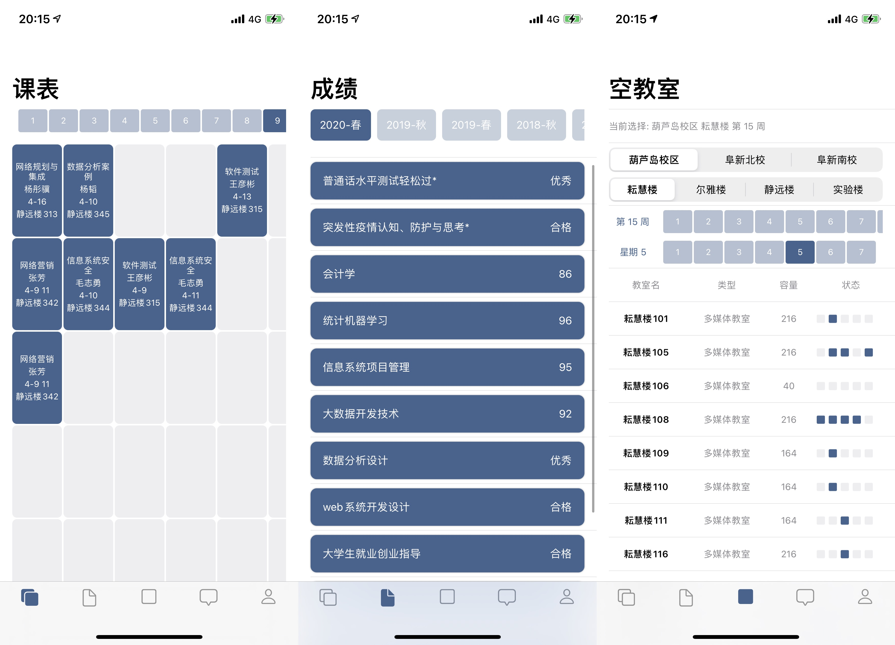
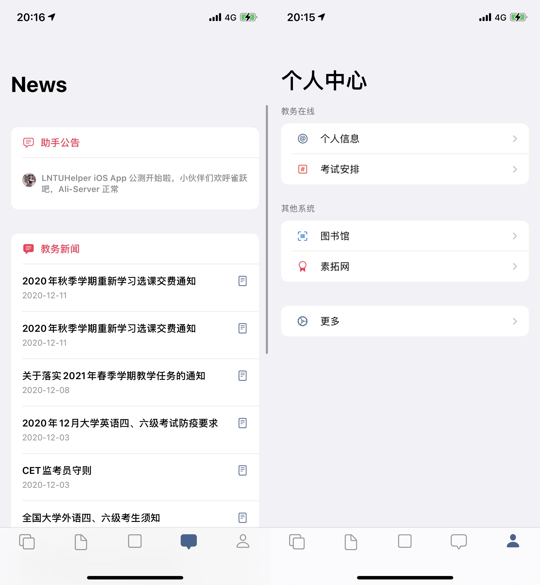
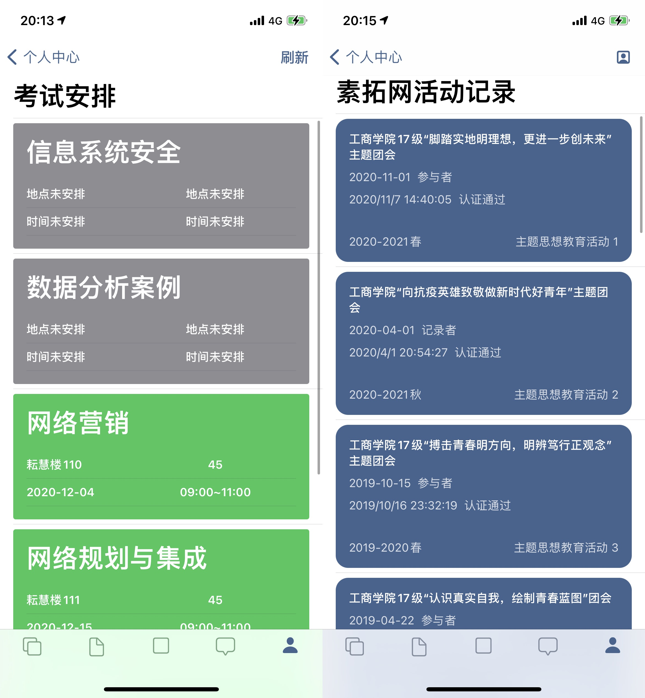

LNTUHelper 是给辽工大学子用的在校助手，集教务、素拓、图书馆数据查询功能于一体，尽量简洁易用。

<!-- more -->

经过一段时间努力，现在已经具备了绝大部分核心功能。不过 App 里还有不少臭虫，UI 也基本停留在原生控件阶段，难免有一些反人类交互，这些都需要时间慢慢打磨。

为了让每一次更新更有意义和重点，现在发布公测版进行内测。

作为内测用户，你可以第一时间体验到一些实验功能，翻译一下就是不稳定。期待你能把最直观的感受第一时间反馈给开发者，也就是俺，这会给 App 注入一点新鲜活力。

## 公测对象

1. 辽工大在校朋友（拥有教务在线 ID）
2. iOS 用户（iPhone\iPad），且系统满足 iOS 13+、iPadOS 13+

## 获取公测版

1. 通过 TestFlight 安装 https://testflight.apple.com/join/TWG460YJ
2. 为方便后续公测的持续进行，可加 QQ 群：646177319

## 预览

