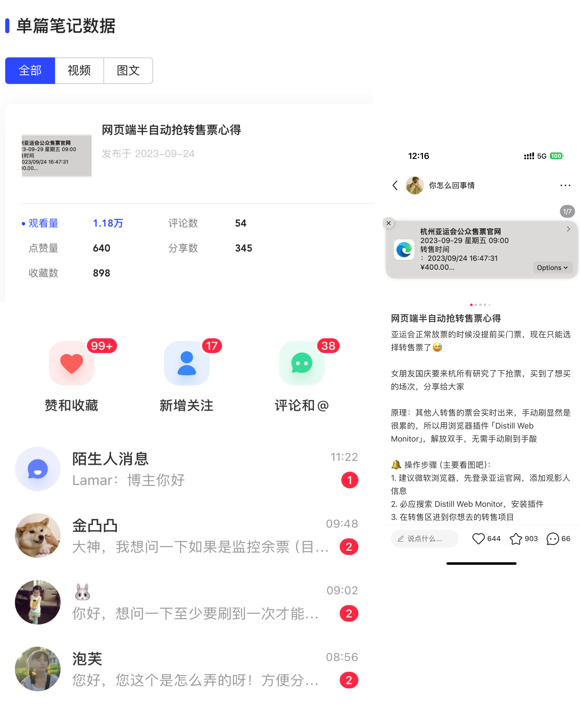

秋招好累，昨天下午实在无心学习，顺手写了篇小红书抢亚运会转售票的文章：[《网页端半自动抢转售票心得》](https://www.xiaohongshu.com/explore/65100bc0000000001f03eaaa)。

早上一睁眼发现满屏红点，不到 12 个小时就 1w 阅读、1k 多收藏，还从 0 开始涨了一小波粉丝。

明明是个没什么技术含量的东西，一句话概括就是用浏览器插件自动刷新、提醒库存，方便抢票，效果却出奇地好 🤨。

搞得我洗澡的时候想了好久：为什么？还能复刻吗？能不能尝试做点什么？

## 为什么效果还不错？

因为大家真的很想解决「手机一直刷也买不到转售票」这个问题。

- 这个方法只是 **一点小小的优化**，但确实打中了痛点，而且学习成本低，用户体验也还行。
- 文章里放了不少最后抢成功的图，会刺激读者继续看、继续试。后面我又在评论区不断鼓励大家去做，有人跟着做成功后再来评论，正向反馈就滚起来了。
- 推荐算法确实牛逼，能把内容推到目标用户面前，对他们直接产生价值。
- 对普通用户来说，这能省下不少给黄牛的钱；对黄牛来说，这种方法就有点致命了，甚至可能催生新的代抢黄牛。

## 还能复刻吗？

可以，但要降低身段，放弃所谓的技术洁癖。做有价值的内容，不要为了炫技而炫技。

**做目标人群觉得有价值的内容，让他们看完觉得有收获，或者至少被激励到。**

**用户快速扫两眼，发现内容符合点开标题前的期待，就会收藏或者点赞。文章权重上来之后，推荐流量也会跟着来，这和做 SEO 是一个道理。**

## 还有什么要注意的？ 一些思考

本来为了满足一点小小的虚荣心，也为了撒点狗粮，我在文章里小秀了一下：最开始是给对象抢票。

但过了一段时间，评论区开始出现一些疑似 👊 的言论。

> 这个评论甚至是现在下面热度最高的，老实说，我本人看到这个没那么舒服。作为一个简单的攻略分享，我其实并没有这个方向的想法和立场。是我玻璃心了？不过，想了一下对我也没什么实质影响，也就没想那么多了，可能这就是现在互联网冲浪的常态吧

这倒是让我后背一凉。要是这篇文章本身没有帮到他们，评论区很容易被带偏，最后直接翻车。

之前和一个专门做新浪微博自媒体的朋友聊过，她说很多人会为了流量故意制造对立，让普通用户在评论区吵架，然后博主直接吃账号权重 😅。

我个人的感受是：**很多小心思都要谨慎表达，因为它会被互联网这种增益器无限放大。对立流量一玩就容易火，有对立、有评论、有热度，也就有推荐，但反噬也基本是肯定的。**

## 能尝试做点什么吗？有什么经验

可以尝试，但要捋清楚目标用户，也要捋清楚内容方向，并保持一致性。最重要的还是行动起来。

- **多尝试多发。** 这个抢票方法我 9 月 20 日就实践了，当时就在想要不要发一下。效果其实很好，还想帮朋友抢一抢，但又觉得大家好像不感兴趣，犹豫一下就没发。昨天实在无聊发了一下，结果确实超乎想象，勇敢的 XXXXXX（摊手）。本来今天下午还有个面试，我紧张到不行，也不太想写总结，最后还是想着赶紧记录一下。
- **技术是为业务服务的。** 如果不能更好地解决问题，再牛的技术似乎也没什么不得了的（尝试麻痹自己 Doge）。
- **要想清楚目标用户。** 举个简单例子，这种没什么技术含量的东西，放在搞技术的人面前根本不值得一提；但对小红书里天天刷抢票的人来说，简直是福音。现在帖子下面还有来还愿的，成就感++。
- **要保持内容方向，才会有粘性。** 打造所谓的人设，做一个垂直方向，确实要花心思想一想。其他东西不要乱碰，**尤其是容易引战的内容**。
- **行文逻辑还需要练。** 写完帖子后我让 GPT-4 润色了一下，结果机翻味浓厚，唯一作用就是加了一些 emoji 😈。《金字塔原理》还得看完。

关于实际落地的内容，可以从「怎么让用户觉得自己学到了东西，或者能学到东西」这个角度想。不要太犹豫，主要还是赶紧行动，「小步快跑，快速迭代」。

另外一些简单经验可以参考我之前做网易云自媒体号的体会[《在云村搬运视频的一年多所感受到的》](https://liaoguoyin.com/post/livebot-netease-music/)

回想起来，之前网易云做到了大概 9k 粉，前阵子做的微信工具公众号也有 9k 粉，Bilibili 做视频剪辑、挂演唱会直播，累计播放量也有几十万。

越来越觉得，这种东西做起来是有套路的。无非是用有价值的内容换用户流量、换粉丝。

所谓的流量到底有什么用，我到现在也没想清楚。很多人张口闭口就是变现，但我总觉得不该一上来就奔着这个去。分享才是互联网一开始很吸引我的地方，出发点可能只是分享点有用的东西，也可能只是想找点乐子，和网友产生一点特别的链接，然后才是那些附加而来的东西。

一开始就想着太功利的东西，总感觉做起来会很受阻碍。扯远了（doge）。

## Recap

回到开头的问题，效果为什么好？

**一方面是方法确实简单有效，内容有直接价值；另一方面是推荐算法把目标用户推得很准。这件事对后面做内容方向很有启发。**

最后的最后。对我个人来说，这次经历更重要的是给了很多正反馈和信心。秋招的颓废短暂地一扫而光。虽然俺创新属性普通，但是俺组合能力 Max 啊，起码用奇思妙想、用各种工具，或者二开各种东西去解决实际问题的能力，应该还是过了平均线的。

这让我有那么几分钟的错觉：秋招如果实在找不到合适的工作，也不至于饿死，因为日常这种小把戏我还挺多的。

本科的时候也好几次听同学说「有问题找 LGY」。我家狗子也说我比许愿池里面的王八好使，也不知道是夸还是骂 MD。

虽然我听了嘴上骂骂咧咧，说又被白嫖了，但打心里面，其实吧，蜜罐子都打翻了 🤣。
