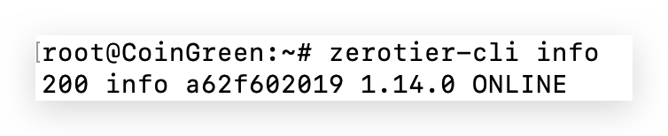
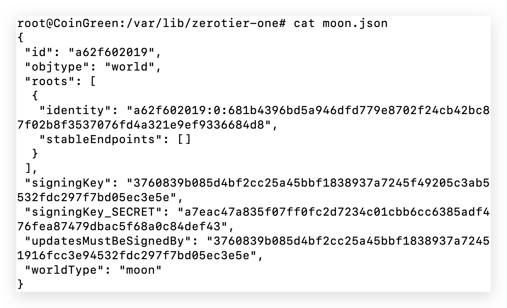
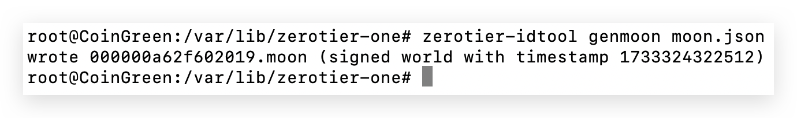
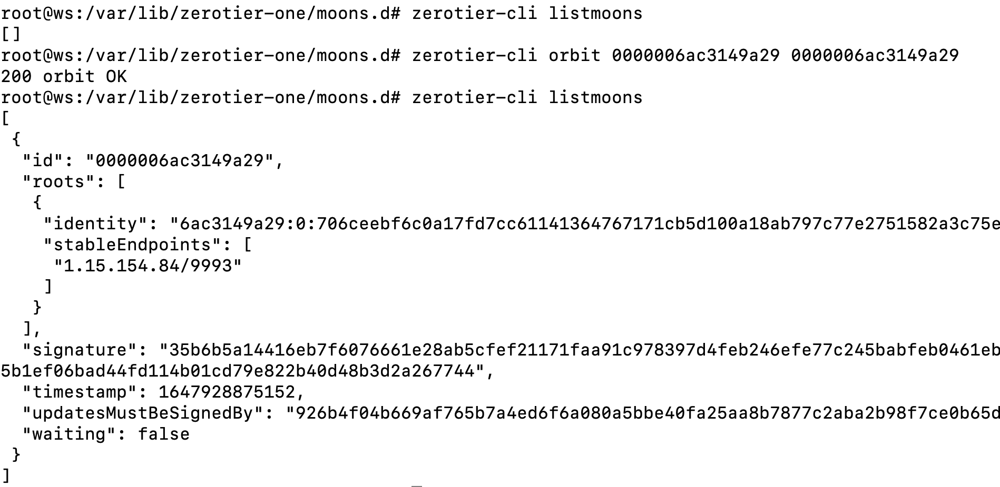
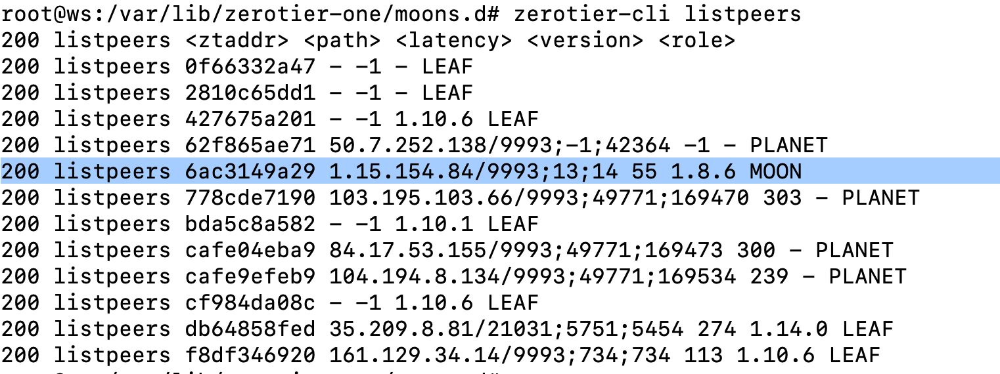

ZeroTier 是一个挺好用的 P2P 组网方案，但官方根服务器在境外，中国大陆用户经常会遇到延迟偏高的问题。为了解决这个问题，[ZeroTier 从 1.2.0 开始引入了自建 Moon 节点功能](https://docs.zerotier.com/roots)，可以自己部署私有中转节点来优化网络。

这篇记录一下 Moon 节点的部署和使用步骤。

## 1. Moon 节点工作原理概述

ZeroTier 网络中的所有节点默认都在 Planet 里，也就是官方根服务器网络。Moon 节点可以理解成用户自定义的根服务器，特点大概是：

1. **双重路由机制**
   - 节点同时使用 Planet 和 Moon 服务器
   - 自动选择延迟最低的路由
   - 当 Moon 不可用时，仍然可以回退到官方服务器
2. **适用场景**
   - 优化特定地理位置的网络性能
   - 创建离线/内网组网环境（毕竟整个互联网也算是个大局域网）

## 2. 部署 moon 节点

前置条件：

- 节点需要有静态 IP，可以是公网 IP，也可以是内网 IP。如果没有公网 IP，公网设备自然没法直接路由访问。
- 开放 UDP 9993 端口，服务器防火墙和云服务商安全组都要放行。
- 网络连接尽量稳定。

### 2.1 安装 Zerotier

打开命令行，在云服务器 Linux 上安装 ZeroTier：

```

# Linux 下载安装

curl -s https://install.zerotier.com/ | sudo bash

# 验证安装情况

zerotier-cli info

```



### 2.2 生成 moon 配置文件

```

# 进入配置目录

cd /var/lib/zerotier-one

# 生成初始配置。读取 identity.public 中的公钥信息，生成初始的 moon 节点配置的 JSON 文件:

zerotier-idtool initmoon identity.public > moon.json

```

> 如果没有生成 `moon.json` 文件，可能是没有写文件权限。可以 `sudo -i` 切换为超级用户后再执行。



```

# 生成最终配置文件。基于 moon.json 配置文件，生成最终的 moon 配置文件（通常命名为 000000xxxx.moon）：

zerotier-idtool genmoon moon.json

```



如上图，最终生成的 `000000a62f602019.moon` 包含完整配置信息：

- 是二进制文件，不可读
- 带有加密签名
- 通常放在 `/var/lib/zerotier-one/moons.d/` 目录下
- moon-id 是 10 位或 16 位标识符，比如 **000000a62f602019** 或 **a62f602019**

## 3. 使用 Moon 节点加速

客户端同样需要先安装 ZeroTier，然后把这台 Moon 节点加入进去。

#### 3.1 在客户端添加 moon 节点

> 不同客户端版本 moon-id 不一致，需要检查本机 zerotier 版本（zerotier-cli -v 命令可查看版本），如：
>
> - 在 zerotier 1.10.6 版本中，moon-id 是 16 位，前面有多余 0
> - 在 zerotier 1.12.2 版本后，moon-id 是 10 位字符串
>
> 总的来说，新版里的 moon-id 是 10 位字符串，需要把前面多余的 0 去掉。
>
> 这是一个很奇怪的更新，官方文档里我没找到明确说明，[最后还是自己去 GitHub 开 Issue 问到的（笑脸黄豆.jpg）](https://github.com/zerotier/ZeroTierOne/issues/2197)

```

zerotier-cli orbit <moon-id> <moon-id>

```

注意版本差异：

- 1.10.6 版本：使用 16 位 moon-id（含前导零）

```

zerotier-cli orbit 000000a62f602019 000000a62f602019

```

- 1.12.2+ 版本：使用 10 位 moon-id（去除前导零）

```

zerotier-cli orbit a62f602019 a62f602019

```

`orbit` 命令返回 200 表示添加成功。如果一直返回 404，优先检查上面的版本差异，尤其是 moon-id 前面的 0。

#### 3.2 检查所添加的 moon 状态

可以通过 `listmoons` 和 `listpeers` 检查 Moon 状态。

#### 3.2.1 检查 moons 列表

`listmoons` 可以列出本机加入的自建 Moon 节点。

```

zerotier-cli listmoons

```



上图可以看到加入 Moon 前后的 `listmoons` 结果。如果列表不为空，就说明添加成功。

#### 3.2.2 检查 peers 状态

`listpeers` 会列出本机所在组网环境里的节点，可以用来检查机器之间的连接情况。

```

zerotier-cli listpeers

```



其中最后一个字段 `<role>` 表示机器身份：

- PLANET 表示 ZeroTier 官方中转节点，延迟 42364ms
- MOON 表示自建 ZeroTier 中转节点，延迟 55ms
- LEAF 表示组网范围内的其他同级别节点

在两台 LEAF 节点里同时添加 MOON 节点后，延迟会明显下降。

> 确认添加完成后，可以用 ping 看一下组网机器之间的延迟，观察中转效果。
>
> 加入前后两机之间的 ping 时间明显减少，500ms+ -> 50ms+

其他指令：

- `zerotier-cli deorbit <moon-id>` 可用于取消加入 Moon 节点
- `zerotier-cli -h` 可查看所有指令

## 4. 最佳实践

- 建议客户端至少加入两个 Moon 节点
- Moon 节点专注做网络中转
  - 避免将多个节点部署在同一物理服务器上
  - 避免将 Moon 服务器同时作为 Moon 和 Leaf 节点
  - 适合将 Moon 部署在就近的数据中心（如国内云服务商）

## 5. Ref

- [Private Root Servers | ZeroTier Documentation](https://docs.zerotier.com/roots/)
- [MoonID 变更情况，新机器无法加入 moon-id 的方案](https://github.com/zerotier/ZeroTierOne/issues/2197)
- [Private Root Servers](https://docs.zerotier.com/roots)
